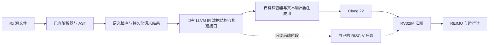
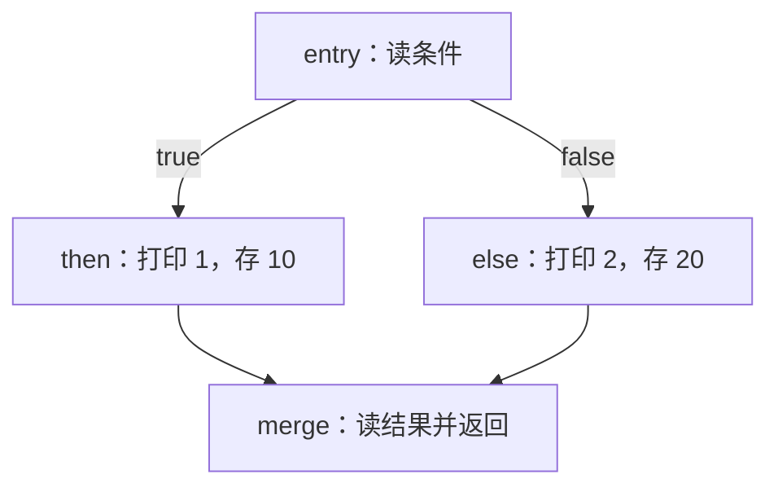

# Rx LLVM IR 实现计划（无 LLVM API，P2 完成基线）

语言行为、有效程序边界、目标平台和运行时接口均按[《Rx 编译器规范完整中文翻译》](../Rx编译器规范完整中文翻译.md)实现。
按规范引言，遇到条文有歧义或与官方 `rustc` 行为不一致时，记录最小 Rx 样例和对应条款，请助教澄清。
现有代码和测试用于确定接入位置、检查实现。

编写日期：2026-10-28；修订日期：2026-11-18。本文按 **P0–P2 已完成的基线**整理，
同时保留 P3–P11 的后续实现计划；“P2 完成”不表示整个语言的 IR lowering 已完成。
“建议”“本计划选择”表示工程方案；“规范要求”表示必须保留的行为。
P0–P2 中的设计说明作为已交付契约保留，实际接口与验收证据以各节状态及附录 E 为准；
伪代码和后续阶段的新类型、文件名仍是建议，不表示仓库里已经存在。
P0 及三个手写读例的历史核验结果见附录 D；不能用手写模块证明源码 lowering 已实现。
当前代码与无 LLVM API 路线的验证记录见附录 E；历史 API 核验不作为新路线的验收结果。

## 0. 怎样阅读和执行这份计划

### 0.1 先明确这一阶段要交付什么

整个 IR 部分最终的交付物是：自己的前端把有效 Rx 程序转换为合法的文本 LLVM IR，
再由 Clang 22 转成 RV32IM 汇编，在 REIMU 中得到正确行为。
当前 P2 基线交付的是其中的基础设施闭环：持久化语义结果 → 自有 IR → 自检 → `.ll`，
以及空源 main 和机器入口的端到端验证。完整语言覆盖与正式 IR 接线在 P3–P11 继续完成。

第一次动手时，先看下面两个程序。两者都应输出 `42\n`，区别在于传给打印函数的整数从哪里来。

| 小步 | 完整 Rx 源码 | 要生成的操作 |
| --- | --- | --- |
| P3.1 打印常量 | `fn main() { println_i32(42); }` | 在 `generator.cpp` 读取语义分析确定的字面量和调用目标，复用已有的 `call` 生成 `call void @println_i32(i32 42)`。 |
| P3.2 读取变量 | `fn main() { let x = 42; println_i32(x); }` | 给自有模型增加 `alloca`、`store`、`load`，依次为 x 分配位置、写入 42、读出整数，再交给同一个 `call`。 |



依据：[引言](../Rx编译器规范完整中文翻译.md#引言)、
[§16「LLVM IR 和代码生成」](../Rx编译器规范完整中文翻译.md#llvm-ir-和代码生成)。
完整课程编译器最终仍要有自己的后端；本阶段使用 Clang 验证前端。
运行时可以分配内存和实现 I/O，不能通过解释 Rx 或 IR 代替代码生成。

**本计划选择不调用 LLVM API 的路线。** 编译器使用 C++20 自行实现模块、类型、函数、
基本块、操作数和指令的数据结构，以及构建接口、结构检查器和 LLVM 文本输出器。
编译器及自有后端不包含 LLVM 头文件，不链接 LLVM 库，也不通过 C API、绑定或包装层间接调用 LLVM API。
后续自有后端直接读取同一份自有 IR 结构。
这是一项工程选择；§16 要求合法 LLVM IR 和自有后端，并不强制使用 LLVM 的内存对象。

当前 `SemanticResult` 保存源语言事实；`Place`、`EmitResult`、`CoercionPlan` 和 `FunctionABI`
分别在后续阶段描述存储位置、生成结果、转换与调用约定；IRGen 自行决定求值顺序、copy/move、容器操作、克隆和相等。
自有 IR 表示本前端实际生成的 LLVM IR 子集，不另设一门需要再次 lowering 的中间语言，
也不预先实现完整 LLVM 指令集或复杂的通用继承树。文本拼写集中在输出器，AST lowering 不散落拼接字符串。

LLVM 22 **命令行工具仍用于编译器之外的验证**：测试 runner 对输出 `.ll` 调用
`llvm-as-22`、`opt-22 -passes=verify -disable-output` 和 Clang 22，再用 REIMU 检查行为。
rxcc 生成 `.ll` 本身不启动这些工具；构建 rxcc 不应要求 LLVM 开发包。
Clang 可编译 C 运行时和验证汇编，自有后端的最终实现责任保持不变。

### 0.2 为什么按这个顺序写

不要一开始就把所有 LLVM 指令和所有 AST 节点铺开。
先获得可以观察的输出，再围绕一个不断扩大的小程序增加能力：

| 阶段 | 当前要回答的问题 | 做完后新增的能力 |
| --- | --- | --- |
| P0 | 怎样知道一段 IR 真的执行正确？ | 手写最小 IR → Clang → REIMU → 输出 |
| P1 | 语义分析已经知道的事实保存在哪里？ | IR 可以读取类型、绑定、符号和常量 |
| P2 | 怎样自行表示、构建和输出合法 LLVM IR？ | 自有 IR 模型、构建/检查/打印、移除 LLVM 库依赖、`--stage ir -o` |
| P3 | 变量、函数参数和返回值怎样落到 IR？ | 局部变量、块、普通调用和 I/O |
| P4 | 同为 32 位整数，哪些操作仍然不同？ | 完整标量运算和 cast |
| P5 | 什么时候需要地址，什么时候读取值？ | 引用、临时值、强制转换和赋值 |
| P6 | 表达式中途跳走后，还能否继续生成代码？ | 分支、短路、循环和带值 break |
| P7 | 一个结构体或数组怎样作为独立的值流动？ | 布局、字段、索引、按值聚合参数/返回 |
| P8 | 点方法调用比普通调用多做了什么？ | 接收者调整、关联调用、数组 len |
| P9 | 拥有的堆存储和动态序列怎样工作？ | Box、Vec、增长、remove |
| P10 | 复制、克隆和相等为什么不能共用一种操作？ | 深克隆、结构化相等、递归辅助函数 |
| P11 | 怎样证明这些能力一起工作？ | 官方 IR 接线、完整回归和交付检查 |

**当前进度与执行边界。** 当前生成器支持到 P2。P3 及后续阶段的测试目录已有源码、输入和期望输出，供实现相应步骤时使用。

| 阶段 | 本文状态 | 完成边界或后续工作 |
| --- | --- | --- |
| P0 | 已完成 | 手写模块、RV32 目标、入口和 I/O 验证方式已核对，历史结果见附录 D |
| P1 | 已完成首批契约 | `SemanticResult` 拥有符号，保存稳定身份、表达式/字面量/常量/普通调用事实；使用位置调整已有独立预留表 |
| P2 | 已完成 | 自有模型、builder、检查器、输出器、模块所有权、双 main、CLI 和无 LLVM 库构建已接通，见 P2.4 |
| P3–P4 | 待重写 | 按 P3 六个小步从字面量 I/O 开始，再增加存储、调用、返回与 bool；随后 P4 实现运算/cast |
| P5–P10 | 待实现 | 引用/赋值、源码控制流、聚合、方法、容器和 trait lowering；分支模型与 CFG 检查也待对应阶段增加 |
| P11 | 待完成 | `config.mk` 的 IR/CODEGEN 仍为 Rust 参考路径，尚未完成自己的正式 IR 全量回归 |

下文 P0–P2 的“实现内容”用于说明已完成基线的职责和维护要求，不是要求重新迁移一遍。
下一步从 P3 开始重新实现，保留 P1 语义结果和 P2 基础设施作为起点；不得把 P11 的最终完成清单提前全勾选。

**编写顺序、编译器执行顺序、源程序求值顺序是三件不同的事。**
例如 sema 为确定赋值目标类型可以先检查左侧；生成的赋值代码仍必须先执行右侧。
所有后续步骤都围绕“动机 → 前置条件 → 实现内容 → 产出 → 验证”展开。
跨阶段的数据结构按实际需要增加字段，不要求在 P1 一次写完所有后续功能。
每个小节的“验证”须区分**本步验收**和**后续联合验收**；若测试依赖后续 lowering，
要标明依赖步骤，不能把它作为当前小节的完成门槛。

### 0.3 当前代码起点

以下是 2026-11-08 重构后对当前仓库接口的观察，不是规范条款；验证记录见附录 E：

| 现有位置 | 已有能力 | IR 接入时还需要什么 |
| --- | --- | --- |
| [main.cpp](../../rxcc/src/main.cpp) | IR stage、`-o`、自有检查/打印和标准 C++ 文件输出 | 随后续 lowering 扩展能力，保持失败时不截断旧输出 |
| [sema.hpp](../../rxcc/src/sema/sema.hpp)、[result.hpp](../../rxcc/src/sema/result.hpp) | `analyze(const Crate&)` 已交付拥有符号的 `SemanticResult` | 复用已有事实，按后续 lowering 需要补齐记录 |
| [body/context.hpp](../../rxcc/src/sema/body/context.hpp)、[result.hpp](../../rxcc/src/sema/result.hpp) | 已保存首批表达式事实、绑定与路径身份，临时作用域不再是 IR 的查询来源 | 后续补具体使用位置转换、投影和循环目标 |
| [body/calls/call.hpp](../../rxcc/src/sema/body/calls/call.hpp) | 调用签名、方法选择结果和接收者调整的数据结构 | 补充具体目标身份，将最终选择与调用 AST 关联 |
| [body/conversions.cpp](../../rxcc/src/sema/body/conversions.cpp) | 兼容性判定和 LUB | 记录具体转换路径及最终公共目标 |
| [ast.hpp](../../rxcc/src/ast/ast.hpp) | 完整语法结构 | `Expression::type`、`PathExpression::resolution` 当前是未回填的预留槽位 |
| [ast_builder.cpp](../../rxcc/src/ast_builder.cpp) | 已将末尾无分号表达式统一放入 `BlockExpression::tail` | 生成器直接使用 `tail`，不再从语句列表猜块尾 |
| [config.mk](../../config.mk) | semantic 已使用 rxcc | IR/CODEGEN 当前仍使用参考 rustc |
| [scripts/test.py](../../scripts/test.py) | IR → Clang → REIMU，逐字节比对输出 | 把 IR 命令切换到自己的前端，提供共享运行时 |
| [src/ir/](../../rxcc/src/ir/) | 自有 model/builder/check/printer；仅 void/i32、call/ret、空源函数和机器入口 | P3 起重新增加源值/存储/表达式与后续指令；不保留旧 P3/P4 代码 |
| [rxcc/CMakeLists.txt](../../rxcc/CMakeLists.txt) | 已移除 LLVM 开发包/库依赖，登记自有模型与迁移后的测试目标 | 增加后续阶段源码和测试；LLVM CLI 仅在 runner 中使用 |

本文不要求先重写 AST 或重做语义检查。首先保存现有检查过程已经得出的事实。
也不要让 IR 生成器再次按名称猜测类型、重新选择方法或重新推导整数。

### 0.4 先划清必须实现的范围

依据：[§1](../Rx编译器规范完整中文翻译.md#1-语言范围和测试保证)、
[§13](../Rx编译器规范完整中文翻译.md#13-引用和存储期限)、
[§14「堆清理」](../Rx编译器规范完整中文翻译.md#堆清理)。

| 必须保留 | baseline 可以省略 |
| --- | --- |
| 正确求值顺序、I/O、写引用和控制流 | 溢出检测、越界 panic、栈展开 |
| copy/move 的值语义，clone 的独立拥有存储 | move/借用数据流检查、运行时所有权标记 |
| 有效引用的目标与存储期限 | 生命周期语法的 IR 表示、生命周期检查 |
| 32 位整数、地址、usize/isize，正确外部 ABI | 一般泛型、trait object、函数值 |
| 有效控制流中的全部行为；生成前检查整个程序 | 为被排除执行规定行为或补运行时检查 |
| unit 作为函数/控制流结果 | 普通零大小绑定、参数、聚合/堆数据的完整实现 |
| Box/Vec 操作、深克隆、结构化相等 | 析构、逐对象 free、作用域退出清理 |

空 `Vec<T>`（T 非零大小）是有效数据，不能与被排除的零长度数组混为一谈。
被排除的是**源程序的无效执行**；实现引入的错误地址、提前结束或错误输出仍然是缺陷。

### 0.5 初次实现 IR 时怎样使用这份计划

**读者前提。** 本文面向已经能阅读 C++20、AST 和本仓库 sema 结果，但第一次实现 IR 的读者。
不要求先学完 LLVM API、优化或寄存器分配。当前 P2 已完成，第一次动手只需读 0.3、P3.0 和 P3.1；
把第一个整数打印出来后，再读 P3.2。P5 以后的引用、布局与容器规则在做到相应阶段时再展开。

**先看程序，再看结构。** 每个小步按以下顺序执行，不把整章所有接口一次写完：

1. 写下最小 Rx 输入、预期 stdout 字节和当前缺失能力。
2. 读懂对应目标 IR，分清“本步新指令”与“已能复用的指令”。
3. 新增指令时，先完成模型、构建、检查和打印的独立小例子，再接 AST 到该结构的转换。
4. 让自己的 rxcc 生成 `.ll`，执行外部 LLVM 检查与 RV32 行为验证；手写 IR 通过不能代替源码生成通过。
5. 补一个最容易写错的反例，记录结果，再进入下一步。后续依赖的测试单独列联合验收。

每个新指令至少回答五个问题：有什么操作数和显式类型、是否产生结果、能放在哪个块、
检查器怎样拒绝错误用法、输出器应打印成什么文本。这样增加功能时不会漏改某一层。

**首次遇到术语时再查。** 不要求在 P3 开始前掌握后面所有概念。

| 术语 | 在本文中的直观含义 | 第一次需要理解 |
| --- | --- | --- |
| lowering | 把已通过检查的源操作落实为较低层的类型、指令和存储操作 | P3.1 |
| Operand / ValueId | 指令使用的常量或局部值；ValueId 区分不同参数/指令结果 | P2/P3.1 |
| slot / Place | slot 是分配的存储；Place 是生成器记录的地址、源类型和存取信息 | P3.2 |
| Unit | 正常完成，但没有数据值；后续语句仍能执行 | P3.3 |
| NoContinuation | 当前路径已经 return/break/continue，外层不能再接着发指令 | P3.5/P6 |
| coercion / CoercionPlan | 已选定的源类型调整，以及为它必须执行的地址/读取操作 | P5.2 |
| CFG / 支配 | 块的跳转关系；一个定义所在块是否必经于某次使用之前 | P6.1/P6.2 |
| LUB | 没有固定目标时，sema 为多个分支或 break 结果确定最终公共类型 | P6.7 |
| FunctionABI | 源参数/结果怎样变成内部 IR 参数/结果的统一约定 | P7.4 |
| TypeKey | 区分具体源类型的结构化缓存键，避免递归 helper 重复生成 | P10.3 |

**两种“失败”必须分开。** 源程序非法先由 sema 报错；有效程序中尚未实现的 lowering 要明确失败。
两者都不能假装生成成功。与它们不同，Unit 和 NoContinuation 是成功生成后对源执行路径的描述，
不能用 NoContinuation 隐藏内部错误。具体结果接口随 P3 的小步增加，不预先创建全部空文件。

**各阶段采用的学习切分。** P3 与 P6 下文给出详细小步，其余阶段先按下面的最小顺序读正文：

| 阶段 | 先完成的最小观察点 | 再扩展到 |
| --- | --- | --- |
| P4 | i32 加法，再逐个增加减/乘/除余 | 无符号差异、比较、位运算，最后移位与 cast |
| P5 | `&x` 与 `*r` 读原变量 | 简单写入 → RHS 优先 → 临时物化/多层转换 → 引用操作数读取时机；按正文依赖回填 |
| P7 | 一个 bool/i32 混排结构体的布局 | 字段与数组投影 → 独立值快照 → 跨函数聚合结果 |
| P8 | 一个用户共享接收者方法 | 可变/按值接收者、限定调用、数组 len；容器方法留到 P9/P10 |
| P9 | 一个 Box<i32> | 空 Vec 的头 → push 一个元素 → 增长 → remove → 嵌套拥有值 |
| P10 | 一个非递归结构体的 clone 与 eq | Box/Vec 内容操作，最后递归 helper 缓存 |

这些顺序只拆学习目标，不缩小最终语义覆盖；正文与附录 B 的规范要求仍全部需要完成。

## P0：先建立可以观察结果的最小回路（已完成）

**状态。** 目标、入口、运行时和字节级验证方法已经建立；手写示例的实际记录见附录 D。
本节保留可复现的教学步骤，不把示例能力计为编译器的源码生成能力。

### P0.1 用手写 IR 确认目标、入口和 I/O

**动机。** 尚未开始遍历 AST 时，先确认“正确的输出长什么样、用什么命令运行”。
这样以后失败时可以区分前端生成问题与工具链、运行时问题。

**前置条件。** 只需要理解：LLVM 模块包含函数，函数中的 `call` 调用其他函数，
`ret` 结束当前函数。

**实现内容。**

1. 从仓库根目录打开 shell，按下方命令创建开发期临时目录，在其中准备 `smoke.ll`；
   这不是编译器输出实现。
2. 使用 Clang/LLVM 22，命令目标采用规范的 `riscv32-unknown-elf`，
   并固定 `-march=rv32im -mabi=ilp32`。
3. 先为源 `fn main() -> ()` 写一个内部 void 函数；
   再导出 C ABI 的 `i32 @main()`，调用它并返回 0。
4. 声明并调用 `println_i32(i32)`，与规范兼容的 C 运行时一起执行。

先在当前 shell 设置目录变量，后续命令继续在仓库根目录运行：

```sh
rx_ir_smoke_dir="$(mktemp -d)"
printf '%s\n' "$rx_ir_smoke_dir"
```

将下面完整模块保存为 `$rx_ir_smoke_dir/smoke.ll`，
把规范中的完整参考 C 运行时保存为 `$rx_ir_smoke_dir/runtime.c`。
这里的路径表示使用上面变量的实际值；两份文件都准备好后再执行验证命令。

最小完整模块示意：

```llvm
target datalayout = "e-m:e-p:32:32-i64:64-n32-S128"
target triple = "riscv32-unknown-unknown-elf"

declare void @println_i32(i32)

define internal void @__rx_fn_0() {
entry:
  call void @println_i32(i32 42)
  ret void
}

define i32 @main() {
entry:
  call void @__rx_fn_0()
  ret i32 0
}
```

上面的 layout/triple 来自当前本地 Clang 22 对规范目标的探测：

```sh
clang-22 --target=riscv32-unknown-elf -march=rv32im -mabi=ilp32 \
  -S -emit-llvm -x c /dev/null -o -
```

Clang 把目标拼写归一化为四段 triple；这是工具输出记录。
规范要求的是与 RV32IM/ILP32 一致的 32 位小端目标，并没有规定上面这个 layout 字符串必须逐字相同。
不要用宿主 x86_64 的 layout 或宿主 `sizeof(void*)`。

**产出。** 一份能经 LLVM 检查、打印 `42\n` 并正常返回 0 的手写模块。

**验证。**

```sh
(
set -eu
llvm-as-22 "$rx_ir_smoke_dir/smoke.ll" -o "$rx_ir_smoke_dir/smoke.bc"
opt-22 -passes=verify -disable-output "$rx_ir_smoke_dir/smoke.ll"
clang-22 --target=riscv32-unknown-elf -march=rv32im -mabi=ilp32 \
  -O0 -S "$rx_ir_smoke_dir/smoke.ll" -o "$rx_ir_smoke_dir/smoke.s"
clang-22 --target=riscv32-unknown-elf -march=rv32im -mabi=ilp32 \
  -O2 -fno-builtin -S "$rx_ir_smoke_dir/runtime.c" -o "$rx_ir_smoke_dir/runtime.s"
for asm in smoke runtime; do
  clang-22 --target=riscv32-unknown-elf -march=rv32im -mabi=ilp32 \
    -c "$rx_ir_smoke_dir/$asm.s" -o "$rx_ir_smoke_dir/$asm.o"
done
xmake run -P vendor/REIMU reimu --memory=256M --stack=1M \
  -f "$rx_ir_smoke_dir/smoke.s,$rx_ir_smoke_dir/runtime.s" \
  -o "$rx_ir_smoke_dir/smoke.out" -p "$rx_ir_smoke_dir/smoke.profile"
python3 - "$rx_ir_smoke_dir" <<'PY_CHECK'
from pathlib import Path
import sys

directory = Path(sys.argv[1])
stdout = (directory / "smoke.out").read_bytes()
if stdout != b"42\n":
    raise SystemExit(f"unexpected stdout: {stdout!r}")
profile = (directory / "smoke.profile").read_text().splitlines()
exits = [line for line in profile if line.startswith("Exit code:")]
if exits != ["Exit code: 0"]:
    raise SystemExit(f"expected one zero exit code in REIMU profile, got {exits!r}")
PY_CHECK
)
```

`runtime.c` 按 [§16「参考 C 运行时」](../Rx编译器规范完整中文翻译.md#参考-c-运行时)
提供 I/O 和后续需要的分配器；不定义机器 main。
保持输出中的换行为实际的 `0x0A` 字节。
参考 C 示例此前把格式串误写为 `"%d\\n"`，会输出反斜杠和字母 n；
本次已按规范 §15 的文字要求修正为 `printf("%d\n", value)`。
上述命令逐字节检查输出，并从 REIMU 的 profile 读取机器 `main` 的返回值。
可以只把手写模块末尾的 `ret i32 0` 改成 `ret i32 7` 再跑一次。
此时仍会打印 `42\n`，但 profile 会记录 `Exit code: 7`，整段命令应失败。改回 0 后应通过。
本仓库通过 xmake 启动 REIMU；可执行文件路径属于本地工具接入方式。
若需要移除 Clang 生成而 REIMU 不识别的调试指令，复用现有
[strip_asm_debug.py](../../scripts/strip_asm_debug.py) 的处理，不删改程序指令。

依据：[§15](../Rx编译器规范完整中文翻译.md#15-内置-io-和程序入口)、
[§16「目标和工具链」「符号、入口和运行时」](../Rx编译器规范完整中文翻译.md#16-后端)。

### P0.2 固定后续每一步的验证方式

**动机。** “Clang 接受”只能说明 IR 结构和部分类型关系合法，不能证明源行为正确。

**实现内容。** 后续每个小功能都使用同一组观察：

| 检查 | 能发现什么 |
| --- | --- |
| sema 全量检查后再生成 | 无效程序没有绕过名称/类型检查 |
| 自有结构检查器，再用外部 `llvm-as-22` / `opt-22` 验证 | 自有模型不变量、文本语法、指令类型、调用签名和 SSA 使用错误 |
| RV32IM 的 Clang `-O0` → REIMU | 普通执行、ABI、布局和副作用错误 |
| 对关键语义样例再用 `-O2` | 溢出标志、别名承诺等错误被优化放大 |
| 与期望 stdout 逐字节比较 | 数字、换行、顺序、多执行或少执行 |
| 检查 REIMU profile 中唯一的 `Exit code: 0` | 程序输出正确但机器入口返回错误状态 |

每一步先验证自己新增的能力及受影响的旧能力。
未实现的有效功能在开发期可以明确报告“IR lowering 尚未支持”，并让测试失败；
不能把它改判为源语言非法，也不能静默输出空程序后声称通过。

## P1：让 IR 能读到语义分析已经得出的结论（首批契约已完成）

**状态。** P1.1 的结果所有权、P1.2 的首批查询以及 P1.3 的调整预留接口已实现。
实际入口为 `SemanticAnalyzer::analyze(const Crate&)`；`SemanticResult` 独立拥有符号，
驱动在临时分析器析构后将结果传给 `generate_ir`。不再实施 `run/take_result` 过渡方案。
`result.hpp` 已包含 `function_locals`、`let_bindings`、`expressions`、`paths`、
`integer_literals`、`ordinary_calls`、`constant_values` 等表。
`use_adjustments` 仅预留且当前不填写，不能据此声称具体 coercion 或 LUB 调整已完成。
以下保留契约与记录位置；字段/方法目标、具体转换和循环身份按 P5–P10 补齐，不是 P1 的遗留阻塞项。

**本阶段先交付到哪里。** 先支持后续 P2/P3 所需的查询：
源 main、普通函数和 I/O 的目标与签名、参数/let 的身份、整数/bool 的类型和值、
局部/常量路径的身份。全局符号的所有权也在这时明确。
结构体、容器等仍照常接受完整 sema 检查；它们专用的生成记录可以在对应阶段再增加。
P1 的完成不要求先做完引用转换、方法 lowering 或聚合布局。

### P1.1 先解决结果的所有权和生命周期

**动机。** 改造前全局符号归 `SemanticAnalyzer` 所有，`SemanticType` 中还保存结构体符号指针。
函数体检查结束后，局部作用域被清空。P1 已将需要跨阶段保留的事实移入结果，避免分析器析构后丢失信息或产生悬空指针。

**前置条件。** 已有 sema，不依赖任何 LLVM 指令实现。

**实现内容。**

1. 增加建议文件 `sema/result.hpp`，定义 `SemanticResult`。
2. 让结果拥有全局结构体、函数、常量符号及后续记录的局部绑定；
   分析器在构建结果时仍可持有对这些表的访问。
3. 分析完成后，把结果移交驱动；其生存期覆盖全部 IR 生成。
   AST 同样活到 IR 生成结束，节点地址才能用作查询键。
4. 建议最终接口形如 `SemanticResult analyze(const Crate&)`；
   保留现有 `run` 再增加 `take_result()` 也可以，迁移时一次统一调用者。
5. 有任何语义诊断时停止，不把含 `Error` 的不完整结果交给 IR。

可以先保留“分析器与 AST 一直活到生成结束”的过渡接口，
但最终必须明确谁拥有符号，不要复制一份仍指向已释放符号的结果。

**产出。** 驱动明确持有 `crate → SemanticResult → IR Module` 所需的对象。
`SemanticResult` 不包含 LLVM 值或类型，不包含 LLVM 头文件。
自有 IR 操作数、值/块身份等生成期映射只存在于 IRGen；模块的所有权在 P2 确定。
迁移时不把现有 LLVM 指针换入语义结果；`SemanticResult` 的接口保持与具体 IR 表示无关。

**验证。** 取出结构体字段类型、函数签名、常量结果，
在分析器已结束工作后仍能稳定读取；原 semantic 接受/拒绝行为保持一致。

### P1.2 给每个绑定和表达式留下可查询的事实

**动机。** IR 遇到两个都叫 `x` 的绑定时，必须知道读的是哪一个；
遇到 `1` 时，也必须知道它已经被定成哪种整数。

**实现内容。**

| 语义结果中的记录 | 为什么要存 | 后续使用 |
| --- | --- | --- |
| 每个参数、self、let 的 `LocalId` 和固定类型 | 遮蔽后仍区分不同存储 | P3 分配 slot |
| 路径 → LocalId / FunctionId / ConstantId；调用 → 用户函数或 builtin 目标 | 不在生成时重新名称查找，明确区分内置 I/O | P3 读取和调用 |
| 表达式 → 原始 `SemanticType`、place 信息、`diverges` | 区分值、地址、源级类型和检查时的发散结论 | P3–P10 |
| 字面量 → 已选类型和 32 位位模式 | 复用后缀/期望/default 的结论 | P4 常量输出 |
| 字段 → 所属 StructId、声明序号 | 表达式源码顺序与布局顺序不同 | P7 字段投影 |
| 常量项、数组长度、重复长度 → 求值结果 | 不再运行一遍常量求值 | P3/P7 |
| 函数列表及完整签名 | 先登记全部符号，再生成函数体 | P2/P3 前向调用 |

建议初版以 `const Node*` 为 AST 键，局部绑定使用独立编号。
同名字符串、源码 span、`SemanticType::toString()` 都不适合充当唯一身份。
当前 `SemanticType::toString()` 会显示结构体名，但字符串仍只是诊断文本；
类型身份必须由 `StructId`/符号身份判断，不能用打印结果作键。

记录绑定时保持原规则：**先检查并记录初始化器，再登记新绑定**。
例如 `let x = x + 1;` 的右侧指向旧 LocalId。

**记录接入位置。** 下表是职责索引：首批绑定、表达式、整数、常量和普通调用记录已接入；
标为 P5 及之后的记录仍按对应阶段增加，不能把整张表都视为已实现。

| 记录 | 产生结论并写入的位置 | 后续读取方 |
| --- | --- | --- |
| 全局 StructId / FunctionId / ConstantId、builtin 身份 | `declarations/collect.cpp` 登记符号时分配稳定身份；签名和常量定型后补齐内容 | P2 函数登记、P3 路径和调用 |
| 参数和 self 的 LocalId | `body/checker.cpp::enter_function`，与声明类型一起登记 | P3 参数 slot、P8 接收者 |
| let 的 LocalId、类型和绑定可变性 | `check_statement` 检查初始化器并完成类型核对后；随后才调用 `declare_local` | P3 let slot |
| 局部/常量路径解析到的身份 | `body/values.cpp::check_value_path`，在名字查找成功处记录 | P3 路径读取；不再查 Scope |
| 原始表达式事实 | `check_expression` 的统一返回处，以及直接调用的 `check_block` 返回处 | P3–P10 的值、place 和指令选择 |
| 整数文字的类型与位模式 | `check_integer_literal` 已选好类型后，结合 AST 的数值转成 32 位无符号位模式 | P4 常量输出；不重做类型推导 |
| 普通函数/I/O 的 CallTarget | `calls/call.cpp::check_ordinary_call` 选定符号与签名后，与调用节点关联 | P3 普通 call |
| 字段所属类型、声明序号和投影路径 | P7 扩展 `body/aggregate.cpp::check_field` 和结构体构造检查 | P7 字段地址与构造 |
| 方法/限定调用的目标和接收者调整 | P8 扩展 `calls/method.cpp` 及 `resolve_qualified_callee` 的解析结果 | P8 调用；P9/P10 builtin 操作 |
| 使用位置的 CoercionPlan | P5 扩展固定目标检查的调用处，P6/P7 在最终 LUB 确定后统一补齐各结果边 | 对应位置的转换发射 |
| LoopId 和跳转目标 | P6 扩展 `body/control_flow.cpp` 中的循环帧建立与跳转解析 | P6 CFG 生成 |

建议首批数据表形如下面的伪代码；它只表达关系，不是可以直接粘贴的 C++ 定义：

```text
SemanticResult
    owned_symbols                       // 按 P1.1 持有符号及其稳定身份
    locals[LocalId] = { type, is_mut }
    function_locals[FunctionId] = { self_id?, parameter_ids_in_order }
    let_bindings[LetStatement*] = LocalId
    expressions[Expression*] = { original_type, place, diverges }
    paths[PathExpression*] = Local(LocalId) | Constant(ConstantId) | Function(FunctionId)
    integer_literals[IntegerLiteral*] = { selected_type, bits_u32 }
    ordinary_calls[CallExpression*] = UserFunction(FunctionId) | BuiltinIO(kind)
```

`Parameter` 和 `SelfParameter` 当前不继承 `Node`，不要把它们强转成 `Node*` 作为键。
参数可用“FunctionId + 参数序号”映射，self 单独记录，let 使用声明节点地址。
局部作用域中的 `Binding` 需要增加 LocalId，或者改为引用结果表里的绑定记录；
即使 `lookup_local` 返回 Binding 副本，身份也随副本一起返回。
LocalId 可在整个结果内递增分配；若按函数重新编号，查询键就必须同时带 FunctionId。

`check_expression` 当前有很多直接 return。建议把原分派主体移到一个内部函数，
外层统一执行“调用内部检查 → 保存原始 ExpressionResult → 返回”；内部递归仍经过外层入口。
函数体和 if/loop 分支还可能直接调用 `check_block`，因此块结果也要在该函数返回处保存，
不能只给普通表达式加记录而漏掉块。相同块经两条入口保存时应保持同一事实。
不为保存记录再次检查同一个表达式，也不拿转换后的目标类型覆盖原始类型。

调用中的函数路径由调用解析器直接处理，结构体构造中的路径表示类型，
它们都不作为普通值表达式定型。生成器分别读取调用目标、结构体身份记录，
不要求这些特殊路径也具有可读取的源值。各表在成功生成某节点时应有必要的查询项；
缺项报告内部错误，不能默认为 i32、LocalId 0 或某个同名符号。

**产出。** IR 可以按节点查询事实，不需要读取即将消失的 `Scope`。

**验证。** 为遮蔽、参数被 let 遮蔽、同名结构体与函数、Self 和关联常量做结果查询。
断言查询到的身份正确，且原本合法的程序仍通过 sema。
首批可用 `fn main() { let x = 1; let x = 2; println_i32(x); }` 做查询验收：
两个 let 对应不同 LocalId，println 的实参指向第二个，调用目标为 builtin println_i32。
这时不要求已有可执行 IR；P2/P3 再消费同一份结果。

依据：[§6](../Rx编译器规范完整中文翻译.md#6-名称和作用域)、
[§10](../Rx编译器规范完整中文翻译.md#10-类型和推导)、
[§12](../Rx编译器规范完整中文翻译.md#12-常量上下文)。

### P1.3 给后续的“调整”预留明确的记录位置

**动机。** 一个表达式的自身类型，与它在某个位置被调整成的目标类型可能不同。
只保存一个“最终类型”会丢失应当执行的操作。

**实现内容。**

1. 将“表达式原始事实”与“使用位置的调整”分开保存。
   使用位置可以由“父节点 + 参数/字段/分支序号”描述。
2. 在 P5 增加具体的引用转换路径；在 P6 为最终 LUB 给每条结果边补全调整。
3. 普通函数/I/O 的调用目标在 P1/P3 就应可读取；
   在 P8 再扩展方法和限定调用，保存具体目标、`ResolvedMethod` 签名和 `ReceiverAdjustment`。
   当前 `ResolvedMethod` 只有签名与调整，没有用户 FunctionId 或 builtin 身份；
   必须在选中候选时补存具体目标，不能只把现有对象复制出来就视为完成。
4. 记录字段/索引自动解引用的路径、break/continue 的语义目标，
   可在实现相应节点时逐项加入。

例如 `if` 两支的原始类型分别是 `&mut i32` 和 `&i32`：
整个 if 的公共结果为 `&i32`，第一支需要调整，第一支自身的原始类型仍然是 `&mut i32`。
不要把两支直接改成同一个类型，然后让生成器猜发生过什么。

**产出。** 语义事实由 sema 决定，IR 按已选路径实现操作。
下面各阶段扩展这份结果，而不是建立第二套类型推导器。

**本小节交付边界。** P1 只建立“表达式原始事实”和“使用位置调整”分开存储的接口/数据表约定，
并验证两类记录不会互相覆盖；此时引用 coercion 和 LUB 结果边可以尚无记录。
具体 `CoercionPlan` 在 P5、最终 LUB 边在 P6/P7 随语义规则接入时写入并验收。
不以完整实现未来所有调整作为进入 P2 的前置条件。

## P2：生成结构合法的 LLVM 模块和最小程序（已完成）

**状态。** P2.1–P2.3 已由自有 C++20 实现交付，不调用 LLVM API。
实际实现和验收汇总见 P2.4；当前实现已缩减到 P2 最小子集，下面涉及后续类型/指令的关系仅作为扩展方向。

### P2.1 自行建立最小 IR 模型、构建接口和文本输出器

**动机。** 不调用 LLVM API 后，模块结构、类型、值身份、块状态和文本语法都需要自己维护。
先建立可供输出器与后端共同读取的结构，避免在遍历 AST 时到处拼接 LLVM 文本。

**前置条件。** P0 已有合法模块示例，P1 已有符号和类型查询。
当前 `rxcc/src/ir/` 已有最小自有模型与对应构建/检查/打印实现；本节保留其设计契约，
新增能力按后续阶段逐项扩展，不表示后续 lowering 已完成。

**先读懂 P0 模块中的记号。**

| 记号 | 含义 | 自有模型中的表示 |
| --- | --- | --- |
| `@main`、`@println_i32` | 模块级函数符号 | 模块持有的函数声明/定义及 `IRFunctionId` |
| `entry:` | 函数内基本块标签 | 函数持有的 `BasicBlock` 及 `BlockId` |
| `i32`、`void`；`i1` 到 P3.6 增加 | 32 位整数、无返回数据；后续的 1 位 bool 计算值 | 当前为 `Type` 枚举；源类型与存储类型分别记录 |
| `i32 42` | 带类型的常量操作数 | 保存类型和位模式的 `Operand::Constant` |
| `call void @f()` | 调用无返回数据的函数 | `Call` 指令，只有副作用，没有结果 `ValueId` |
| `ret void`、`ret i32 0` | 结束当前函数 | `Return` 终结指令 |

后面会遇到 `%x.slot`、`%loaded` 这样的函数内名字。它们各自只定义一次，
属于 LLVM 的 SSA 值；SSA 即“静态单赋值”。名字保存的可以是整数，也可以是地址。
`%x.slot` 保存地址时，该地址本身不变，但地址里的内容可以用 store 多次改写。
因此“LLVM 名字只定义一次”不要求源变量也只能赋值一次。
函数内的参数、指令结果和基本块标签共用文本命名空间；这次必须由自己的输出器防止冲突。

**实现内容。**

1. **先确定最小数据模型。** 使用枚举、结构体和 `std::variant` 等 C++20 设施即可；
   只增加当前步骤需要的类型与指令，不建立完整 LLVM 类层次。建议关系如下，名称是伪代码：

```text
IRArtifact owns Module
Module = { target, functions }
Function = { id, name, linkage, signature, parameters, blocks, is_declaration }
BasicBlock = { id, instructions, optional<Terminator> }
Instruction = { optional<ValueId> result, result_type, operation }
Terminator = Return
Operand = Constant(i32, bits) | LocalValue(ValueId)
IRType = Void | I32
```

   P2 当前实际模型仅有 `void`、`i32`、函数声明/定义、`call` 和 `ret`。
   `i1/i8/ptr` 与 alloca/load/store 在 P3 增加，算术/比较/cast 在 P4 增加，
   分支与 CFG 在 P6 增加；数组、命名结构体与 GEP 在 P7 增加。
   每种 operation 有专用字段，例如 call 保存 `IRFunctionId` 和实参，load 保存显式存储类型，
   GEP 保存基址、显式源元素类型和带类型索引。不要把操作本体退化为一段待打印字符串。
   指令名、类型名、函数名与字段的语义必须对应合法 LLVM IR；本模型只是其受控子集。
   当前 `Type` 为枚举，P3.2 才增加 `entry_allocas`，P6 才增加分支变体，
   命名类型的字段定义待 P7 加入模块类型表。先让当前模型与代码对应，再逐项扩展。

2. **明确身份与所有权。** `IRArtifact` 拥有模块；当前模块拥有函数，类型先用枚举，P7 再增加类型表。
   函数拥有参数与块，块拥有普通指令与至多一个终结指令。`IRFunctionId` 与 sema 的 `FunctionId` 用映射关联，
   不混用编号；`ValueId`/`BlockId` 在各自函数内解释，类型身份在模块内解释。
   分配身份后保持稳定，不把可能因容器扩容失效的元素指针/引用长期缓存。
   常量可直接作为操作数；只有参数和产生数据的指令才占用 `ValueId`。
   `SemanticResult` 和 AST 只在 lowering 时借用，完成的模块包含后端需要的显式类型、
   签名、目标和符号信息，不依赖临时检查器或 LLVM context。

3. **提供小而受约束的构建接口。** 自有 `IRBuilder` 维护“当前函数 + 可选当前块”，
   提供登记函数、创建块、添加普通指令和设置终结指令等操作。
   添加指令时分配唯一值身份，检查操作数类型；void call/store 等不产生伪结果。
   `set_terminator` 拒绝第二个终结指令并关闭当前插入位置；普通发射要求当前块存在且未终结。
   当前 builder 只提供 call/ret 构建；入口 alloca 插入区到 P3 增加，分支接口到 P6 增加。
   源表达式生成接口从 P3 开始增加，`NoContinuation` 到 P3.5 引入并由 IRGen 显式传播，
   不仅靠 builder 的插入状态推断源表达式结果；P2 不保留这些空壳实现。

4. **实现自己的结构检查器。** 最小版检查符号/身份唯一性、声明和定义签名一致、
   call 参数/返回类型、ret 与函数结果匹配、所有值引用属于当前函数、
   定义有入口块、每个定义中的块都恰有一个终结指令，以及普通指令不存在 void 数据结果。
   外部运行时声明可以没有函数体；内部源函数和需要的 helper 必须在最终输出前完成定义。
   当前检查器核对 call 结果在同块中定义先于使用，参数可供函数内各块使用；
   不支持跨块结果传递。存取类型/对齐检查到 P3 增加，跳转目标、前驱和支配关系到 P6 增加；初版不生成 phi。
   检查器明确返回成功/失败并报告诊断；不能用自检替代外部 LLVM 工具的合法性验证。

5. **集中实现 LLVM 文本输出。** 输出器只读取已检查的模块，不再次遍历 AST 或推导源类型。
   按稳定顺序打印 target、命名类型、函数声明/定义、块和指令。
   函数内部可用 `%arg_0`、`%v_0`、`bb_0` 等不同前缀；内部函数用 `__rx_fn_<id>`，
   类型用 `%__rx_struct_<id>`，helper 使用独立前缀。编号不依赖内存地址或哈希表遍历顺序。
   每个基本块显式打印标签；引用该块时使用 `label %bb_0`。
   统一处理类型、操作数、常量位模式、标点和换行；32 位常量的打印不执行宿主有符号溢出。
   内部符号采用上述受控名字，外部符号限于已知运行时接口，避免直接把任意源码名称写入文本。
   由标准 C++ 输出流写出文件并检查打开、写入、flush/close 错误。

6. **固定目标并迁移构建。** 模块记录 P0 已核对的 RV32 triple 和 data layout 字符串；
   目标规则由自有 target/layout 服务解释，不能从宿主指针大小或宿主结构体布局推导。
   当前已完成 `src/ir/`、驱动及测试的 API 替换，并从 CMake 移除 LLVM 包发现、版本检查、
   include、编译定义和链接库配置；保留 C++20、ANTLR 和 Threads，后续不得重新引入 LLVM 库依赖。
   不再使用 `llvm-config-22` 或 `LLVM_DIR`。CLI 验证工具的版本与可用性由测试 runner 检查，
   外部工具缺失只阻塞相应验证，不应阻塞 rxcc 本体配置、构建或输出 `.ll`。

**最小构建读例。** 以下是自有接口的伪代码，不是已有的 C++ API：

```text
artifact = IRArtifact(rv32_target)
module = artifact.module
builder = IRBuilder(module)
source = module.declare_function("__rx_fn_0", internal, void, [])
entry = module.declare_function("main", external, i32, [])
builder.begin_function(source)
builder.begin_block(source.new_block())
builder.set_terminator(Return())
builder.begin_function(entry)
builder.begin_block(entry.new_block())
builder.emit_call(source, [])       // void call 不分配结果值
builder.set_terminator(Return(Constant(i32, 0)))
check_module(module)                // 所有函数定义完整后检查
print_llvm(module, output_stream)   // 只负责序列化
```

应输出两个函数：内部源 main 以 `ret void` 结束；机器 main 调用它并 `ret i32 0`。
块名可以与 P0 不同，仍须是相同语义的合法 LLVM 22 文本。
初版不做常量折叠或运行优化 pipeline，保证模型与输出指令直接对应；
外部 Clang 的 `-O0/-O2` 只用于行为验证。

**产出。** 不依赖 LLVM 开发包的 IR 模型、构建接口、自有检查器和文本输出器，
以及由它们构建并打印的最小模块。后续自有后端能够直接读取该模型。

**本步验证。** 原 API smoke 测试已迁移为自有模型测试；用自有接口生成上述模块并经自己的检查器输出，
再由 runner 执行 `llvm-as-22`、`opt-22 -passes=verify -disable-output`，
最后以 RV32 Clang → REIMU 验证 stdout 为空且程序退出 0。
补充缺少/重复 terminator、错误 call/ret 类型、重复符号、无效值身份等失败用例，
检查失败时不交付输出模块；由外部 LLVM 验证文本命名和语法。
随后接入 P2.2/P2.3 的源码空 main。用不提供 LLVM 开发包的干净构建环境检查构建独立性，
并保住 parse/ast/semantic 原行为；P3 再用自己的前端验收源码 I/O。

### P2.2 将源 main 与机器 main 分开

**动机。** 源 main 返回 unit，还可以被源程序普通调用；
机器 main 必须符合 C ABI 并在初次调用完成后返回 i32 的 0。

**实现内容。**

1. 为全部源函数（包括 main 和方法）分配唯一内部名字，例如 `__rx_fn_<id>`。
   生成名字不直接由用户拼写组成，避免与入口、运行时和辅助函数碰撞。
2. 为源 main 生成 `void` 返回的内部函数。
   §15 规定入口没有值参数和泛型参数，由 sema 检查。§7 允许普通函数声明生命周期参数。
   IR 生成器按值参数和返回类型构造普通函数的签名，生命周期声明不占用 IR 参数。
3. 导出 `define i32 @main()` 包装器，调用源 main，随后 `ret i32 0`。
4. P3 接入源代码调用时，对 main 的调用按其 FunctionId 指向内部函数；P2 当前只生成包装器中的调用。
5. P0 手写模块的 I/O 保留规范 C ABI 符号；P3 再接源码 I/O，每个运行时定义只链接一次。

**产出。** 空的源 `fn main() {}` 可以正确结束；
后续“源 main 递归调用”不需要特殊终止指令。

**验证。** 当前用自己的前端验证空 `fn main() {}`；用 P0 手写模块验证机器入口和 I/O。
给空 main 分别配上 `fn f() {}` 和 `fn f<'a>() {}`，两个程序应生成相同的 IR。
另用 `fn main<'a>() {}` 检查入口限制，semantic 和 IR 两个入口都应报告同一语义错误。
到 P6 有分支后再验证递归调用源 main：内层返回应恢复源调用者。

依据：[§4「解析后可以丢弃的语法」](../Rx编译器规范完整中文翻译.md#解析后可以丢弃的语法)、
[§7「函数」](../Rx编译器规范完整中文翻译.md#函数)、
[§15「程序入口」](../Rx编译器规范完整中文翻译.md#程序入口)、
[§16「符号、入口和运行时」](../Rx编译器规范完整中文翻译.md#符号入口和运行时)。

### P2.3 接入命令行和错误处理

**动机。** 从现在起，每一步都应能通过自己的可执行文件观察输出。

**实现内容。**

1. 保留现有 `--stage ir` 和 `-o <file.ll>`；本计划选择 IR stage 显式要求输出路径。
2. 复用现有词法、语法、AST 和完整 sema；全部成功后才开始 IR 生成。
3. 生成完整的自有 `Module`，全部 helper 完成并通过自有结构检查后，交给文本输出器。
   使用标准 C++ 文件流检查打开、写入、flush/close 错误；失败时报告诊断并非零退出。
   尽可能先在内存完成文本生成，再打开目标文件，避免语义/lowering/结构检查失败时截断输出。
   外部 LLVM 验证由测试 runner 在成功输出后执行，rxcc 不调用 LLVM API 或外部验证进程。
4. 沿用项目已有的用法/IO 错误退出类别；源程序错误仍按原约定拒绝。
   开发中的缺失 lowering 明确说明，不伪装成成功或源语言规定的类型错误。
5. 保留 parse、ast、semantic 的原行为，补充 usage 和 CMake 源文件列表。

**产出。**

```sh
./rxcc/build/rxcc --stage ir empty_main.rx -o empty_main.ll
```

`empty_main.rx` 的内容为 `fn main() {}`。`rxcc/examples/hello.rx` 包含局部变量、加法和 I/O，
分别依赖 P3/P4，不作为 P2 的输入。

**验证。** 用自己的前端生成空 main；另测缺失 `-o`、输出路径错误和语义失败。
单次源码 `println_i32(42)` 的端到端验证放在 P3.1；
`rxcc/examples/hello.rx` 的端到端验证放在 P4。
若存在 `--dump-tree` 等调试输出，它们不能进入 `-o` 指定的 LLVM 文件。
本阶段已迁移 `rxcc/tests/run_ir.py` runner，保留空 main 等现有用例，
后续步骤向同一 runner 增加测试；P11 再接入官方清单和大程序回归。

### P2.4 已交付实现与完成检查

以下清单只确认 P2 基础闭环，不替代 P11 的完整语言 IR 验收。

| 交付项 | 当前实际位置与接口 |
| --- | --- |
| 模块与所有权 | `ir/model.*` 的 `rx::ir::Module`；`IRArtifact` 以 `unique_ptr` 独立拥有模块，完成模块不借用 AST/sema |
| 稳定身份和构建 | `ir/builder.*` 的 `IRBuilder`；`IRFunctionId` 携带模块身份，`ValueId/BlockId` 携带函数归属，终结后关闭插入点 |
| 自有结构检查 | `ir/check.*` 检查模型正反例、签名/值归属、块终结与同块 call 结果定义先于使用；未保留 CFG/支配关系实现 |
| 文本序列化 | `ir/printer.*` 集中打印 LLVM 22 文本；`IRArtifact::verify_and_print` 先检查，非法模块不输出部分文本 |
| 目标规则 | `ir/model.hpp` 固定 `rv32_triple`、`rv32_data_layout`，当前不计算源存储布局，不使用宿主布局 |
| 源码入口 | `ir/generator.*` 的 `generate_ir` 读取 `SemanticResult`，生成内部源 main 与导出 `i32 @main()` 包装器 |
| 命令行和输出 | `main.cpp` 处理 `--stage ir ... -o ...`，先完整 sema、lowering、自检及内存序列化，再打开输出文件 |
| 构建和验证 | CMake 仅链接项目 IR/前端、ANTLR 和 Threads；CTest 与 `tests/run_ir.py` 从进程外调用 LLVM 22 工具验证 |

- [x] 编译器不包含 LLVM 头文件、不链接 LLVM 库，不经绑定或包装层调用 LLVM API。
- [x] rxcc 输出 `.ll` 不启动 `llvm-as`、`opt` 或 Clang；它们只属于外部测试验证链。
- [x] 空 `fn main() {}` 生成可验证模块，源 main 返回 void，机器 main 调用它后返回 i32 的 0。
- [x] 自有模型构建、结构检查、确定文本输出及独立模块生命周期具有测试。
- [x] 缺失 `-o`、无效输出路径、语义失败和不支持的 lowering 非零退出；生成前失败不截断旧输出。
- [x] 本次重新配置、构建成功，CTest 5/5 通过，包含 semantic invariant、模型、入口与 CLI 外部 LLVM 验证。

**验收限制。** 当前机器仍安装 LLVM 开发文件，未做“卸载开发包后的干净环境构建”实验；
无 LLVM 开发包依赖由源码、CMake 和已有链接检查支撑，不把未执行的环境实验写成通过。
本次验证命令及与既有历史记录的区别见附录 E。
引用、源码分支/循环、聚合及全部标准内置操作不在 P2 完成声明内；正式 `make test STAGE=ir`
仍走参考 Rust，不能用其成绩证明自己的 IR 已完整交付。

## P3：从输出一个整数开始，每次只增加一种能力（待实现）

P3 的起点是 P2：`Type` 只有 `Void/I32`，底层能构造 call/ret，源码仅能生成空函数。
`value.*`、`storage.*` 当前不存在。按下面六步增加能力，每步通过后再做下一步。

| 步骤 | 新增能力 | 完成本步后能观察什么 |
| --- | --- | --- |
| P3.1 | 整数字面量与最小 I/O 调用 | `println_i32(42)` 输出 `42\n` |
| P3.2 | 整数 let、局部路径与固定存储 | 两个遮蔽绑定分别输出 1、2 |
| P3.3 | 无参 unit 调用、语句和块 | 调用后回到调用者，继续输出 |
| P3.4 | 整数实参、形参和尾返回 | 把 7 传入函数，再把 7 返回并输出 |
| P3.5 | 提前 return 与 NoContinuation | return 前的效果保留，之后的效果不执行 |
| P3.6 | bool 的计算/存储/传参边界 | i1 与 i8 不混用；真值输出在 P4.2 联合验收 |

### P3.0 先找接入点，并准备所有小步共用的验证回路

**先读什么。** 按顺序读以下已有接口，无需重新实现 P2：

| 已有位置 | 已有事实 | P3 应怎样使用 |
| --- | --- | --- |
| `ir/generator.cpp::validate_functions` | 当前拒绝非空体、参数和非 unit 返回 | 随每小步增加精确支持边界；先检查整个 crate，不能只放开 main |
| `ir/model.hpp`、`builder.*` | Type 枚举、Operand、Call、Return 与稳定身份 | P3.1 直接复用；到存储/bool 小步才增加类型和指令 |
| `ir/check.cpp`、`printer.cpp` | 检查并打印当前 call/ret 子集 | 每增加一种指令，同步增加检查与打印 |
| `sema/result.hpp` | `integer_literals`、`ordinary_calls`、`locals`、`let_bindings`、`paths`、`function_locals` | 读取已经选定的类型、位模式和身份，不重新查名或推导 |
| `ast/ast.hpp`、`ast_builder.cpp` | 语句序列与 `BlockExpression::tail` | 按 statements → tail 生成，不重新猜测块尾 |
| `tests/ir/entry_test.cpp`、`tests/run_ir.py` | P2 正例与“P3+ 尚未支持”的反例 | 本步实现后，把相应用例转为生成成功；其余尚未支持的用例仍须拒绝 |

**本次新增指令时的固定顺序。** `model → builder → check → printer → generator → 测试`。
先手动构造一个小模块验证新指令，再让源码生成它；不要一边遍历 AST 一边临时拼 LLVM 字符串。
当前继续使用 `rx::ir::Type` 枚举，P3 的 `Place::storage_type` 也使用 `Type`。
到 P7 确实需要数组/命名结构体时，再决定类型表与 `IRTypeId` 的迁移，不在 P3 提前重做类型系统。

**注意测试也有阶段。** 当前 runner 对 P2 模块禁止 alloca/load 等指令，这个限制应继续只检查 P2 样例。
添加 P3 样例时按新增子集验证；不要把新模块送进旧黑名单，也不要全局取消类型/结构检查。
当前 runner 没有“选择 P3 小步”的参数，计划不假设这样的选项已经存在。
初期先在已有测试文件增加小用例，确有必要时再增加带明确定义的参数。

**共用命令。** 以下是每步实现后的开发期验证方法，不表示当前 P2 已能生成后面的源码。
从仓库根目录设置临时目录，并准备规范 I/O 的最小兼容运行时：

```sh
rx_ir_step_dir="$(mktemp -d)"
: > "$rx_ir_step_dir/input.txt"
cat > "$rx_ir_step_dir/runtime.c" <<'C'
typedef int int32_t;
extern int printf(const char *, ...);
extern int scanf(const char *, ...);
int32_t get_i32(void) { int32_t value; (void)scanf("%d", &value); return value; }
void print_i32(int32_t value) { (void)printf("%d", value); }
void println_i32(int32_t value) { (void)printf("%d\n", value); }
C
```

此文件没有机器 main、没有 Rx/IR 解释器；分配器到 P9 再接入。
将每步的 Rx 例子保存为 `$rx_ir_step_dir/input.rx`，按该步说明准备 `expected.out`。
把程序要读取的字节写入同目录的 `input.txt`，无输入的用例将它留空。循环中每次启动 REIMU 都重新打开该文件，O0 和 O2 从同一份输入的开头读取。
整段命令在独立子 shell 中失败即停，不改变交互 shell 的选项。
构建、生成、LLVM 检查、汇编或输出断言任一步失败都表示本步未通过；
尤其不能在 rxcc 失败后继续验证它按约定保留的旧 `.ll`，也不能用 O2 成功掩盖 O0 失败。

```sh
(
set -eu
cmake -S rxcc -B rxcc/build
cmake --build rxcc/build -j2
./rxcc/build/rxcc --stage ir "$rx_ir_step_dir/input.rx" -o "$rx_ir_step_dir/output.ll"
llvm-as-22 "$rx_ir_step_dir/output.ll" -o "$rx_ir_step_dir/output.bc"
opt-22 -passes=verify -disable-output "$rx_ir_step_dir/output.ll"
clang-22 --target=riscv32-unknown-elf -march=rv32im -mabi=ilp32 \
  -mllvm -riscv-no-aliases -O2 -fno-builtin -S "$rx_ir_step_dir/runtime.c" -o "$rx_ir_step_dir/runtime.s"
clang-22 --target=riscv32-unknown-elf -march=rv32im -mabi=ilp32 \
  -c "$rx_ir_step_dir/runtime.s" -o "$rx_ir_step_dir/runtime.o"
for rx_ir_opt in O0 O2; do
  clang-22 --target=riscv32-unknown-elf -march=rv32im -mabi=ilp32 \
    -mllvm -riscv-no-aliases -"$rx_ir_opt" -S "$rx_ir_step_dir/output.ll" -o "$rx_ir_step_dir/output.s"
  clang-22 --target=riscv32-unknown-elf -march=rv32im -mabi=ilp32 \
    -c "$rx_ir_step_dir/output.s" -o "$rx_ir_step_dir/output.o"
  xmake run -P vendor/REIMU reimu --memory=256M --stack=1M \
    -f "$rx_ir_step_dir/output.s,$rx_ir_step_dir/runtime.s" \
    -o "$rx_ir_step_dir/actual.out" -p "$rx_ir_step_dir/profile.txt" < "$rx_ir_step_dir/input.txt"
  python3 - "$rx_ir_step_dir" <<'PY_CHECK'
from pathlib import Path
import sys
p = Path(sys.argv[1])
assert (p / "actual.out").read_bytes() == (p / "expected.out").read_bytes()
exits = [line for line in (p / "profile.txt").read_bytes().splitlines() if line.startswith(b"Exit code:")]
assert exits == [b"Exit code: 0"]
PY_CHECK
done
)
```

如需汇编兼容处理，必须在 `-c` 和 REIMU 执行之前完成，让两者检查同一份最终文本。
`.o` 只用于集成汇编器检查，REIMU 仍读取 `.s`；上述子 shell 非零退出时不要继续宣布本步通过。
随后运行 `ctest --test-dir rxcc/build --output-on-failure` 和扩展后的 `python3 rxcc/tests/run_ir.py --reimu`。
每次只补本步及受影响能力的检查；阶段大范围改动后再跑 `make test STAGE=semantic`。
`make test STAGE=ir` 目前仍走 Rust 参考路径，不能用它替代上述自己的生成器检查。

**怎样读下面的目标 IR。** 除明确标注“完整模块”的例子外，LLVM 代码块只给出源函数定义。
若要手写运行，将它们放到以下公共头部和包装器之间；多数例子把源 main 放在第一个声明位置，
故内部符号为 `__rx_fn_0`。实际编译器必须查询 `main_function`，不能硬编码这个编号。

```llvm
target datalayout = "e-m:e-p:32:32-i64:64-n32-S128"
target triple = "riscv32-unknown-unknown-elf"
declare void @println_i32(i32)
declare void @print_i32(i32)
declare i32 @get_i32()
; 在这里插入本步的源函数定义。
define i32 @main() {
entry:
  call void @__rx_fn_0()
  ret i32 0
}
```

公共框架本身还缺源函数定义，不能单独当作完整模块验证。
目标 IR 用于解释操作与顺序，不要求临时名字逐字相同；检查器、执行输出和求值次数才是验收依据。

### P3.1 先让 `println_i32(42)` 真正输出

**动机与前置条件。** 先获得源码生成的可观察效果；本步只复用 P2 的 i32、call 和 ret。
尚不处理局部存储、用户函数调用、bool 或提前返回。

**最小源码。**

```rust
fn main() { println_i32(42); }
```

**按顺序修改。**

1. 在 `generator.cpp` 开放由已支持表达式语句组成的函数体；本步首批节点组合是“内置打印 + i32 字面量”。
2. 从 `SemanticResult::ordinary_calls` 取得 `BuiltinIO::PrintlnI32`，从 `builtin_signatures` 取签名；
   不根据 callee 字符串判断，也不允许用户同名符号冒充 builtin。
3. 从 `integer_literals` 取字面量已定的 `type/bits`，构造 `Operand::constant(Type::I32, bits)`。
   不按数值大小重新选类型，不在宿主执行有符号溢出。
4. 只登记一次外部 `println_i32` 声明，用已有 builder 发 call；void call 没有结果 ValueId。
5. 当前仍由空块的正常结束生成 `ret void`，不提前引入完整表达式结果体系。
   错误走已有诊断/失败通道；其他未支持表达式仍明确拒绝，不匹配某段固定源码文本。

**目标 IR。**

```llvm
define internal void @__rx_fn_0() {
entry:
  call void @println_i32(i32 42)
  ret void
}
```

**验证与完成条件。** 仓库已保存本步的最小用例。在 P3.0 创建的临时目录中准备好输入和期望输出后，执行 P3.0 共用命令。

```sh
cp rxcc/tests/ir/p03/println_42.rx "$rx_ir_step_dir/input.rx"
cp rxcc/tests/ir/p03/println_42.out "$rx_ir_step_dir/expected.out"
```

应只输出 `42\n` 并返回 0。
再改成 7、0，确认常量来自语义事实；同一函数连续打印两次，确认声明不重复、执行顺序正确。
源码有类型错误时仍先被 sema 拒绝，输出文件不被截断。
做到这里就停，不以“先完成全部 AST 遍历”作为本步门槛。

### P3.2 再增加整数 let、地址与读取

**先理解三个指令。** `alloca` 得到存储地址；`store` 写入该地址；`load` 在当前位置读取内容。
地址与内容是两件事，源变量可以多次写入存储，而每个 LLVM 临时名字仍只定义一次。
`ptr` 只表示地址，不携带“里面放着 i32”的信息；load/store 的存储类型需要显式保存。

**前置条件。** P3.1 已能输出整数，此时样例不会依赖尚未实现的 I/O。

```rust
fn main() {
    let x = 1;
    println_i32(x);
    let x = 2;
    println_i32(x);
}
```

**按顺序修改。**

1. `model.*`：给 Type 增加 `Ptr`；增加 `Alloca/Load/Store` 记录及函数的入口 alloca 区。
   本步整数存储为 i32，大小/对齐为 4；先不增加 i1/i8 或复合布局。
2. `builder.* → check.cpp → printer.cpp`：增加固定入口分配、带类型 load/store、对齐和操作数检查/打印。
   alloca 和 load 有结果；store 没有结果。输出顺序固定为入口 alloca 区 → 入口正文 → terminator。
3. 建议此时新建 `ir/value.*`，定义 `IRValue { Operand, SemanticType }` 和下面的 Place；
   源整数即使都表示为 i32，也保留 i32/u32/isize/usize 的身份供 P4 选择运算。

```text
Place = { address: Operand(ptr), source_type: SemanticType,
          storage_type: Type, alignment: uint32 }
load_value(place) -> IRValue
store_value(place, prepared_value)
```

4. 建议新建 `ir/storage.*`：按 `let_bindings` 的 LocalId 分配独立 slot；
   `paths` 的 LocalId 查询同一张表。不要用字符串 x 作键，否则遮蔽会读错变量。
5. 初始化器先求值，再建立新绑定的生成映射；`let x = x;` 的右侧读取旧 LocalId。
   将初始化 store 留在实际执行位置；事后添加 alloca 不能移动初始化效果、主插入点或重新编号已有值。
6. 本步先支持整数 literal/局部路径的值读取；常量路径直接取 sema 的常量缓存，不生成运行时初始化函数。
   引用、赋值和需要借用的临时物化到 P5 实现；不要为已有变量制造“地址副本”。

**目标 IR。** 两个 x 对应两个 slot，不能把第二个初始化写回第一个地址。

```llvm
define internal void @__rx_fn_0() {
entry:
  %x.old = alloca i32, align 4
  %x.new = alloca i32, align 4
  store i32 1, ptr %x.old, align 4
  %first = load i32, ptr %x.old, align 4
  call void @println_i32(i32 %first)
  store i32 2, ptr %x.new, align 4
  %second = load i32, ptr %x.new, align 4
  call void @println_i32(i32 %second)
  ret void
}
```

**验证与完成条件。** `printf '1\n2\n' > "$rx_ir_step_dir/expected.out"`，执行 P3.0 共用命令。
再测 `let x = 1; let x = x; println_i32(x);` 输出 `1\n`，以及读取整数常量项。
模型反例检查非 ptr 地址、错误 load/store 类型、非法对齐、无插入点和 ret 后存取均被拒绝，且不发射部分指令。
`let x = x + 1` 依赖 P4，`x = 2` 依赖 P5，不列为当前源码验收门槛。

### P3.3 无参 unit 函数调用、语句和块

**动机。** 函数调用正常返回后，调用者还要继续执行；“没有数据”不代表“路径结束”。
前置条件是 P3.1/P3.2；本步仍不接参数、整数返回或显式 return。

```rust
fn main() { ping(); println_i32(8); }
fn ping() { println_i32(7); }
```

**修改位置与顺序。**

1. 复用 `assign_function_names` 和 P2 的源 FunctionId → IRFunctionId 映射，先登记所有签名，再生成体。
   当前 main 在 ping 前面，正好验证前向调用；不要靠定义的遍历顺序临时查名。
2. 在 `generator.cpp` 的调用处理处读取 `ordinary_calls`，区分用户函数与 builtin；
   打印 I/O 共用 call 发射，不为每种调用重复实现求值流程。
3. 在 `value.*` 将正常结果统一为 `EmitResult = Value(IRValue) | Unit`。
   若选用 `std::optional<EmitResult>` 报告生成错误：有值的 `Unit` 是正常完成，外层空 optional 才是失败。
   现有底层 `builder.call` 的空 optional 表示 void 结果，属于另一层 API，不要将它当作生成错误。
4. 按源码顺序生成表达式语句；丢弃结果仍保留副作用。嵌套块先生成 statements，再处理已有的 tail 字段。
   unit 块正常完成后继续外层，不为 unit 分配 slot。块中的整数尾值在 P3.4 接入。

**目标 IR。**

```llvm
define internal void @__rx_fn_0() {
entry:
  call void @__rx_fn_1()
  call void @println_i32(i32 8)
  ret void
}
define internal void @__rx_fn_1() {
entry:
  call void @println_i32(i32 7)
  ret void
}
```

**验证与完成条件。** `printf '7\n8\n' > "$rx_ir_step_dir/expected.out"`，执行共用命令。
将 ping 调用放进嵌套 unit 块，输出保持相同；再调用源 main 的结构例子只检查符号指向，
有终止条件的 main 递归执行到 P6 再测，不能将无限递归超时视作成功。

### P3.4 整数参数、尾返回与调用结果

**动机。** 同一个值需要跨越调用边界。底层 P2 已有 i32 参数/返回的模型，本步补齐源码接线。

```rust
fn main() { println_i32(echo(7)); }
fn echo(value: i32) -> i32 { value }
```

**修改位置与顺序。**

1. 放开对应源函数签名；同一份 lowered 签名供函数声明、定义、call 和函数结束处读取。
   普通整数为 i32，unit 结果为 void；签名登记仍先于所有函数体。
2. 读取 `function_locals` 的参数 LocalId，入口将每个 IR 参数写到它自己的 P3.2 slot。
   `echo` 中读取 value 就是一次普通局部路径 load，不为形参另做名称解析。
3. 参数从左到右求值，每完成一个就固定其标量值，再继续下一个；最后只发出一次目标 call。
   调用有值结果得到 Value，void 结果得到 Unit。聚合实参快照在 P7 增加。
4. 正常生成函数体 tail；整数尾值经过已确认的同类型传递后交给已有 `builder.ret`，unit 正常完成则 ret void。
   使用 `BlockExpression::tail`，不从语句列表再次识别尾表达式。
5. 补齐 `get_i32() -> i32` 的 I/O 结果接线和 `print_i32`，并把已支持的整数 literal/路径/调用/块值组合起来。
6. 扩展开发 runner `rxcc/tests/run_ir.py`。当前 `run()` 把标准输入固定为 `subprocess.DEVNULL`。本步为带输入的用例保存输入字节，每次启动 REIMU 都从头提供这份输入，无输入的用例继续使用空输入。

**目标 IR。**

```llvm
define internal void @__rx_fn_0() {
entry:
  %answer = call i32 @__rx_fn_1(i32 7)
  call void @println_i32(i32 %answer)
  ret void
}
define internal i32 @__rx_fn_1(i32 %value) {
entry:
  %value.slot = alloca i32, align 4
  store i32 %value, ptr %value.slot, align 4
  %result = load i32, ptr %value.slot, align 4
  ret i32 %result
}
```

**验证与完成条件。** `printf '7\n' > "$rx_ir_step_dir/expected.out"`，执行共用命令。
用 `mark(1)`、`mark(2)` 作为两个实参，mark 先打印再原样返回，观察“1、2、目标函数效果”的顺序。
补九个整数参数的调用、调用后继续读取旧局部值、整数常量路径和带值嵌套块。
机器寄存器、栈传参由验证用 Clang 完成，自有机器 ABI 到后端实现；本步只保证 IR 签名一致。

本步接通完整 I/O 后，再运行 `rxcc/tests/ir/p03/` 的两个组合用例。
`literal_io.rx` 应输出 `1242\n`。`read_io.rx` 读取 `read_io.in`，输出应与 `read_io.out` 逐字节一致。

再用下面的用例验证输入。执行 P3.0 的共用验证命令，两次运行都应输出 `-12\n` 并返回 0。将同一组源码、输入和期望输出加入开发 runner。

```sh
printf '%s\n' 'fn main() { println_i32(get_i32()); }' > "$rx_ir_step_dir/input.rx"
printf '%s\n' '-12' > "$rx_ir_step_dir/input.txt"
printf '%s\n' '-12' > "$rx_ir_step_dir/expected.out"
```

### P3.5 提前 return：第一次引入 NoContinuation

**动机。** Unit 表示“正常完成，可以执行下一句”，return 表示“当前路径已经结束”。
本步只增加结束路径的传播，分支/循环仍到 P6。

```rust
fn main() { println_i32(answer()); }
fn answer() -> i32 {
    return 7;
    println_i32(99);
}
```

**修改位置与顺序。**

1. 在 `value.*` 扩展 `EmitResult = Value(IRValue) | Unit | NoContinuation`；生成错误仍走独立失败通道。
   `PlaceResult = Location(Place) | NoContinuation` 在 P5 出现复杂 place 求值时再使用。
2. 在 `generator.cpp` 发 return 前先求值操作数；整数发 ret i32，裸 return 或正常 unit 值发 ret void。
   不把已结束路径变成常量 0、false 或 Unit。
3. 复用 builder 的终结后关闭插入点约定。任何外层运算、语句、块或调用看到 NoContinuation 都立即停止该路径；
   例如第一个实参 return 后，不生成后续实参和最终 call。
4. 函数体 NoContinuation 结尾不再补一个正常 ret；返回的 Value/Unit 才走正常尾返回。
   未标注的 Never let 不分配 slot；有具体类型标注时允许预留 slot，但初始化器结束后不能 store。
5. sema 始终检查全部源码，IR 跳过后续副作用不代表跳过后续名字/类型错误。

NoContinuation 描述本次生成的路径，不等同于表达式的静态类型。
例如一个静态结果为 i32 的调用可能在运行时永不返回，生成器不需要证明它会停机，
也不能据此擅自改写已保存的函数签名。

**目标 IR。**

```llvm
define internal void @__rx_fn_0() {
entry:
  %answer = call i32 @__rx_fn_1()
  call void @println_i32(i32 %answer)
  ret void
}
define internal i32 @__rx_fn_1() {
entry:
  ret i32 7
}
```

**验证与完成条件。** `printf '7\n' > "$rx_ir_step_dir/expected.out"`，执行共用命令；模块中没有打印 99 的调用。
再测 unit 函数 `return;`、`consume(return, get_i32())` 的后续输入不执行、嵌套块提前返回和 Never 初始化器。
在 return 后使用未定义名字应由 sema 拒绝，不应以“反正不执行”接受程序。

### P3.6 最后增加 bool：分别看清 i1 和 i8

**动机。** 先前只有整数，计算和存储都用 i32。bool 需要明确一次表示转换，而不是沿用整数大小。

| 含义 | 当前选择 |
| --- | --- |
| bool 计算值、内部参数与返回 | i1，false 为 0，true 为 1 |
| bool slot | i8，大小/对齐为 1 |
| 写入 slot | zext i1 → i8，然后 store i8 |
| 从 slot 读取 | load i8，然后 trunc i8 → i1 |

```rust
fn main() { let flag = relay(true); relay(false); }
fn relay(value: bool) -> bool { value }
```

**修改位置与顺序。** `model` 增加 `I1/I8` 和 Trunc/ZExt 记录；依次补 builder/check/printer，
再扩展 `value.*` 的类型映射、load/store 和 `generator.cpp` 的布尔 literal/签名。
所有 bool 存取走统一接口，不在 let、参数、返回处各自手写一遍转换。

**目标 IR。**

```llvm
define internal void @__rx_fn_0() {
entry:
  %flag.slot = alloca i8, align 1
  %flag = call i1 @__rx_fn_1(i1 true)
  %byte = zext i1 %flag to i8
  store i8 %byte, ptr %flag.slot, align 1
  %ignored = call i1 @__rx_fn_1(i1 false)
  ret void
}
define internal i1 @__rx_fn_1(i1 %value) {
entry:
  %value.slot = alloca i8, align 1
  %byte = zext i1 %value to i8
  store i8 %byte, ptr %value.slot, align 1
  %loaded = load i8, ptr %value.slot, align 1
  %result = trunc i8 %loaded to i1
  ret i1 %result
}
```

**本步验证。** `: > "$rx_ir_step_dir/expected.out"`，执行共用命令，stdout 为空且退出 0。
模型检查需要确认 true/false 常量范围、i1 调用/返回、i8 存取和对齐；i32 冒充 bool 值必须在发射前拒绝。
此源码尚不能通过输出区分两种真值，所以不能仅靠空 stdout 声称 bool 行为完全正确：
可用手工底层驱动 zext 结果再打印做本步检查；源码 `relay(true) as i32` 输出 1、false 输出 0，
明确留到 P4.2 的 cast 完成后联合验收。

**P3 完成条件。** 六步各自有最小正例、失败用例和实际命令记录；整数与 bool 的变量、普通调用、
块、常量和返回路径已接通，错误与 NoContinuation 没有混用。
P5 再补引用/赋值/临时物化，P6 再补源码控制流，P7 再补聚合传递；不要把这些依赖当成 P3 的提前门槛。

依据：[§6「作用域规则」](../Rx编译器规范完整中文翻译.md#作用域规则)、
[§7「函数」](../Rx编译器规范完整中文翻译.md#函数)、
[§11「Place 和值」「调用表达式」「Return 表达式」](../Rx编译器规范完整中文翻译.md#11-表达式和求值)、
[§15「I/O 函数」](../Rx编译器规范完整中文翻译.md#io-函数)。

## P4：实现标量运算，先把 32 位语义做准确

### P4.1 从原始语义类型选择指令

**动机。** 四种整数都能表示为 LLVM i32，但除法、余数、右移和排序仍依赖源类型的符号性。
不能先丢掉类型区别，再从 IR 的 i32 猜回来。

**前置条件。** P3 的计算值、存取边界、从左到右的普通操作数求值。

**实现内容。**

| 源操作 | LLVM lowering | 额外约束 |
| --- | --- | --- |
| 整数 `+`、`-`、`*` | `add`、`sub`、`mul i32` | 按 32 位回绕 |
| 有符号 `/`、`%` | `sdiv`、`srem` | 向零截断，余数符号随被除数 |
| 无符号 `/`、`%` | `udiv`、`urem` | 按无符号位模式 |
| 整数/布尔 `&`、`\|`、`^` | `and`、`or`、`xor` | 两侧都执行；bool 用 i1 |
| 一元整数负号 | `sub i32 0, value` | 不附加不溢出承诺 |
| 整数 `!` | 与全 1 位模式 xor | 不使用布尔真值规则 |
| 布尔 `!` | `xor i1 value, true` | 逻辑取反 |
| 同类型标量 `==`、`!=` | `icmp eq/ne` | 源类型仍由 sema 判定一致 |
| 整数排序 | `icmp s*` 或 `icmp u*` | 根据源类型选择 |
| bool 排序 | 无符号 `icmp` | false < true；不能把 i1 的 true 当有符号 -1 |

普通二元操作先求值左操作数，再求值右操作数，最后执行运算。
本步先处理直接标量；共享引用变体在 P5 明确它们的读取时机。
短路 `&&`/`||` 到 P6 通过控制流实现。

**产出。** 一个只接收已准备好标量值的运算发射函数，
可由普通运算和后续复合赋值共用。

**验证。** 有符号负数除法/余数、u32 高位为 1 的比较、bool 排序、
非短路 bool 位运算，以及跨越 i32/u32 边界的加减乘。
用 `-O0`、`-O2` 验证相同结果。

依据：[§10「支持的类型」](../Rx编译器规范完整中文翻译.md#支持的类型)、
[§11「算术和位运算」「比较和逻辑」](../Rx编译器规范完整中文翻译.md#运算符表达式)。

### P4.2 单独实现移位和 cast

**动机。** 原样把源移位量传给 LLVM shift，无法满足“只保留低 5 位”的规则；
把整数 cast 当数值拓宽，也会引入本语言没有的行为。

**实现内容。**

1. 移位前发出 `count & 31`，包括普通移位和后续的 `<<=`/`>>=`。
2. 左移使用 `shl i32`；有符号右移用 `ashr`，无符号右移用 `lshr`。
   结果的源类型取左操作数，右侧可以是另一种整数。
3. 四种整数之间的 cast 保留 i32 位模式，通常不需要指令，
   但返回结果的源类型必须换为目标类型。
4. bool 到整数用 `zext i1 to i32`；false 为 0，true 为 1。
5. literal 使用 P1 保存的位模式；处理有符号最小值时不在宿主 C++ 中执行有符号溢出。
6. 本步不实现常量折叠器；自有构建接口原样记录已选定的运算。
   生成器直接落实回绕和移位掩码语义，不依赖后续优化补救错误 lowering。

**产出。** 移位、位模式转换和布尔转换的统一实现。

**验证。** 移位量 0、31、32、33、负数的低位情况、不同右侧整数类型、
`-1i32 as u32`、`2147483648u32 as i32`、true/false 到四种整数。
最终通过 `as i32` 交给 I/O，观察符号与位模式。

### P4.3 从第一版开始约束 LLVM 的语义承诺

**动机。** 合法的 LLVM 文本也可能因错误的附加承诺而在优化后改变结果。

**实现内容。**

- baseline 的回绕算术不发 `nsw`/`nuw`；没有证明时不发 `exact`。
- 不为了省指令删除移位量掩码。
- 不把除零或 MIN / -1、MIN % -1 的排除规则扩展成“所有整数运算都不会溢出”。
- 引用相关的别名属性留到确有证明时再考虑，P5 初版不自动附加 `noalias` 等承诺。
- 源程序中的普通名称/类型错误由 sema 完整处理，LLVM 的类型擦除不能代替检查。

自有算术指令初版不设置不溢出/精确性标志，输出器只打印普通 add/sub/mul 等指令。
将来如扩展这些属性，默认值仍应为空，并由引入它们的优化提供证明；
自有结构检查器与外部 LLVM verifier 都不能证明这些源语义承诺成立。

**产出。** `-O0` 与 `-O2` 可共同验证的标量 baseline。

**本阶段验收。** 整数、cast、shifts 和标量 I/O 的对应执行样例通过；
P3 的绑定、调用和返回继续正确。

## P5：明确地址、读取时机，再实现引用和赋值

### P5.1 引用指向原位置，值表达式需要时只物化一次

**动机。** `&x` 应指向 x 的 slot；
`&mut make()` 则需要为 make 的结果创造一个稳定位置。
如果每次“需要地址”都重新求值，就会重复副作用。

**前置条件。** P3 的 Place、固定 slot 与 Value/Unit/NoContinuation。

**先补已有接口。** 在 `value.*` 把引用映射为计算值 ptr、存储类型 ptr，大小/对齐为 4；
引用变量的 slot 保存目标地址，读取这个 slot 与读取目标内容是两次不同的 load。
沿 P3 的 model/builder/check/printer 路线核对 ptr 类型的存取，不从 opaque ptr 反推源类型。
此时在 `storage.*` 增加按“当前函数 + AST 静态位置”缓存的临时 slot：同一位置循环执行时复用入口分配，
不同函数/不同位置不共用缓存，初始化 store 仍留在实际求值位置。

**实现内容。**

1. `&place`、`&mut place` 返回位置的地址，不先复制 place 的内容。
2. 对值借用、值基表达式的字段/索引、需借用的值接收者，
   使用 `materialize_once(value)` 将已求得的值写入固定临时 slot。
3. 每个显式 `*` 执行一次内置解引用：读出引用值后，把该地址视为目标 Place。
   P9 为 Box 补全同一投影机制；Vec 不可被 `*` 解引用。
4. 读取保存引用的局部变量，只加载指针值；读取其目标必须是另一项明确操作。
5. 对引用的引用，每层解引用分别读取该层保存的指针。
6. 生成器使用已通过检查的权限信息，不通过“复制到可写临时值”绕过不可变位置。

建议保留权限路径作为生成期不变量；其本身不需要运行时检查或额外字节。
不可变绑定保存 `&mut T` 时仍可通过它写 T；跨过共享引用的访问仍不可写。
两种行为不能仅由最外层变量是否 mut 决定。

**产出。** 引用参数、引用返回、显式借用/解引用以及标量临时借用。

**验证。**

```rust
fn main() {
    let x = 1;
    let old = &x;
    let x = 2;
    println_i32(*old);
    println_i32(x);
    let p = &mut 3;
    *p = 4;
    println_i32(*p);
}
```

输出 `1\n2\n4\n`。本程序的写入在 P5.3 接通。
P7 再补 `let r = &mut make_array()[0]`：调用一次，数组临时存储持续有效，
之后修改和读取元素得到预期值。

依据：[§11「Place 和值」「临时 place」](../Rx编译器规范完整中文翻译.md#place-和值)、
[§13](../Rx编译器规范完整中文翻译.md#13-引用和存储期限)。

### P5.2 把引用强制转换变成一条确定的路径

**动机。** `&Box<T> → &T` 可能真的需要读取 Box 指针；
`&mut T → &T` 则通常仍是同一个目标地址。
“两边都是 ptr”不足以证明应该直接透传。

**实现内容。**

1. 在 sema 中为通过的一对一转换记录 `CoercionPlan`。
   把现有兼容性判定与“生成调整路径”的规则集中复用，不保留两套可能分歧的算法。
2. 路径描述源引用、内置解引用步数/种类、到达的目标类型、最终共享/可变借用。
   不能仅记录目标类型，令 IR 无法知道需要几次 load。
3. 同类型普通值保持 copy/move；同类型 `&mut T` 在强制转换位置记录重借用语义。
4. `&mut T → &T`、同目标重借用通常透传指针；沿引用链继续解引用则加载相应指针。
   Box 的指针加载在 P9 补全后同样可用。
5. 强制转换结束时得到“到达位置的引用”，不加载/移动那个位置保存的 T。
6. 不引入拥有值的隐式借用、Vec 解引用、切片或容器元素整体转换。

**产出。** `emit_coercion(prepared_value, plan)`，
由 let、参数、返回、字段初始化和后续 LUB 的结果边共用。
计划只描述源语义调整，不携带 LLVM 指令对象。

**验证。** 普通引用参数、可变到共享、嵌套引用的合法解引用强制转换、
带标注 let 的可变重借用；P9 补 `&Box<T>` 和多层 Box 的执行验证。
生成时不重新推导整数，不改变内部引用可变性。

依据：[§10「强制转换类型」「可变引用重借用」](../Rx编译器规范完整中文翻译.md#强制转换类型)。

### P5.3 先求右侧，再求目标，最后写入

**动机。** 普通赋值和复合赋值的求值顺序与普通二元运算不同。
直接照抄 checker 先检查左边的递归顺序，会生成错误副作用顺序。

**实现内容。**

```text
普通赋值 lhs = rhs：
    right = emit_value(rhs)，实施已经选定的强制转换并固定结果
    若 right 没有后续路径：停止
    target = emit_place(lhs)，只计算一次目标位置
    若 target 的计算没有后续路径：停止
    store_value(target, right)
    返回 Unit

复合赋值 lhs op= rhs：
    prepared_right = 求值 rhs
    若 prepared_right 是 NoContinuation：返回 NoContinuation
    固定右侧的标量值或共享引用值
    target = emit_place(lhs)，只计算一次目标位置
    若 target 是 NoContinuation：返回 NoContinuation
    old = load_value(target)
    right_scalar = 若右侧为共享引用，此时才读取其目标
    result = P4 的标量运算(old, right_scalar)
    store_value(target, result)
    返回 Unit
```

右侧是直接标量时，在求值 RHS 的时刻就固定其值；
右侧是共享引用时，先固定引用，读其目标的动作留到最终运算。
复合赋值不重新生成整个 lhs 表达式，也不提前读取旧值。
移位复合赋值复用 P4 的低 5 位掩码。
P7 将普通赋值的 store 扩展到完整聚合，P9 覆盖容器元数据。

**产出。** 一个统一、可检查的“准备 RHS → 目标地址 → 读取/写入”流程。

**验证。** 目标函数和 RHS 函数各打印一个编号，两种赋值都应先打印 RHS 编号。
让目标地址函数在返回地址前改变目标旧值，复合赋值应读取改变后的旧值。
共享引用 RHS 使用独立的、借用有效的数据，分别统计两个函数只执行一次。

下面的程序分别在右侧和目标地址求值时提前返回。先判断哪些打印应当执行，再检查生成的 IR。

```rust
fn target(p: &mut i32) -> &mut i32 { println_i32(99); p }
fn right() -> i32 { println_i32(2); 3 }
fn leave_rhs(p: &mut i32) -> i32 {
    *target(p) += { return 7; 1 };
    0
}
fn leave_target(p: &mut i32) -> i32 {
    *{ return 8; p } += right();
    0
}
fn main() {
    let mut x = 10;
    println_i32(leave_rhs(&mut x));
    println_i32(leave_target(&mut x));
    println_i32(x);
}
```

预期 stdout 为 `b"7\n2\n8\n10\n"`。`leave_rhs` 在求值右侧时返回 7，跳过 `target(p)`。
`leave_target` 先调用一次 `right()` 打印 2，再在计算地址时返回 8，x 仍为 10。
检查两个源函数的 IR，确认结束路径上均跳过本次复合赋值的旧值读取、加法和写回。

**规范与测试的区别。** 规范明确要求所有受支持复合赋值右侧优先；
该处还说明官方测试不检查两操作数的相对顺序。
因此本项目仍要写对应的顺序验证点，不能把测试未检查当作可以换序。

依据：[§11「借用、解引用和赋值」中的「求值顺序」](../Rx编译器规范完整中文翻译.md#借用解引用和赋值)。

**读例一：同一个地址，两次不同的内容。** 现在已经接通 P5 的普通赋值；
用已经完成的整数 let、读取和 I/O 检查同一位置被更新后的结果。

```rust
fn main() {
    let mut x = 1;
    println_i32(x);
    x = 2;
    println_i32(x);
}
```

对应的完整教学模块可保存为 `locals.ll`：

```llvm
target datalayout = "e-m:e-p:32:32-i64:64-n32-S128"
target triple = "riscv32-unknown-unknown-elf"

declare void @println_i32(i32)

define internal void @__rx_fn_0() {
entry:
  ; alloca 产生 ptr：%x.slot 保存地址，不是源变量里的整数。
  %x.slot = alloca i32, align 4
  ; let 初始化：把 i32 常量 1 写进该地址。
  store i32 1, ptr %x.slot, align 4
  ; 值语境读取 x：在此时取得它的整数值，再传给 I/O。
  %before = load i32, ptr %x.slot, align 4
  call void @println_i32(i32 %before)
  ; x = 2：先得到 RHS 的常量值，再找到原来的 slot，改写内容。
  store i32 2, ptr %x.slot, align 4
  %after = load i32, ptr %x.slot, align 4
  call void @println_i32(i32 %after)
  ret void
}

define i32 @main() {
entry:
  call void @__rx_fn_0()
  ret i32 0
}
```

这里 `LocalId(x) → Place(%x.slot, i32, align 4)` 在生成函数期间保持不变。
`emit_place(x)` 返回这个位置；`emit_value(x)` 在需要读取的地方发出 load。
`%before`、`%after` 是两个不同的 SSA 值，各定义一次；修改 slot 不会追溯改变 `%before`。
`alloca i32` 中的 i32 是所分配内容的类型，指令结果则是 ptr；
`load i32` 的结果才是整数。`align 4` 表示该地址至少按 4 字节对齐。
这是本计划根据 i32 slot 的分配保证填写的属性，不能对任意地址照抄。

本例预期字节为 `b"1\n2\n"`，正常返回 0。
把它作为 P0 命令中的输入模块，仍链接同一份 runtime；
将文件名换成 `locals`，字节断言的期望值换成上述内容即可。
这是手写教学模块；本步源码能力仍须由自己的生成器生成 IR 后执行验收。


### P5.4 共享引用参与标量运算时延后读取目标

**动机。** “求值引用”与“读取引用的目标”是两个动作。
规范要求先得到两侧操作数，再真正执行引用标量运算。

**实现内容。**

```text
PreparedScalarOperand =
    DirectScalar(value)
  | SharedReference(reference_value, scalar_type)

left = prepare_operand(lhs)
right = prepare_operand(rhs)
left_scalar = finish_operand(left)
right_scalar = finish_operand(right)
emit_scalar_operation(left_scalar, right_scalar)
```

其中直接标量在自己的求值时刻已读出；共享引用保留指针，到 finish 时才读目标。
一元运算在唯一操作数求值结束后执行同样的 finish。
算术/位运算只接受 sema 已批准的一层共享引用，不能套用任意自动解引用。

排序比较单独使用已记录的引用层级方案：得到左右引用值后，
按匹配的引用层级读取到最终标量，再按其类型比较。
外层 `&T < &mut T` 的运算符专用调整不能被推广到其他方向或内部层级。
相等所需的任意类型结构化读取在 P10 完成。

**产出。** 操作数准备与最终标量读取分离，普通运算和复合赋值共享最终运算函数。

**本阶段验收。** 引用、临时值、标量引用运算、赋值、重借用和原有标量调用正确；
合法引用不用运行时标记或引用计数。

## P6：把控制流拆成可观察的小步（待实现）

P3.5 已建立“路径结束”的返回约定，P4 已有比较/cast，P5 已有赋值与引用。
本章先只处理 unit 和同类型整数结果，再接短路、循环，最后补齐引用结果的转换与 LUB。
新阶段未接通的有效组合可以明确报告尚未支持；整个 P6 完成时不能遗留这些缺口。

| 步骤 | 本步只新增什么 | 本步验收观察 |
| --- | --- | --- |
| P6.1 | 分支指令和 unit if | 两个分支只打印选中的一个 |
| P6.2 | 跨块合法使用与整数结果 slot | 分支结果正确汇合，非法 SSA 使用被拒绝 |
| P6.3 | if 的提前离开 | 已 return 的分支不再写结果或跳 merge |
| P6.4 | bool 短路 | 不需要的右操作数完全不执行 |
| P6.5 | while 回边 | 条件每轮重新计算，普通循环得到正确次数 |
| P6.6 | unit loop、break、continue | 各跳转命中语义选定的循环目标 |
| P6.7 | 带值 loop，再补所有结果边转换 | 退出值正确；最终 LUB 调整全部正常结果边 |
| P6.8 | 组合回归 | 上述能力与调用、引用、赋值一起工作 |

这些步骤共用 P3.0 的生成/LLVM 检查/REIMU 命令和运行时。
按每步说明写 `input.rx` 与 `expected.out`；分支指令的底层测试先通过，再接源码节点。
不要在生成 if 前就要求完整循环、引用结果转换和通用 SSA 优化全部完成。

### P6.1 只做 unit if：先看清“执行哪条路”

**先理解。** 基本块顺序排在文本里，不代表执行会自动落到下一块。
`br label %target` 明确选择下一块；`br i1 %condition, label %a, label %b` 只选择一条边。
它们和 ret 一样终结当前块，不能在其后继续追加普通指令。

```rust
fn main() {
    if true { println_i32(1); } else { println_i32(2); }
}
```

**修改位置与顺序。**

1. `model.*` 为 Terminator 增加 `Branch/CondBranch`，目标保存 BlockId，条件保存 i1 Operand。
2. `builder.*` 增加跳转接口：目标必须在当前函数，发出后关闭当前插入点。
3. `check.cpp` 核对目标存在、条件为 i1、入口没有前驱、每个输出块恰有一个 terminator；
   `printer.cpp` 打印 br/label。首个底层样例只使用常量，不跨块传递局部 SSA 值。
4. `generator.cpp` 或此时拆出的 `ir/control_flow.cpp` 求条件一次，生成 then/else/merge。
   每个正常完成的分支 br 到 merge；unit if 不分配结果 slot。无 else 时 false 边直接进入 merge。
5. 首步样例避免分支读取外层局部；需要跨块访问的程序到 P6.2 扩展检查器后验收。

**目标 IR。** 这些块没有共享的局部 SSA 数据，先只观察跳转与副作用。

```llvm
define internal void @__rx_fn_0() {
entry:
  br i1 true, label %then, label %else
then:
  call void @println_i32(i32 1)
  br label %merge
else:
  call void @println_i32(i32 2)
  br label %merge
merge:
  ret void
}
```

**验证与完成条件。** `printf '1\n' > "$rx_ir_step_dir/expected.out"` 后执行共用命令；
改为 false 应只输出 `2\n`。再测无 else 的 false if 没有输出。
跨函数跳转目标、非 i1 条件、缺失终结指令、在已终结块发指令都必须失败。
本步不使用会先执行两侧表达式的 select 来实现有副作用的分支。

### P6.2 加入整数结果与跨块检查，再谈结果汇合

**先理解两个不同问题。**

- CFG（控制流图）是“基本块为点、跳转为边”的图，前驱就是能直接跳进当前块的块。
- 如果所有从入口到 B 的路径都经过 A，就称 A **支配** B。
  定义在 A 的 SSA 值才可以安全地在被它支配的块使用；同块仍要求先定义后使用。

例如 then 内定义的 `%value` 不能直接在 merge 使用，因为 else 可以绕过它。
入口分配的 `%result.slot` 地址可供两个分支使用；各分支写入内存，merge 再产生自己的 load 结果。

```text
entry（定义 result.slot）
  ├── then（store 10）──┐
  └── else（store 20）──┴── merge（load result.slot）
entry 支配 then、else、merge；then 不支配 merge。
```

**先改检查器。** 当前 P2 检查器只允许同块 call 结果，不能把它原样用于分支/循环。
在 `check.cpp` 建立前驱表与从入口可达的块集合；参数可供整个函数使用，入口 alloca 视为入口正文前定义。
对可达块可按以下固定点算法求支配集合，先用小图测试，不必写通用优化框架：

```text
Dom(entry) = {entry}
其余可达块的 Dom 初始为全部可达块
反复更新 B != entry：Dom(B) = {B} ∪ 所有可达前驱 P 的 Dom(P) 的交集
直到所有集合不再变化
```

检查操作数时，常量直接可用；局部值须有唯一的定义、正确的函数归属与类型。
同块检查指令顺序，跨块检查定义块在使用块的 Dom 中。新增的 load、算术结果与 ret/br 操作数都要检查，
不能只检查 call。当前不生成 phi，也不要从无正常路径的源代码创造无前驱 merge；相关情形在下一步细化。

**再接整数结果。** 在 `control_flow.cpp` 为 if 准备固定入口 result slot。
每条正常结果边写入整数后才 br merge；merge 产生新的 load 值。
支配检查证明“地址/SSA 定义可用”，不会证明“每条路径都已初始化内存”；
所有正常结果边先写 slot 是 IRGen 另需保证和测试的不变量。

下面保留完整的分支读例；本步先只验收同类型整数结果，不混入引用 LUB。

**读例二：分支各自写结果，到合流块再读取。**

```rust
fn choose(flag: bool) -> i32 {
    if flag {
        println_i32(1);
        10
    } else {
        println_i32(2);
        20
    }
}

fn main() {
    println_i32(choose(true));
    println_i32(choose(false));
}
```

先看 choose 的执行路线：



完整教学模块可保存为 `branch.ll`：

```llvm
target datalayout = "e-m:e-p:32:32-i64:64-n32-S128"
target triple = "riscv32-unknown-unknown-elf"

declare void @println_i32(i32)

define internal i32 @__rx_fn_0(i1 %flag) {
entry:
  %flag.slot = alloca i8, align 1
  %result.slot = alloca i32, align 4
  ; bool 参数的计算形式是 i1，本地存储形式是 i8。
  %flag.byte = zext i1 %flag to i8
  store i8 %flag.byte, ptr %flag.slot, align 1
  %condition.byte = load i8, ptr %flag.slot, align 1
  %condition = trunc i8 %condition.byte to i1
  ; br 是终结指令；本块到这里结束，只沿一条边继续。
  br i1 %condition, label %then, label %else

then:
  call void @println_i32(i32 1)
  store i32 10, ptr %result.slot, align 4
  br label %merge

else:
  call void @println_i32(i32 2)
  store i32 20, ptr %result.slot, align 4
  br label %merge

merge:
  ; 每条进入 merge 的边都已写入结果，才可以在这里 load。
  %result = load i32, ptr %result.slot, align 4
  ret i32 %result
}

define internal void @__rx_fn_1() {
entry:
  %first = call i32 @__rx_fn_0(i1 true)
  call void @println_i32(i32 %first)
  %second = call i32 @__rx_fn_0(i1 false)
  call void @println_i32(i32 %second)
  ret void
}

define i32 @main() {
entry:
  call void @__rx_fn_1()
  ret i32 0
}
```

result slot 是内存位置，分支通过 store 给它赋值；LLVM 不会自动把两支的整数合成一个值。
这份 baseline 用 slot 完成合流，所以暂时不需要 phi 指令。
若某一支改为提前 return，该支直接以 ret 结束，不再写 if 结果或跳到 merge；
若两支都提前离开，外层得到 NoContinuation，不建立需要读取结果的合流路径。

本例按 P0 的方式验证，预期字节为 `b"1\n10\n2\n20\n"`，正常返回 0。
输出中的 1/2 验证分支副作用，10/20 验证返回值；两者都需要正确。

依据：[§10「最小上界强制转换」](../Rx编译器规范完整中文翻译.md#最小上界强制转换)、
[§11「If 表达式」「比较和逻辑」](../Rx编译器规范完整中文翻译.md#if-表达式)。


### P6.3 再把 return 放进 if，处理缺失的正常结果边

**前置条件。** P3.5 的 NoContinuation、P6.1 的分支和 P6.2 的跨块检查。

```rust
fn main() { println_i32(pick(true)); println_i32(pick(false)); }
fn pick(flag: bool) -> i32 {
    if flag { return 7; }
    8
}
```

**修改位置。** 在 `control_flow.cpp` 收集各分支生成结果，而不是按语义结果类型猜是否仍可继续：
正常 Value/Unit 才允许写结果和添加跳转，NoContinuation 没有正常结果边。
unit if 不造 slot；两支都离开时整个 if 返回 NoContinuation，不建立需要读取结果的 merge。
一支离开时只让另一支进入正常后继。条件或 return 操作数自己提前离开时，也停止外层发射。

**目标 IR。** then 的 ret 后没有 br；另一路才返回 8。

```llvm
define internal void @__rx_fn_0() {
entry:
  %first = call i32 @__rx_fn_1(i1 true)
  call void @println_i32(i32 %first)
  %second = call i32 @__rx_fn_1(i1 false)
  call void @println_i32(i32 %second)
  ret void
}
define internal i32 @__rx_fn_1(i1 %flag) {
entry:
  %flag.slot = alloca i8, align 1
  %byte = zext i1 %flag to i8
  store i8 %byte, ptr %flag.slot, align 1
  %loaded = load i8, ptr %flag.slot, align 1
  %condition = trunc i8 %loaded to i1
  br i1 %condition, label %then, label %after
then:
  ret i32 7
after:
  ret i32 8
}
```

**验证与完成条件。** `printf '7\n8\n' > "$rx_ir_step_dir/expected.out"`，执行共用命令。
再测两支都 return、条件表达式中 return、有值 if 仅一支正常完成；
未生成正常结果边时不允许从未写入的 slot 读取占位值。
已跳过的后续源节点仍经过完整 sema，不能因路径结束而漏掉类型/名称错误。

### P6.4 用同样的分支实现短路

**动机。** `false && right` 和 `true || right` 的 right 完全不执行。
先准备两个操作数再做 and/or 的方案只能实现非短路位运算，不能用于这里。

```rust
fn main() { println_i32((false && mark(1)) as i32); }
fn mark(value: i32) -> bool { println_i32(value); true }
```

**修改位置。** 在 `control_flow.cpp` 先求左侧：&& 为 false 直接产生 false，为 true 才进入右侧；|| 对称。
bool 的结果 slot 继续复用 P3.6 的 i1/i8 边界；右侧 NoContinuation 时不写结果或跳 merge。
`as i32` 已由 P4.2 实现，所以此时能直接观察 bool 真值。

**目标 IR。** 运行时 false 走 short，不调用 mark；merge 把 false 转成 0 打印。

```llvm
define internal void @__rx_fn_0() {
entry:
  %logic.slot = alloca i8, align 1
  br i1 false, label %rhs, label %short
short:
  store i8 0, ptr %logic.slot, align 1
  br label %merge
rhs:
  %right = call i1 @__rx_fn_1(i32 1)
  %byte = zext i1 %right to i8
  store i8 %byte, ptr %logic.slot, align 1
  br label %merge
merge:
  %loaded = load i8, ptr %logic.slot, align 1
  %value = trunc i8 %loaded to i1
  %printed = zext i1 %value to i32
  call void @println_i32(i32 %printed)
  ret void
}
define internal i1 @__rx_fn_1(i32 %value) {
entry:
  %value.slot = alloca i32, align 4
  store i32 %value, ptr %value.slot, align 4
  %number = load i32, ptr %value.slot, align 4
  call void @println_i32(i32 %number)
  ret i1 true
}
```

**验证与完成条件。** `printf '0\n' > "$rx_ir_step_dir/expected.out"`，执行共用命令。
改为 `true || mark(2)` 只输出 1；`true && mark(3)` 先输出 3 再输出 1；
`false || mark(4)` 先输出 4 再输出 1。右侧 return 时验证后续调用和外层写入都不执行。

### P6.5 第一个回边：只做 while

**先理解。** 回边只是跳回已经存在的基本块，编译器不重复生成循环体代码。
条件块在运行时每轮执行，所以不能在进入循环前计算一次条件就永远复用。

```rust
fn main() {
    let mut i = 0;
    while i < 2 { println_i32(i); i += 1; }
}
```

**修改位置。** 在 `control_flow.cpp` 生成 cond/body/exit：当前块跳 cond，cond 用 i1 选择 body/exit，
body 正常结束跳 cond。赋值复用 P5 的顺序，slot 仍只放入口；while 正常退出给 Unit。
此步先不用 break/continue，条件、体内已有 return 则沿 P6.3 规则传播。
检查器的支配关系迭代必须能处理回边，不能只按文本块顺序扫描一遍。

**目标 IR。**

```llvm
define internal void @__rx_fn_0() {
entry:
  %i.slot = alloca i32, align 4
  store i32 0, ptr %i.slot, align 4
  br label %cond
cond:
  %current = load i32, ptr %i.slot, align 4
  %test = icmp slt i32 %current, 2
  br i1 %test, label %body, label %exit
body:
  %printed = load i32, ptr %i.slot, align 4
  call void @println_i32(i32 %printed)
  %old = load i32, ptr %i.slot, align 4
  %next = add i32 %old, 1
  store i32 %next, ptr %i.slot, align 4
  br label %cond
exit:
  ret void
}
```

**验证与完成条件。** `printf '0\n1\n' > "$rx_ir_step_dir/expected.out"`，执行共用命令。
另测零次循环和在条件函数中打印计数，确认条件会重新求值。
检查循环体没有 alloca；多轮循环不能动态累积栈分配。

### P6.6 再加入 unit loop、break 和 continue

**按三个检查点实现。** 先做 `loop { break; }`（空输出、正常返回），再做一次 continue，最后验证嵌套目标。
while 的 continue 回 cond，loop 的 continue 回 body；break 都跳对应 exit。

| 构造 | 正常回边 | continue 目标 | break 目标 |
| --- | --- | --- | --- |
| while | body → cond | cond | exit |
| loop | body → body | body | exit |

**修改位置。** 在 sema 的 `body/control_flow.cpp` 建立/解析循环时保存 LoopId 和跳转目标事实，
再由 IR 的循环帧记录 LoopId → body/cond/exit。不要在生成期靠名称或返回类型重新选择最近循环。
无值 break 提供 Unit，break/continue 发 br 后返回 NoContinuation。
while 条件中的跳转屏障仍由完整 sema 检查；指向条件内部嵌套 loop 的合法跳转不能被误指向外层 while。

```rust
fn main() {
    let mut i = 0;
    loop {
        i += 1;
        if i == 2 { continue; }
        if i == 4 { break; }
        println_i32(i);
    }
}
```

**目标 IR。**

```llvm
define internal void @__rx_fn_0() {
entry:
  %i.slot = alloca i32, align 4
  store i32 0, ptr %i.slot, align 4
  br label %loop.body
loop.body:
  %old = load i32, ptr %i.slot, align 4
  %next = add i32 %old, 1
  store i32 %next, ptr %i.slot, align 4
  %for.continue = load i32, ptr %i.slot, align 4
  %skip = icmp eq i32 %for.continue, 2
  br i1 %skip, label %loop.body, label %check.break
check.break:
  %for.break = load i32, ptr %i.slot, align 4
  %stop = icmp eq i32 %for.break, 4
  br i1 %stop, label %exit, label %print
print:
  %number = load i32, ptr %i.slot, align 4
  call void @println_i32(i32 %number)
  br label %loop.body
exit:
  ret void
}
```

**验证与完成条件。** `printf '1\n3\n' > "$rx_ir_step_dir/expected.out"`，执行共用命令。
再测 while continue 会重新计算条件、内层 break 不离开外层，以及 while 条件里的 `loop { break false; }`。
最后一项的带值 break 到 P6.7 完成后联合验收，本步不提前要求它通过。
无 break 的 loop 只建回边，向外返回 NoContinuation；这种例子检查结构，不能把执行超时算通过。

### P6.7 先做整数带值 break，再补齐最终类型与转换

**检查点 A：只处理同类型整数。** 前面已经会结果 slot 和退出边，将它们组合起来即可。

```rust
fn main() { let value = loop { break 7; }; println_i32(value); }
```

**修改位置。** 在 `control_flow.cpp` 为有值 loop 建入口 result slot；break 先求值操作数，
写结果后跳该 loop 的 exit。操作数自己 return 时不写 slot、不发额外 break；循环体普通尾值不是 loop 结果。

```llvm
define internal void @__rx_fn_0() {
entry:
  %result.slot = alloca i32, align 4
  %value.slot = alloca i32, align 4
  br label %loop.body
loop.body:
  store i32 7, ptr %result.slot, align 4
  br label %exit
exit:
  %result = load i32, ptr %result.slot, align 4
  store i32 %result, ptr %value.slot, align 4
  %value = load i32, ptr %value.slot, align 4
  call void @println_i32(i32 %value)
  ret void
}
```

**A 的验证。** `printf '7\n' > "$rx_ir_step_dir/expected.out"`，执行共用命令。
再加入两条不同的整数 break 边，确认所选边决定结果；没有实际正常退出边时不读取 slot。

**检查点 B：补齐所有 if/loop 的结果转换。** 这里才要求完整的引用 LUB 联合验收。
LUB 是“为多个结果选公共源类型”的 sema 规则，不是让 IRGen 从若干 ptr 中猜类型。
P5 已有固定目标的 CoercionPlan；现在在 sema 为最终 LUB 的**每条结果边**补齐同样的转换记录，
包括静态不可达但仍参与语义推导的 break。生成时只给实际正常结果边执行转换和写 slot。

```text
保留各分支/break 的原始类型
sema 无固定目标时独立定型，再选最终公共类型（规范 §10 LUB）
为每个结果使用位置记录到最终目标的 CoercionPlan
IRGen：准备结果 → 执行该边转换 → 写共同 slot → br
```

当前 LUB 目标不能成为下一个整数文字的期望类型；目标改变时必须更新之前各边，
不能只修最后一支。Never 边不伪造值，unit 结果没有数据 slot。

```rust
fn main() {
    let mut x = 1;
    let y = 2;
    let first = if true { &mut x } else { &y };
    println_i32(*first);
    let second = loop {
        if false { break &mut x; }
        break &y;
    };
    println_i32(*second);
}
```

**目标 IR 要点。** 共同结果是共享 `&i32`，存储表示仍为 ptr；可变到共享的转换可保持同一地址，
但源语义转换记录不能省略。下面展示结果地址流动；局部引用绑定可另经自己的 ptr slot 保存。

```llvm
define internal void @__rx_fn_0() {
entry:
  %x = alloca i32, align 4
  %y = alloca i32, align 4
  %if.result = alloca ptr, align 4
  %loop.result = alloca ptr, align 4
  store i32 1, ptr %x, align 4
  store i32 2, ptr %y, align 4
  br i1 true, label %then, label %else
then:
  store ptr %x, ptr %if.result, align 4
  br label %merge
else:
  store ptr %y, ptr %if.result, align 4
  br label %merge
merge:
  %first = load ptr, ptr %if.result, align 4
  %first.value = load i32, ptr %first, align 4
  call void @println_i32(i32 %first.value)
  br label %loop.body
loop.body:
  br i1 false, label %break.x, label %break.y
break.x:
  store ptr %x, ptr %loop.result, align 4
  br label %exit
break.y:
  store ptr %y, ptr %loop.result, align 4
  br label %exit
exit:
  %second = load ptr, ptr %loop.result, align 4
  %second.value = load i32, ptr %second, align 4
  call void @println_i32(i32 %second.value)
  ret void
}
```

**B 的验证。** `printf '1\n2\n' > "$rx_ir_step_dir/expected.out"`，执行共用命令。
再测交换结果出现顺序、显式固定目标、分支中 reborrow、不可达 break 参与定型、break 操作数 return。
Box 路径的结果转换仍与 P9 联合验证，聚合结果写 slot 与 P7 联合验证；这是明确的后续依赖。

### P6.8 最后用一个小程序联合验收

本步不再增加基础概念，只检查前面的小步有没有在组合时破坏求值顺序与存储。

```rust
fn sum_to(limit: i32) -> i32 {
    let mut i = 0;
    let mut sum = 0;
    while i < limit {
        i += 1;
        if i == 2 { continue; }
        sum += i;
    }
    loop {
        if sum > 0 { break sum; }
        return 0;
    }
}

fn main() {
    println_i32(sum_to(4));
}
```

用 `printf '8\n' > "$rx_ir_step_dir/expected.out"` 准备期望文件，按 P3.0 共用命令运行，应输出 `8\n`。再加入递归、有多个参数且调用后仍使用局部值的程序，
检查每次调用拥有独立状态。

**本阶段验收。** 已支持的所有标量/引用表达式可在有效控制流中任意组合；
没有 terminator 后指令、缺少终结指令的块、无真实前驱的伪结果读取。

## P7：把结构体和数组作为真正独立的值处理

### P7.1 先回答一个类型占多少存储

**动机。** 分配 slot、字段投影、数组步长、Box 分配和 Vec 增长都依赖同一份布局。
此时再引入布局服务，因为现在有了第一个需要计算多字段位置的功能。

**前置条件。** 规范类型已经归一化，语义分析已拒绝无限的按值布局环。

**实现内容。** 增加 `Layout { size, align, field_offsets }` 查询，按目标而非宿主计算：

| 类型 | 本计划选择的布局 |
| --- | --- |
| 四种整数、引用、Box 指针 | size 4、align 4 |
| bool | size 1、align 1 |
| `[T; N]` | align(T)，size(T) × N，元素步长为 size(T) |
| 结构体 | 声明顺序、逐字段对齐，最后补齐到最大字段对齐 |
| `Vec<T>` | `{ data: ptr, len: i32, cap: i32 }`，size 12、align 4 |
| unit | 无数据；用于正常结果时不分配 |

Box/Vec 的内部布局是本计划的选择；规范只要求固定大小的拥有者表示及正确行为。
此时先确定 Vec 头的固定大小，是为了让包含 Vec 的结构体也能完成布局；
其操作到 P9 再实现。引用、Box 和 Vec 的布局查询不递归展开其目标/元素，
从而允许 `struct Node { children: Vec<Node> }`。

例如 `struct Mixed { flag: bool, value: i32, tail: bool }`：
字段偏移为 0、4、8，size 为 12、align 为 4；数组中相邻 Mixed 的步长为 12。

LLVM 存储类型与该布局一致：bool 使用 i8，数组使用 `[N x StorageType(T)]`，
结构体使用按声明顺序的普通 LLVM struct，不人为 packed。
本路线自行实现固定 RV32 目标的布局算法，不调用 LLVM DataLayout API，
也不需要先实现任意目标的 data layout 字符串解析器：

1. 标量大小/对齐来自上表的固定目标规则；unit 的布局记录为 size 0、align 1。
2. `align_up(offset, align)` 把偏移向上取整到合法对齐边界；
   对每个结构体字段依次执行对齐、记录偏移、累加字段大小，最后补齐结构体尾部。
3. 数组使用已含尾填充的元素 size 作为 stride，检查 `size(T) × N` 的可表示范围。
4. 引用/Box 固定为一个 ptr，Vec 固定为 `{ptr, i32, i32}`；查询它们的大小不展开目标/元素。
   数组和按值字段才递归查询子布局，并用 Visiting/Complete 缓存防止实现错误导致无限递归。
5. 在自有类型表中先按 StructId 登记命名结构体身份，再补齐字段类型；
   输出器打印对应的命名类型定义，不依靠递归内联打印类型。只有完成定义的存储类型才能查询布局。
6. 大小/偏移计算使用足够宽的宿主无符号中间值，先检查加法、乘法、向上对齐是否溢出，
   再核对目标 32 位范围；不能让 C++ 运算先溢出，也不能使用宿主 `sizeof/alignof`。

固定 target 配置、存储类型映射和布局算法必须一起维护。
GEP 指令在自有模型中保存显式存储类型；若采用字节偏移，也必须读取同一布局查询结果。
自有后端使用模块内的存储类型和相同目标规则计算偏移，不在机器代码阶段另写一套布局约定。
通过独立 `.ll` 布局探针核对 LLVM 22 对相同类型的实际布局：例如用 GEP 计算字段偏移和数组步长，
运行后与自有布局查询结果比较。只通过 LLVM verifier 不能证明自算布局与 LLVM 的解释一致。

未被使用的空结构体等声明可以仍有类型记录；
普通可观察零大小数据不在必须支持的执行域内。

**产出。** 一个被 slot、字段、数组、容器和辅助函数共同使用的布局服务。
类型缓存按 StructId 和完整类型结构区分，不按打印名称合并。

**验证。** bool/i32 混排、尾填充、结构体数组、嵌套数组、引用字段、
包含 Vec 的递归结构体。用布局查询断言 size、align、field offset、array stride，
并检查输出的 LLVM storage type 与布局一致；字段/索引投影的 RV32 执行验证留到 P7.2。

依据：[§10「递归类型」](../Rx编译器规范完整中文翻译.md#递归类型)、
[§16「数据布局」「聚合类型参考布局」](../Rx编译器规范完整中文翻译.md#数据布局)。

### P7.2 构造与投影：按源码求值，按布局存放

**动机。** `S { second: f(), first: g() }` 的计算顺序取决于源码，
字段的内存位置却取决于声明。数组重复又只求值一次元素。

**实现内容。**

1. 先在统一生成结果中定义 `AggregateValue(private_storage)` 与 Place 的区别，
   并提供 `copy_or_move_value(destination, prepared_value)` 的基础接口。
   前者表示已经求得的独立聚合值，Place 表示原位置；该接口先覆盖完整值搬运，
   “读取 Copy 聚合时立即制作独立快照”的规则在 P7.3 完成。
2. 为结构体结果准备临时存储；按 AST 字段的源码顺序生成初始化器，
   每个结果经字段的转换方案后，写到其已解析声明序号对应的位置。
3. 数组列表按源码顺序逐元素求值、调整、写入。
   无固定元素目标时，使用 sema 已定好的最终 LUB 及每项转换。
4. `[element; N]` 先求值 element 一次，执行该使用位置到最终元素类型的 `CoercionPlan`，
   固定调整后的结果，再用它初始化 N 个位置。不能直接重复原始结果，也不在每次复制时重新求值或转换。
   N > 1 时 sema 对调整后的元素类型要求 Copy；这里执行普通复制，不调用 Clone。
   N = 1 可以移动调整后的非 Copy 元素。原始表达式事实仍保留，不用目标类型覆盖它。
5. 大的重复长度使用循环，避免把一个短源表达式无界展开为大量 IR。
6. 字段访问先生成基表达式，沿已确认的引用/Box 路径到达结构体，再投影；
   值基表达式先物化一次。Box 路径的执行随 P9 补齐。
7. 数组索引先求基表达式、再求 index，均一次；完成内置解引用后投影元素。
   index 的源类型必须沿用已定的 usize，IR 表示为 i32。
8. 字段/索引返回 Place；读取、写入或借用由外层需求决定。
9. 有效访问不需要边界 panic。baseline 可用普通 GEP；
   不附加未经证明的指针范围、对齐或别名承诺。

自有 GEP 指令初版不设置 inbounds 或其他范围/回绕标志，输出器打印普通 `getelementptr`；
字段索引为 `{i32 0, i32 declaration_index}`，索引含义见下方聚合读例。
输出器不能因某条指令用于字段投影而自动附加语义承诺。

**产出。** 聚合构造、字段/数组 Place、嵌套投影及其临时存储。
数组索引不插入 Vec 那样的容器借用，权限沿 sema 的路径保持。

**验证。** 用局部聚合验收逆声明顺序的字段初始化器、数组元素顺序、重复元素只求值一次，
以及嵌套字段/索引写入原对象。`make_array()[i]` 和 `&mut make_array()[0]` 依赖 P7.4
的聚合返回；这两项明确移至 P7.4 后联合验收，不要求 P7.2 提前支持跨函数聚合返回。

重复元素还需验证会实际加载指针的转换，而不只验证可保持同一地址的 `&mut T → &T`：

```rust
fn main() {
    let x = 7;
    let r = &x;
    let a: [&i32; 2] = [&r; 2];
    println_i32(*a[0]);
    println_i32(*a[1]);
}
```

预期 stdout 为 `b"7\n7\n"`。`&r` 的原始类型是 `&&i32`，转换需读取 r 中保存的指针，
再把 x 的地址复制到两个元素；若重复的是 r 的 slot 地址，LLVM 的 opaque ptr 类型检查未必能发现错误。
本例在 P7.2 由自己的 rxcc 生成后，按 P3.0 的 LLVM 检查和 O0/O2 执行回路验收。

依据：[§11「数组和索引表达式」「结构体表达式」「字段访问表达式」](../Rx编译器规范完整中文翻译.md#数组和索引表达式)。

### P7.3 用“值快照”保持 copy/move 语义

**动机。** 用地址表示一个聚合值很方便，但那个地址可能仍指向原变量。
若直接把原地址作为按值参数传入，修改形参就会错误修改调用者。
若等所有参数求值后才复制，第一个参数也可能观察到过晚的状态。

**实现内容。**

1. 使用 P7.2 定义的 `AggregateValue(private_storage)` 和
   `copy_or_move_value(destination, prepared_value)` 接口。
2. 在值语境读取 Copy 聚合时，于该表达式求值时刻复制到独立结果存储。
   引用字段复制指针，不复制指向的对象。
3. 非 Copy 的 move 可以使用相同的物理浅复制/转移，
   因测试排除移动后使用，不需要清零源存储或添加移动标记。
   不把“无所有权检查”解释为可以为两个仍可观察的 Copy 值共用可变存储。
4. struct/array 普通赋值先固定完整 RHS 值，再计算 LHS 地址，最后覆盖完整值。
   覆盖含 Box/Vec 的旧值不需要析构或立即释放旧分配。
5. 传递给 if/loop 结果 slot、返回 slot、字段和数组元素时复用统一的
   `copy_or_move_value(destination, prepared_value)`。
6. 字节搬运不要求保留填充字节值。已知新旧区域不重叠时可 memcpy；
   存在重叠可能时用 memmove，或者先完整读取到独立临时值。
7. 深克隆另由 P10 实现；普通移动 Box/Vec 的拥有者不克隆其堆内容。

**产出。** 按值聚合的准备、复制/移动、整体赋值和结果汇合。
值快照的 slot 也按 P3 放在函数入口，不能在循环中动态积累。

**验证。** Copy 结构体/数组的副本可独立修改，引用字段仍指向同一目标，
整个数组赋值、结构体自赋值、多个实参间的副作用都得到正确结果。
测试程序遵守源级借用/移动保证，不以无效别名程序证明实现正确。

依据：[§8「Copy」](../Rx编译器规范完整中文翻译.md#copy)、
[§11「赋值目标」「调用表达式」](../Rx编译器规范完整中文翻译.md#赋值目标)。

### P7.4 扩展统一的函数 lowered 签名

**动机。** 聚合参数和返回值必须跨函数仍然按值，且不能返回指向被调用者栈帧的存储。

**实现内容。** 增加共享的 `FunctionABI` 描述，由声明、定义、调用和 return 同时读取。
本计划选择一种简单的内部约定：

| 源签名部分 | 内部 lowering |
| --- | --- |
| 标量/引用参数 | i32 / i1 / ptr |
| 结构体、数组、Vec 参数 | 指向已准备好的独立按值快照的 ptr |
| 标量/引用结果 | 直接返回对应 LLVM 值 |
| 聚合结果 | 调用者提供独立结果地址，作为额外首参数；IR 返回 void |
| unit 结果 | void，无结果地址 |

1. 每个聚合实参按从左到右求值顺序立即固定快照，再继续下一个实参。
2. 被调用者入口可再复制到自己的形参 slot，便于保持参数存储完全独立；
   初版允许这次额外复制，后续可在证明安全后省略。
3. 聚合返回写入调用者提供的结果 slot，不把被调用函数本地地址作为按值结果返回。
4. 返回“引用”时才直接返回所引用的地址；它与“聚合用隐藏地址返回”必须区分。
5. 初版可以不使用 LLVM `sret`/`byval` 等附加属性，
   只要求所有内部调用者与被调用者使用同一显式约定。
6. 方法的按值 self 也遵守此约定。外部 main、I/O、allocator 仍使用规范 C ABI。

这些 ptr 是内部传递机制，不改变源数组的按值性质，也不形成 C 风格数组退化。
将来的自有后端读取同一 lowered 签名即可。

**验证。** 被调用者修改 mut 数组/结构体参数不影响调用者；
返回嵌套聚合后调用者仍可使用；聚合在分支、loop break 和提前 return 中保持独立；
多个聚合实参、混合标量/聚合、递归聚合返回通过。
并在本步验证 P7.2 延后的 `make_array()[i]` 与 `&mut make_array()[0]`：
`make_array` 必须恰好调用一次，返回数组的存储在引用有效期间保持有效。

**读例三：按值传入结构体，用调用者的存储接收结构体结果。**

```rust
#[derive(Clone, Copy)]
struct Pair {
    left: i32,
    right: i32,
}

fn changed(mut value: Pair) -> Pair {
    value.left = 9;
    value
}

fn main() {
    let original = Pair { left: 1, right: 2 };
    let copied = changed(original);
    println_i32(original.left);
    println_i32(copied.left);
    println_i32(copied.right);
}
```

`Pair` 的两个字段都是 i32，偏移为 0、4，大小为 8、对齐为 4。
changed 的源签名是 `fn(Pair) -> Pair`；按本计划内部约定，
IR 签名为 `void(ptr result, ptr argument_snapshot)`。
两个 ptr 都只是传递机制：第一个由调用者分配结果存储，第二个指向已固定的实参快照。

完整教学模块可保存为 `aggregate.ll`：

```llvm
target datalayout = "e-m:e-p:32:32-i64:64-n32-S128"
target triple = "riscv32-unknown-unknown-elf"

%__rx_struct_0 = type { i32, i32 }

declare void @println_i32(i32)

define internal void @__rx_fn_0(ptr %result.out, ptr %argument.snapshot) {
entry:
  %value.slot = alloca %__rx_struct_0, align 4
  ; 把实参快照完整复制到自己的参数 slot。
  %incoming = load %__rx_struct_0, ptr %argument.snapshot, align 4
  store %__rx_struct_0 %incoming, ptr %value.slot, align 4
  ; 第一个索引 0 表示当前 Pair 对象，第二个 0 选择 left 字段。
  %value.left = getelementptr %__rx_struct_0, ptr %value.slot, i32 0, i32 0
  store i32 9, ptr %value.left, align 4
  ; 将完整返回值写进调用者提供的地址，然后正常返回。
  %returned = load %__rx_struct_0, ptr %value.slot, align 4
  store %__rx_struct_0 %returned, ptr %result.out, align 4
  ret void
}

define internal void @__rx_fn_1() {
entry:
  %original.slot = alloca %__rx_struct_0, align 4
  %argument.slot = alloca %__rx_struct_0, align 4
  %copied.slot = alloca %__rx_struct_0, align 4
  ; 按源码顺序初始化字段，按声明序号投影存储位置。
  %original.left = getelementptr %__rx_struct_0, ptr %original.slot, i32 0, i32 0
  store i32 1, ptr %original.left, align 4
  %original.right = getelementptr %__rx_struct_0, ptr %original.slot, i32 0, i32 1
  store i32 2, ptr %original.right, align 4
  ; 求值按值实参时立即固定快照，之后才可以求后续实参或调用。
  %argument.value = load %__rx_struct_0, ptr %original.slot, align 4
  store %__rx_struct_0 %argument.value, ptr %argument.slot, align 4
  call void @__rx_fn_0(ptr %copied.slot, ptr %argument.slot)
  ; callee 的本地 slot 已结束；这里读的是 caller 自己的存储。
  %original.number = load i32, ptr %original.left, align 4
  call void @println_i32(i32 %original.number)
  %copied.left = getelementptr %__rx_struct_0, ptr %copied.slot, i32 0, i32 0
  %copied.number = load i32, ptr %copied.left, align 4
  call void @println_i32(i32 %copied.number)
  %copied.right = getelementptr %__rx_struct_0, ptr %copied.slot, i32 0, i32 1
  %right.number = load i32, ptr %copied.right, align 4
  call void @println_i32(i32 %right.number)
  ret void
}

define i32 @main() {
entry:
  call void @__rx_fn_1()
  ret i32 0
}
```

GEP（getelementptr）只计算字段或元素地址，不读取内容，也不新建对象。
本例用 LLVM 的完整聚合 load/store 实现值搬运；生成器可把它封装进
`copy_or_move_value`，对其他类型按统一布局选择对应搬运方式。
`%argument.slot` 是实参快照，`%value.slot` 是被调用者参数，`%copied.slot` 是调用者结果，
三者与 `%original.slot` 都有独立存储。这里保留了 P7.4 允许的额外参数复制，便于理解。
结果可直接初始化新绑定 copied；不需要返回指向 `%value.slot` 的地址。
本例是 Copy 复制，未调用 Clone 辅助函数；深克隆仍由 P10 单独实现。

本例按 P0 的方式验证，预期字节为 `b"1\n9\n2\n"`，正常返回 0。
原对象保持 left=1，返回对象的 left=9，未修改的 right=2 也随完整返回值传回。

**本阶段验收。** 所有已支持类型的构造、赋值、调用和结果汇合遵循同一值语义。

依据：[§16「调用约定和值语义」](../Rx编译器规范完整中文翻译.md#调用约定和值语义)。

## P8：把方法降低成带明确接收者的普通调用

### P8.1 保存被选中的方法，不在生成时重新查找

**动机。** `x.clone()` 可能选中 inherent 方法，也可能选中内置/派生 Clone；
Box 的 clone 还可能在继续解引用前就被选中。
仅凭方法名和结果类型无法还原这项选择。

**前置条件。** P1 的使用位置记录、P5 的地址和转换、P7 的聚合调用。

**实现内容。**

1. 扩展现有方法解析结果：在候选命中处同时保存用户 FunctionId 或具体 builtin 种类、
   builtin 所属的具体类型、ReceiverAdjustment、参数/返回类型，再与调用节点关联。
   当前 `ResolvedMethod` 只有签名和调整；只保存它不能区分所有具体调用目标。
2. 复用 P1/P3 的普通调用目标记录，为限定调用补齐同样的具体身份；
   `resolve_qualified_callee` 当前只返回签名，需要在原解析位置保留目标。
   `Type::method(receiver, ...)` 使用普通参数及其强制转换。
3. 生成器不根据实参类型、期望结果或可变性再次筛选方法。
   规范中的“选中第一个候选后再检查”已由 sema 完成。
4. 内部生成 clone/eq 辅助函数时，通过已确定的类型能力选择实现，
   不借用源码点方法查找来递归调用字段的同名 inherent 方法。

**产出。** 所有调用由明确的 CallTarget 驱动，容器 builtin 可以等 P9/P10 填充 lowering。

**验证。** 同名 inherent clone 的真实参数和结果得到尊重；
不同名字空间、关联函数与方法、显式调用与点调用的目标一致。
将来 Box clone 不能误变成 pointee clone。

依据：[§11「调用表达式」「方法查找」](../Rx编译器规范完整中文翻译.md#方法查找)。

### P8.2 按所选路径求值接收者一次

**动机。** 需要 `&mut self` 时应得到接收者原存储的地址；
按值 self 则应该先取得自己的值。二者对同一个 AST 的处理不同。

**实现内容。**

1. 先求接收者并固定它的位置或值，再按 ReceiverAdjustment 解引用、自动借用。
2. 已有 place 保持原地址；值接收者需要借用时物化一次。
   需要借用时不先通过 emit_value 移走原对象；按接收者需求取得 Place 或物化结果。
3. 按值接收者在接收者求值时固定 copy/move 快照。
4. 然后按从左到右顺序求普通实参，最后发出调用。
5. 对借用接收者只准备引用，不在实参求值前提前执行方法体操作；
   P9 的 Vec 修改必须到实参完成后才读取/更新相应元数据。
6. 不实现运行时借用锁。有效的两阶段接收者借用由实际地址和正确操作时机保留。

**产出。** 用户方法的按值、共享、可变接收者，以及显式关联调用。
P9 补 Box 自动解引用后的同一调用路径。

**验证。** 可变方法修改原对象、共享方法只读取、按值方法使用独立参数；
临时结构体的方法只构造一次；函数接收者和实参的打印顺序正确。

### P8.3 固定数组 len 是常量结果，但仍要求值接收者

**动机。** 数组长度来自类型，接收者却可能包含调用副作用。
`make_array().len()` 不能直接替换为一个整数并删掉 make_array。

**实现内容。** 按已选 `&self` 调整处理接收者，
正常完成后返回已求值长度的 usize/i32 常量；
接收者提前离开时不产生长度结果。

**验证。** `make_array()` 在 `.len()` 前打印标记，调用输出长度且标记恰好出现一次。
再用带值分支提前 `return` 的数组接收者，确认该路径直接返回、不会产生 len 结果：

```rust
fn length(flag: bool) -> usize {
    (if flag { return 0; } else { make_array() }).len()
}
```

正常分支仍正确求值接收者并输出长度。本项只使用固定数组，不依赖 P9 的 Vec lowering。

**本阶段验收。** 用户方法、关联函数、关联常量、数组 len 与普通函数共享参数/返回约定。
容器方法和 builtin clone 的记录已经清楚，具体行为由后续阶段实现。

## P9：增加拥有的堆对象和 Vec 动态序列

### P9.1 先接分配器，再做只有一个对象的 Box

**动机。** 堆与栈的核心差别是存储可以跨函数返回。
先做 Box 的一个 T，再扩展为 Vec 的连续 T 序列，概念更少。

**前置条件。** P7 布局与值转移、P8 调用目标。

**实现内容。**

1. 生成器声明 `ptr @__rx_alloc(i32 size, i32 align)`，
   与规范的 `void* __rx_alloc(uint32_t, uint32_t)` C ABI 对接。
2. `Box::<T>::new(value)` 先按参数规则固定 value，
   请求 size(T)/align(T)，将值复制/移动到新分配，返回拥有者指针。
3. Box 的移动转移这个指针，不自动克隆 pointee。
4. `*box` 以拥有的目标地址形成 Place；
   完成 P5/P7/P8 中经过 Box 的强制转换、字段、索引和接收者解引用路径。
5. 读取 Copy pointee 可复制，拥有 Box 的非 Copy pointee 可移动；
   这些操作不需要销毁或释放旧分配。
6. 不增加 free、析构、退出清理或分配失败分支；
   有效请求满足规范的成功和非零大小保证。

**产出。** Box 构造、嵌套 Box、Box<数组/结构体>、Box<引用> 和通过 Box 的地址访问。

**验证。** Box 从函数返回后仍可用，写 pointee 更新正确目标；
内容中的可变引用与拥有者可变性按语义结果区分；
多层 `&Box<T>` 强制转换、自动字段/索引/方法只求基表达式一次。

依据：[§14「内置签名」「Box 的访问和移动」](../Rx编译器规范完整中文翻译.md#14-box-和-vec)、
[§16「堆分配接口」](../Rx编译器规范完整中文翻译.md#堆分配接口)。

### P9.2 Vec 先只有头、len 和索引

**动机。** 在写增长算法前，先固定“头存在哪里、元素存在哪里、哪些字节有效”。

**实现内容。**

1. 沿用 P7 的 `{ptr data, i32 len, i32 cap}`：
   头可以在局部/字段/数组/另一个 Vec 的元素中，元素缓冲区在堆上。
2. new 创建 `{null, 0, 0}`，不调用 `__rx_alloc(0, ...)`，
   不解引用空缓冲区。
3. len 读当前头的长度；is_empty 返回 len == 0。
4. 索引先准备基表达式的容器位置，再求 index，
   随后由该头读取数据指针并按 size(T) 投影元素。
   不能把容器位置与元素缓冲区地址混为一谈。
5. 保存已通过 sema 的 Vec 索引访问方式和权限路径，
   后续字段、Box、元素中的 `&mut` 不能绕过“该次 Vec 索引需要可变访问”的要求。
6. 索引不移动非 Copy 元素；要取出这种元素使用 remove。
   同一头的更新必须写回真实头，不能误更新其临时副本。

**产出。** Vec 的表示、只读查询和元素 Place。
索引的运行验收与 P9.3 的 push 一起完成，不能以空向量的结构检查代替它。

**验证。** 空 Vec 的 len/is_empty；
P9.3 后追加后再索引；嵌套头、字段中的 Vec、Vec<引用> 和 Vec<Vec<T>>。
数组、Box 与 Vec 中保存的 `&mut` 使用不同权限规则，继续保留 semantic 负例回归。

依据：[§14「Vec 操作」「索引和可变访问」](../Rx编译器规范完整中文翻译.md#vec-操作)。

### P9.3 push：先准备元素，再根据当前头决定是否增长

**动机。** 增长不是 clone：它只是把已有的拥有值移动到新存储。
若要求 T: Clone，就会错误拒绝有效的非 Clone 元素。

**实现内容。**

```text
接收者求值：固定 Vec 头的地址
普通参数求值：固定待追加元素的按值结果
进入 push：
    读取此刻的 data / len / cap
    若 len == cap：
        选择新的容量，计算容量 × size(T)
        分配新缓冲区
        搬运 len 个已初始化元素，保持顺序
        将真实头更新为新 data / cap
    将准备好的元素写入 data[len]
    最后把 len 更新为 len + 1
```

建议初始容量从 1 开始，后续倍增；容量和增长策略是不可观察的内部选择。
所有实际字节请求按 32 位 usize 正确计算；选择容量时避免无意义的倍增导致溢出，
必要时退回满足 required length 的可表示容量。
不读取、克隆或比较备用容量；旧缓冲区可以泄漏。

可以按具体 T 生成 typed helper，也可以在 IRGen 中内联；
编译器仍负责元素布局和元数据，不由运行时解释类型。

**产出。** 非 Copy、非 Clone 元素也可 push 的动态增长。

**验证。** 多次跨增长边界，元素顺序稳定；聚合和 Box/Vec 元素保留拥有关系；
`v.push(v.len())` 在 `v: Vec<usize>` 下有效：
先准备头地址、再得到 len 实参，最后进行 push，不能提前修改长度。
用引用有效的样例检查增长前后的元素值。

### P9.4 remove：先保存结果，再移动后缀

**动机。** remove 同时“产生一个被移出的值”和“把后面的值左移”；
如果先移动后缀，会把返回值覆盖。

**实现内容。**

1. 接收者及 index 按调用顺序准备；读取当前头。
2. 将位置 index 的值移动到独立结果存储。
3. 将后续 `len - index - 1` 个活动元素向左搬一位，
   重叠区域使用 memmove 或等价正确方向的搬运。
4. 更新 len 为 len - 1；原最后位置的旧字节不再是活动元素。
5. 返回保存的结果；不要求 T: Copy/Clone，不深克隆，不递归析构。
6. index < len 属于有效执行保证，不增加边界 panic。

**产出。** 有序删除和拥有值取出。

**验证。** 删除首、中、末元素；删空后再 push；
非 Clone 结构体、Box 和嵌套 Vec 的 remove 返回后可继续使用。
不能使用已被删除、移位或增长失效的旧元素引用作为有效测试。

**本阶段验收。** Box/Vec 可在任意已支持聚合、调用、分支和循环中组合；
typed helper 不调用通用解释器，空 Vec 不发生零字节分配，
增长/删除只处理活动元素。

依据：[§14「存储和引用」「堆清理」](../Rx编译器规范完整中文翻译.md#存储和引用)。

## P10：实现 Clone 与 PartialEq，再扩展到递归类型

P10.1/P10.2 的首轮实现和验收限定为非递归具体类型；P10.3 建立辅助函数登记/缓存后，
再把 Clone、PartialEq/Eq 扩展到递归与相互递归类型。
因此“任意受支持具体类型”指 P10.3 完成后的最终覆盖，不是 P10.1 的单步前置要求。

### P10.1 为每个具体类型生成独立的 Clone 操作

**动机。** 普通复制/移动保留拥有者指针，而克隆拥有容器必须获得独立堆内容。
共享引用则刚好相反：克隆引用本身，目标继续共享。

**前置条件。** P7 的布局与值传递，P9 的分配和动态序列。

**实现内容。** 建议统一辅助函数接口：
`void clone_T(ptr destination, ptr source)`，随后按 T 的计算值形式取出结果。

| T | Clone lowering |
| --- | --- |
| 整数、bool | 复制值 |
| `&U` | 复制引用地址；不克隆 U |
| `&mut U` | 没有 Clone；sema 已阻止该操作 |
| 数组 | 按顺序克隆每个元素 |
| 有效派生结构体 | 按字段递归克隆 |
| `Box<U>` | 分配新的 U 存储，递归克隆 U |
| `Vec<U>` | 创建等长的新活动序列，逐元素克隆；不克隆备用容量 |

空 Vec 的 clone 不需要零大小分配，但元素的 Clone 能力仍由 sema 要求。
显式 `Type::clone` 与点调用按各自已选目标进入此实现；
选中用户 inherent clone 时调用用户函数，不按方法拼写强行进入 builtin。

**产出。** 对本步已覆盖的非递归具体类型执行显式克隆；不生成 Copy 的运行时方法。
递归/相互递归具体类型由 P10.3 扩展，不作为本步验收范围。

**验证。** 克隆拥有 Box/Vec 的聚合，修改克隆内容不影响原拥有数据；
克隆共享引用字段后，两者仍观察同一个引用目标；
克隆嵌套容器、数组、空 Vec；inherent clone 使用其真实签名。
另外验证 `r: &NonClone` 的 `r.clone()`：查找可选择共享引用自身的 Clone，
返回引用，而不是要求 NonClone 也实现 Clone；最终仍以 sema 已选目标为准。
这些首轮样例不含递归类型；递归 helper 的生成和递归值测试放在 P10.3。

依据：[§8「Clone」](../Rx编译器规范完整中文翻译.md#clone)、
[§14「克隆和相等」](../Rx编译器规范完整中文翻译.md#克隆和相等)。

### P10.2 相等借用操作数，按内容比较

**动机。** 比较不应消耗 Box/Vec，指针地址不能代表内容，
结构体的填充字节也不属于相等语义。

**实现内容。** 建议统一辅助函数接口：
`i1 eq_T(ptr left, ptr right)`。

1. 按普通左右顺序准备两个操作数的借用。
   已有 place 保留原位置；值表达式只物化一次并保留到比较完成。
2. 两侧准备完成后才执行比较；不把非 Copy 操作数移走或深克隆。
3. 标量按值比较；引用逐层比较目标，不能比较指针地址来代替目标。
4. 数组逐元素、结构体逐字段比较，忽略填充。
5. Box 比较其内容；Vec 先比 len，再比较活动元素，忽略 data 地址和 cap。
6. `!=` 对一次相等结果取反，不重复求值两个操作数。
7. 无需为 Eq 增加新操作；它是 sema 已验证的能力。
8. 不使用整对象 memcmp，也不以“两个指针不同”直接判 false。
   同地址捷径也不能擅自代替可能递归的语义比较。

辅助函数内部可以逐项失败即返回，不影响两个源操作数都已按规定求值。
T 的完整身份来自 sema，不能因两边都 lowered 为 ptr 就允许跨类型相等。

**产出。** 非递归同源类型上、保留拥有值的结构化相等/不等；递归类型扩展在 P10.3。

**验证。** 对非递归具体类型，不同分配地址但相同内容的 Box/Vec 相等；
Vec 容量不同但活动序列相同仍相等；
两个不同引用地址指向相同值时相等；
比较后双方继续使用；混有 bool 填充的结构体不依赖填充字节。
不在本步生成递归 helper；对应递归类型覆盖由 P10.3 完成。

依据：[§8「PartialEq」「Eq」](../Rx编译器规范完整中文翻译.md#partialeq)、
[§14「克隆和相等」](../Rx编译器规范完整中文翻译.md#克隆和相等)。

### P10.3 先登记递归辅助函数，再生成函数体

**动机。** `Node { children: Vec<Node> }` 的布局有限，
但“生成 Node clone → 生成 Vec<Node> clone → 生成 Node clone”会令编译器无限递归。

**实现内容。**

1. 缓存键为“操作种类 + 完整具体 TypeKey”。
   StructId 区分名义类型，容器/数组/引用保存完整子类型和数组长度；
   不因生命周期或打印名称产生多余或错误的实例。
2. 请求辅助函数时先分配函数身份、登记签名并标记 Generating，
   缓存其自有 `IRFunctionId`，随后再生成函数体。
3. 再次遇到 Generating 项时引用已存在的函数，不继续展开。
4. 生成完成后标记 Complete；最终模块中每个需要的辅助函数都必须有完整定义。
5. 递归结构体类型复用 P7 的自有命名类型身份缓存，
   先登记 `IRTypeId` 再补字段定义；不在 C++ 中无限递归创建或打印类型。
6. 不为所有可能容器组合预先生成代码，只为程序确实需要的具体类型生成辅助函数。

生成辅助函数体时，建议使用该函数专用的 builder；若复用主 builder，必须保存并恢复插入点，
还要保存当前源函数、局部绑定和循环上下文，不能只恢复自有 builder 的插入点。
最终模块验证在所有 helper 完成后执行，不能让 Generating 状态残留到输出阶段。

**产出。** 递归和相互递归类型的有限 IR 生成；
实际执行通过普通运行时递归遍历有限的值。

**验证。** 派生 Clone/PartialEq/Eq 的 Vec 子节点树、
互相引用的类型定义、深层嵌套容器；
检查 helper 数量稳定、没有重复定义、没有未完成的声明被当作实现。
声明本身布局有限但无法构造终止值的类型，不应令编译器死循环。

**本阶段验收。** Copy、move、Clone、PartialEq 和 Eq 各自承担正确职责，
递归辅助函数生成终止，克隆与相等可通过完整程序观察。

## P11：接入正式测试并完成联合验收

### P11.1 让测试入口真正使用自己的 IR

**动机。** 当前测试配置的 IR 使用 rustc；只运行 make 的绿色结果不能证明新生成器正确。
运行时也要明确由哪条构建路径提供，避免缺失或重复定义。

**前置条件。** P0–P10 的能力已逐步通过独立验证，运行时 C 文件已准备好。

**实现内容。**

1. 建议新增 `rxcc/runtime/runtime.c`，提供规范的三个 I/O 函数和 `__rx_alloc`；
   它只包装 C/REIMU libc，不包含源 main，也不解释源程序或 IR。
2. BUILD 继续构建 rxcc，并用 Clang 22 为同一 RV32IM/ILP32 目标编译这份运行时，
   把汇编写入测试约定的 `{runtime}`。
3. 将 IR 命令切换为：

```make
IR = ./rxcc/build/rxcc --stage ir {source} -o {output}
```

4. CODEGEN/optimization 尚依赖参考 rustc 时，保留其需要的 reference crate 构建。
   检查新共享运行时与参考路径的实际符号，只链接每个运行时定义一次；
   不能为了切换 IR 就删除参考路径仍需的构建步骤。
5. 核对现有 runner 的 Clang 参数：目前使用
   `--target=riscv32-unknown-none-elf -march=rv32im -mabi=ilp32`。
   本计划的独立验证命令使用规范的 `riscv32-unknown-elf`；
   接线时明确核对两种拼写的 RV32 数据布局和 ABI，不能悄悄回退到宿主目标。
6. RUN 继续使用两份文本汇编、256 MiB 内存、1 MiB 栈，
   保存纯程序输出用于逐字节比较。
7. 运行时生成的调试元数据若影响 REIMU，同样采用已有的汇编兼容处理；
   不依赖某个不可达的非法汇编指令被运行时跳过。
8. 开发 runner 与正式 IR 测试路径都必须对兼容处理后的程序汇编和运行时汇编执行同目标的
   Clang 22 集成汇编器检查，例如 `clang-22 --target=riscv32-unknown-elf -march=rv32im -mabi=ilp32 -c program.s -o program.o`，
   运行时汇编同样检查；任一失败即判失败。随后 REIMU 读取同一份已检查的文本，目标文件只用于验证。
   `clang -S` 从 `.ll` 生成 `.s` 不能替代这一步；复用当前本地 runner 的 `-c` 检查并扩展到正式路径和运行时。

**产出。** `make test STAGE=ir` 的每个 .ll 都来自 rxcc，
Clang 只负责本阶段验证用的机器代码生成。

**验证。** 保存日志和一个实际生成的模块，检查没有调用 rustc 生成该 .ll，
没有从参考产物拷贝结果；独立使用规范目标命令也能编译和运行该模块。

### P11.2 将语言覆盖与测试目录对应起来

**动机。** 应按语义验证能力，而不是只观察总通过数。
同一问题需要小样例定位，也需要大程序检查组合。

**实现内容。**

- 开发期继续扩展现有 `rxcc/tests/ir/` 和 `run_ir.py`：
  小程序按 P0–P10 组织，记录源文件、输入、精确输出、预期生成成功与否。
  新路线所需的正反例按阶段补充，已有 API 用例迁移后继续保留相应语义覆盖。
- runner 固定放在 `rxcc/tests/run_ir.py`，从 P2.3 的最小空 main 骨架逐阶段扩展；
  本步骤再加入官方清单和 optimization 大程序覆盖。新增或迁移的测试和 runner 必须提交到版本控制，
  并接入 CI；`.gitignore` 对 `rxcc/tests/*` 的通配规则必须为 `ir/` 和 `run_ir.py` 留出例外。
- 开发 runner 执行 rxcc（自有结构检查与文本输出）→ 外部 LLVM 验证 → RV32 Clang 生成汇编
  → 必要的兼容处理 → Clang 集成汇编器检查程序及运行时汇编 → REIMU；正式 IR 测试路径采用同样的检查要求。
  异常退出、超时、缺失输出文件、汇编失败、输出不同都失败。
  CI 必须安装或提供固定版本的 `llvm-as-22`/`opt-22`；
  不能假定只安装 `clang-22` 就已经提供 verifier，也不再安装 LLVM 开发包作为 rxcc 的构建前提。
   原 API 测试已在 P2 基线迁移为自有模型的构建/检查/打印测试；此处继续扩展已有测试文件和 runner，
   不丢失原有命令行、入口、存储和标量语义覆盖，不再安排一次重复迁移。
- 对阶段尚不支持的能力明确列 pending；阶段验收只报告实际覆盖内容。
  最终验收不允许靠 pending 或过滤隐藏缺失能力。
- 源错误用例检查 IR 入口同样经过 sema，不能生成一个看似成功的可运行模块。
- 为关键语义补小样例：复合赋值 RHS 优先、引用操作数的准备与读取、
  接收者/参数一次求值、按值聚合实参快照、递归 helper 生成。

当前扫描到的官方语料规模是工程记录，会随测试仓库变化：

| 来源 | 当前规模 | 在本计划中的用途 |
| --- | --- | --- |
| semantic | 236 个源程序 | 改造结果保存时保住接受/拒绝行为 |
| codegen | 60 个源程序、115 组 I/O | runner 自动生成对应 IR 测试项 |
| optimization | 13 个源程序、39 组 I/O | 额外作为大程序 IR 正确性/资源回归 |

**特别注意：现有 runner 不为 optimization 项自动生成 IR 项。**
`make test STAGE=ir` 只覆盖从 codegen 清单扩展出的 IR 检查。
要让后面 13 个源程序也验证自己的 IR，应由开发 runner 读取其原始清单，
覆盖编译阶段为自己的 IR → Clang，复用原 I/O。
不修改官方 manifest，也不把仍走参考 CODEGEN 的
`make test STAGE=optimization` 作为自己的 IR 通过证据。

**产出。** 小样例、官方 IR 样例、大程序三层覆盖；
测试数量和实际命令可以对照。

### P11.3 检查 IR 本身及资源行为

**动机。** 大程序会暴露小样例看不出的栈累积、布局展开、符号重复和调用状态错误。

**实现内容。**

| 不变量 | 检查重点 |
| --- | --- |
| 结果完整 | 所有已生成节点有必要的语义事实，Error 不进入生成器 |
| LLVM 合法 | 指令操作数类型正确；定义可用于使用处；块终结正确 |
| 身份与所有权 | 模块/函数/块拥有关系明确；值、块和类型身份稳定，不跨函数/模块错用 |
| 无 LLVM API 依赖 | 编译器和自有后端无 LLVM 头文件、库、绑定或间接 API 调用；外部工具仅用于验证 |
| 文本输出 | 类型/符号/标签/操作数一致，打印不依赖内存地址；相同输入产生稳定文本 |
| 路径正确 | 提前离开后不继续副作用；合流只读取已定义结果 |
| 存储稳定 | 固定 slot 在入口；循环迭代不累积动态 alloca；递归有独立帧 |
| 聚合独立 | Copy 副本和按值参数/返回没有意外共用可写值存储 |
| 布局统一 | bool、数组步长、字段偏移、堆大小都来自同一套规则 |
| 堆使用正确 | Vec 只访问活动元素；空 Vec 不解引用 null；不要求释放 |
| 生成终止 | 类型/辅助函数有缓存；递归类型不会编译期无限展开 |
| 符号一致 | 源 main 调用内部符号；机器 main 返回 0；运行时定义一次 |
| 目标正确 | 32 位地址和 usize/isize，小端，RV32IM/ILP32 |
| 优化后等价 | 回绕、移位、别名相关关键样例在 -O0/-O2 结果一致 |

使用大栈帧、多活动局部值、多参数、深递归调用、循环状态合流、
拥有树、排序、最短路径和栈机器等现有大程序作组合回归。
这些目录是验证素材；规范中的资源和语义要求仍是判断依据。

IR 必须保留完整 32 位常量和正确的地址计算。
超出 12 位的立即数/偏移、远距离跳转、机器栈布局与寄存器分配，
由验证用 Clang 处理；转入自有后端时必须继续实现，不能在 IR 阶段截断信息来规避。

### P11.4 本阶段完成定义

只有下面各项都满足，才把 IR 阶段标为完成：

- [ ] `rxcc --stage ir input.rx -o output.ll` 走自己的前端生成模块。
- [ ] 生成前完成整个程序的语义检查，原 semantic 回归保持正确。
- [ ] 文本 LLVM IR 被 LLVM/Clang 22 接受，目标与 RV32IM/ILP32 一致。
- [ ] 兼容处理后的程序及运行时文本汇编均通过同目标 Clang 22 集成汇编器检查，且同一份文本被 REIMU 接受；不能仅以生成 `.s` 代替汇编检查。
- [ ] 编译器与自有后端不调用 LLVM API，CMake 不依赖 LLVM 开发包；全部 helper 完成后通过自有结构检查，再由自有输出器生成 `.ll`。
- [ ] runner 使用 LLVM 22 命令行工具验证 `.ll`，生成 IR 本身不启动外部 LLVM 工具。
- [ ] `SemanticResult` 不依赖具体 IR 对象；IRGen 保留源类型和生成状态，自有后端可读取 artifact 中的自有 module。
- [ ] 自算目标布局与输出的 LLVM 存储类型一致，字段偏移、尾填充和数组步长已通过 RV32 布局探针核对。
- [ ] 当前全部官方 IR 项的所有 I/O 输出正确，无失败、异常、超时或遗留 pending。
- [ ] optimization 语料也经自己的 IR 路径验证，而不是借用参考 codegen 的结果。
- [ ] 关键求值顺序和存储语义的小样例具有明确预期，并已通过。
- [ ] 源 main 普通/递归调用、机器入口正常返回 0、运行时符号和外部 ABI 正确。
- [ ] Box/Vec、聚合值语义、克隆、相等和递归类型全部完成联合验证。
- [ ] 在规范的内存/栈参数下执行；循环没有动态栈累积。
- [ ] 有一份真实验证记录，写明构建、编译器命令、测试集合和结果。

最终验收使用已纳入仓库的入口，以下命令也在子 shell 中失败即停：

```sh
(
set -eu
cmake -S rxcc -B rxcc/build
cmake --build rxcc/build -j2
ctest --test-dir rxcc/build --output-on-failure
make test STAGE=semantic BUILD=
python3 rxcc/tests/run_ir.py --reimu
make test STAGE=ir
)
```

其中 `make test STAGE=ir` 仅在 P11.1 已切换到自己的 rxcc 并接好运行时之后作为验收证据。
不依赖被忽略的本地 `tests/custom/run_semantic.py` 或 `rxcc/tests/run_phases.py`；
如以后确需这些额外入口，须连同必要测试数据正式纳入版本管理，不能假定干净检出已具备它们。
`rxcc/tests/run_ir.py` 的现有参数在迁移时保持兼容；额外大程序覆盖的参数和完整调用方式届时明确。
这些命令是未来执行计划；本文本身不宣称新的 IR 生成器或这些验收结果已存在。

## 附录 A：现有文件与后续职责划分

**为什么把文件表放在这里。** 先理解“要保存什么、要生成什么”，再决定它们放在哪里；
文件划分为逻辑服务，不是实现顺序。P2 基线按实际位置列出；后续建议位置不要求立即建文件。
不要为了凑表一次创建全部空文件，也不要为匹配旧计划而拆分现有实现。

| 建议位置 | 主要职责 | 首次需要 |
| --- | --- | --- |
| `sema/result.hpp` | 符号所有权、LocalId、表达式/使用位置事实 | P1 |
| 现有 `sema/body/*` | 检查时记录结果、最终 LUB、调用/投影选择 | P1，随后逐项扩展 |
| `ir/model.hpp / model.cpp` | 自有模块、函数、块、操作数、指令、终结指令与类型表 | P2，按后续阶段增加子集 |
| `ir/artifact.hpp / artifact.cpp` | 自有模块所有权；供输出和后续自有后端访问 | P2 |
| `ir/builder.hpp / builder.cpp` | 身份分配、当前块状态、带类型的指令构建 | P2 |
| `ir/check.hpp / check.cpp` | 自有结构检查，随指令集增加类型/CFG/SSA 检查 | P2，P3/P6 扩展 |
| `ir/printer.hpp / printer.cpp` | 自行序列化类型、符号、块、指令为 LLVM 22 文本 | P2 |
| 现有 `ir/artifact.*`、`src/main.cpp` | 已组织自检、内存序列化及标准 C++ 文件流错误处理；不另建 output 文件 | P2 已完成 |
| 现有 `ir/model.*` | 已固定 RV32 triple/data layout；P3 增加标量存储大小/对齐，P7 再扩展布局服务 | P2 已完成，P3/P7 扩展 |
| `ir/value.hpp / value.cpp`（待新增） | P3.2 加入整数值与 Place，P3.3 加 Unit，P3.5 加 NoContinuation，P3.6 加 bool 边界 | P3，P7 扩展聚合结果 |
| `ir/storage.hpp / storage.cpp` | LocalId/静态临时位置到 slot 的映射、入口 alloca 区 | P3 |
| `ir/generator.hpp / generator.cpp` | crate/函数入口、绑定到存储、统一生成结果 | P2/P3 |
| `ir/operators.cpp` | 标量运算、操作数准备、cast；赋值按 P5 增加 | P4/P5，待重写 |
| `ir/references.cpp` | place、物化、借用、解引用和强制转换 | P5 |
| `ir/control_flow.cpp` | 分支、短路、循环、跳转、结果边 | P6 |
| `ir/layout.hpp / layout.cpp` | 源类型到存储类型、目标大小、对齐、偏移 | P7 |
| `ir/aggregates.cpp` | 结构体/数组、投影、copy/move 值快照 | P7 |
| 现有 `ir/generator.cpp`；后续可拆 `ir/calls.cpp` | 当前只生成空函数和机器入口调用；P3.1/3.3/3.4 逐步接 I/O、普通调用与参数结果 | P2 基线，P3/P7/P8 待扩展 |
| `ir/containers.cpp` | Box/Vec 的具体类型操作 | P9 |
| `ir/traits.cpp` | Clone/PartialEq 具体类型辅助函数及递归缓存 | P10 |
| `runtime/runtime.c` | 规范 I/O 和无类型分配 | P0 临时验证；P9/P11 正式接入 |
| `tests/ir/`、`tests/run_ir.py` | 小样例与官方 I/O 的自己的 IR 路径 | P2.3 建立骨架，各阶段逐步增加 |
| 现有 `CMakeLists.txt` | 已移除 LLVM 开发包/库依赖，登记自有 IR 源码和迁移后的测试目标 | P2 已完成，后续按需扩展 |

上表路径均以 `rxcc/` 为根，`sema/`、`ir/` 位于其 `src/` 下。
代码尚小时可以合并相邻职责，出现独立规则后再拆分。

依赖方向保持：

```text
AST + SemanticResult ──→ 自己的 IRGen ──→ IRArtifact(自有 Module)
                                             │
                                             ├──→ 自有检查器 → 文本输出器 → .ll
                                             │                             │
                                             │                       外部 LLVM 22 工具验证
                                             └──→ 后续自有后端 → RV32IM 汇编
```

sema 不引用 IR 对象；IRGen 把源语言语义完整落实到自有 module 的显式类型、指令和符号。
后续自有后端遍历 `Module → Function → BasicBlock → Instruction`，
实现指令选择、寄存器分配、栈帧、调用约定和汇编输出，不依赖 AST 或临时 BodyChecker。
终结指令字段和入口 alloca 区也是后端必须读取的模块结构，不能只遍历普通指令列表。
后端不使用 LLVM 解析/遍历 API，不必先把 `.ll` 重新解析为 LLVM 对象；
独立读取任意外部 `.ll` 不属于当前计划，若以后需要，应另行规划自有子集解析器。
对 opaque pointer 的 load/GEP，后端读取自有指令携带的显式类型，不能从 ptr 猜被指向类型。
模块只需使用本前端约定生成的 LLVM IR 子集；遇到未支持指令应明确报错。
若以后添加自有模块优化，必须同步扩展自有模型、构建接口、检查器、输出器和后端的指令支持。
外部 opt/Clang 优化后的模块不自动作为自有后端输入。
Clang 的代码生成继续用于验证，不承担最终提交的自有后端职责。

## 附录 B：规范要求到步骤的覆盖索引

本表是从唯一规范文件提取的实现覆盖索引，不增加新的语言规则。
规范引用均指同一份文件的相应章节及文中命名的小节。

| 编号 | 需要保留的行为 | 规范位置 | 实现/验证步骤 |
| --- | --- | --- | --- |
| IR01 | 合法 LLVM 22 文本，自己的前端和后续自有后端职责明确 | 引言、§16 LLVM IR | P0、P2、P11 |
| IR02 | RV32IM、ILP32、小端、32 位地址与整数 | §10 类型、§16 目标/布局 | P0、P3、P7 |
| IR03 | 源 main 是 unit 普通函数，机器 main 返回 0 | §15 入口、§16 符号/入口 | P2、P6、P11 |
| IR04 | 三个 I/O 的签名、十进制和精确换行 | §15 I/O、§16 C ABI | P0、P3、P11 |
| IR05 | 前向调用、关联项、Self、局部遮蔽 | §6、§7、§12 | P1、P3、P8 |
| IR06 | 类型推导结论复用，四种整数源类型不同 | §10 推导/类型身份 | P1、P4 |
| IR07 | 常量项和数组长度只用已验证的常量求值结果 | §12 | P1、P3、P7 |
| IR08 | 加减乘/取负回绕，无错误不溢出标志 | §11 算术和位运算 | P4 |
| IR09 | 有/无符号除法余数、算术/逻辑右移 | §11 算术和位运算 | P4 |
| IR10 | 移位量低 5 位，cast 保留位模式 | §10 cast、§11 运算/cast | P4、P5 |
| IR11 | 普通操作数、参数、数组元素从左到右 | §11 求值顺序 | P3–P8 |
| IR12 | 结构体字段按源码求值，按声明布局 | §11 结构体表达式、§16 布局 | P7 |
| IR13 | 普通与复合赋值 RHS 优先，各部分一次求值 | §11 赋值求值顺序 | P5 |
| IR14 | 引用标量操作先求引用值，运算时读目标 | §11 算术和赋值顺序 | P5 |
| IR15 | 只在需要时物化值，旧 place 不变副本，临时存储足够长 | §11 临时 place、§13 | P3、P5、P7 |
| IR16 | 引用转换/重借用按所选内置路径，Vec 不解引用 | §10 强制转换、§14 | P5、P9 |
| IR17 | LUB 先独立定型，最终调整所有结果边 | §10 LUB | P1、P6、P7 |
| IR18 | if/短路只执行所选路径，unit 与发散不同 | §10 never、§11 控制流 | P3、P6 |
| IR19 | return/break/continue 跳到正确目标，while continue 重测条件 | §11 循环/return | P6 |
| IR20 | 不可达代码仍检查，生成时不执行被跳过副作用 | §1、§10 不可达代码 | P1、P6、P11 |
| IR21 | 固定 slot、遮蔽不结束旧存储、递归独立帧 | §13 存储和实现 | P3、P11 |
| IR22 | 数组重复一次求值并先做元素转换；N>1 的最终元素类型要 Copy；len 仍求接收者 | §11 数组和数组方法 | P7、P8 |
| IR23 | 字段/索引自动解引用、基表达式一次求值 | §11 索引/字段 | P5、P7、P9 |
| IR24 | 聚合整体赋值和按值参数/返回，数组不退化 | §8 Copy、§11、§16 调用 | P7 |
| IR25 | 方法使用已选目标及调整；限定调用不自动借用 | §11 调用/方法查找 | P8 |
| IR26 | Box 拥有存储，构造/移动/访问保持正确引用关系 | §14 Box | P9 |
| IR27 | Vec 连续活动序列、增长、两阶段接收者借用 | §14 Vec/存储和引用 | P8、P9 |
| IR28 | Vec 索引的可变访问限制贯穿后续路径 | §14 索引和可变访问 | P1、P9 |
| IR29 | remove 保序且不要求 Copy/Clone | §14 Vec 操作 | P9 |
| IR30 | 深克隆拥有内容，共享引用只复制地址 | §8 Clone、§14 克隆 | P10 |
| IR31 | 相等借用操作数，按字段/目标/活动元素比较 | §8 PartialEq、§14 相等 | P10 |
| IR32 | 有限递归布局与递归 trait/helper 的编译期终止 | §8 能力、§10 递归类型 | P7、P10 |
| IR33 | 分配接口、对齐、重叠搬运、运行时不解释程序 | §16 分配/职责划分 | P7、P9、P11 |
| IR34 | 可省略堆清理，但不改变 move/clone/引用语义 | §14 堆清理 | P7、P9、P10 |
| IR35 | use/生命周期不进入 IR；普通语义检查仍在 | §1、§4 丢弃语法、§13 | P1、P2、P11 |
| IR36 | 不依赖 ZST、越界、所有权违规等被排除行为 | §1、§11、§13、§14 | 全阶段的验证样例 |
| IR37 | 256 MiB/1 MiB、完整输出，最终程序及运行时汇编均被 Clang 集成汇编器和 REIMU 接受 | §16 资源/执行 | P0、P11 |

## 附录 C：每完成一个步骤时留下什么记录

建议在对应步骤末尾追加简短记录，内容使用下面的格式：

```text
步骤：P5.3
实现：实际文件和入口；本次增加了什么行为
语义接口：增加/修改的记录，以及谁读取它
最小验证：源程序、输入、预期输出与实际结果
回归：实际执行的测试集合与通过/失败数量
遗留：明确的未支持能力；它由哪个后续步骤补齐
```

记录以实际发生的验证为准。测试代码尚未覆盖的规范行为，
仍在本计划的覆盖表里保持待完成，不能因总分已绿而删去。

## 附录 D：本次文档示例的实际核验记录

核验日期：2026-10-30。输入为当时版本计划中的四个完整手写 LLVM 模块，
运行时直接提取自已修正换行格式串的规范 C 示例，全部构建产物放在临时目录。

| 模块 | 对应位置 | 实际 stdout 字节（与期望完全一致） |
| --- | --- | --- |
| `smoke.ll` | P0.1 最小入口与 I/O | `b"42\n"` |
| `locals.ll` | 读例一：变量存取（本轮移到 P5.3，避免 P3 提前要求赋值） | `b"1\n2\n"` |
| `branch.ll` | P6.2 读例二：分支与结果合流 | `b"1\n10\n2\n20\n"` |
| `aggregate.ll` | P7.4 读例三：按值参数与聚合返回 | `b"1\n9\n2\n"` |

四个模块均通过 `llvm-as-22` 和 `opt-22 -passes=verify -disable-output`。
Clang 22 使用 `--target=riscv32-unknown-elf -march=rv32im -mabi=ilp32`，
分别以 `-O0`、`-O2` 编译每个模块；生成的汇编也通过 Clang 集成汇编器检查。
运行时以相同目标和 `-O2 -fno-builtin` 编译。
REIMU 以 `--memory=256M --stack=1M` 执行，8 次模块/优化级别组合全部退出 0，
并按上表逐字节比较输出。

当时三个读例的完整 Rx 源码均通过对应版本的 `rxcc --stage semantic`。
P0 的三个 shell 代码块均通过 `bash -n`；目标探测和完整验证命令块也已实际执行成功。
这些结果只验证教学示例和命令，反映 2026-10-30 的历史状态。
截至本次整理，P1 首批接口和 P2 生成基础设施已实现，当前状态见 P2.4 与附录 E；
三个手写读例不能证明对应的完整源码 lowering 已实现，官方 IR 回归仍待 P11 接通。

## 附录 E：P2 完成基线的代码整理与验证

整理日期：2026-11-08。按“P2 后重新实现”的要求，当前代码只保留 P0–P2 基础闭环。
P1 的语义结果及完整语义检查保持原样；P3/P4 lowering 及提前实现的分支/CFG 基础设施已移除。
这次调整取代此前“保留已有后续能力”的状态说明，P3–P11 正文仍作为后续计划保留。

| 范围 | 当前状态 |
| --- | --- |
| `rxcc/src/ir/model.* / builder.* / check.* / printer.*` | 仅 void/i32、函数/基本块/值身份、call/ret、基础签名与同块定义检查、确定文本输出 |
| `rxcc/src/ir/artifact.*` | 独立拥有模块，自检成功后输出；不依赖 LLVM API 或 AST/sema 生存期 |
| `rxcc/src/ir/generator.*` | 所有源函数先核对 P2 边界，再生成空的无参 unit 普通函数及机器入口；后续能力明确诊断为尚未支持 |
| 已移除的 P3/P4 文件 | `ir/value.*`、`ir/storage.*`、`ir/scalar.*` 及 `tests/ir/scalar_test.cpp`；不留空壳或禁用实现 |
| `rxcc/tests/ir/` | `model_test.cpp` 取代旧 `api_smoke.cpp`，保留模型正反例；入口测试仅覆盖 P2 与后续功能的明确拒绝 |
| CMake 与 runner | 移除 scalar 测试目标和参数，runner 仅验证 P2；正式 `config.mk` IR/CODEGEN 仍为参考 Rust 路径 |

当前模型可手工构造带 i32 参数/返回的 call/ret，用来验证 P2 的底层签名与身份关系，
不代表源码参数、普通调用或返回表达式已经实现。
此前迁移期间的“24 模块、48 次执行、6/6 CTest”属于清理前范围，不再作为当前代码的覆盖声明。

本次实际执行结果：

| 命令/检查 | 本次结果 |
| --- | --- |
| `cmake -S rxcc -B rxcc/build`、`cmake --build rxcc/build -j2` | 配置、构建成功 |
| `ctest --test-dir rxcc/build --output-on-failure` | 5/5 通过，包含本地 `semantic_invariants`、模型正反例、空函数入口与 P2 CLI 验证 |
| `make test STAGE=semantic BUILD=` | 使用本次构建的 rxcc，245/245 通过；跳过重复构建 |
| `python3 rxcc/tests/run_ir.py --reimu` | 6 个模块通过 `llvm-as-22`/`opt-22`，12 次 RV32 `-O0/-O2` 汇编检查与执行均通过，stdout 为空且退出码为 0 |

未远程运行 CI，也未卸载本机 LLVM 开发包。正式 IR/CODEGEN 仍走参考 Rust，未用其成绩代替本次验收。
清理前已备份相关源码、测试、CMake 与计划文档；备份位于工作区之外。
P1 核心契约测试 `rxcc/tests/semantic_invariants.cpp` 已解除忽略，并作为 `BUILD_TESTING`
开启时的必选测试注册；不再因文件缺失而静默跳过。该测试与源码一起纳入版本管理，
覆盖结果所有权、移动后查询、绑定遮蔽、表达式与常量事实以及调整记录分离。

2026-11-18 复核时，当前检出的 `.gitignore` 忽略 `documents/`，`git ls-files` 未列出本计划。
文档修改保存在工作区，普通 `git diff` 不会显示它们。

### 本轮初学者步骤细化的核对记录

日期：2026-11-08。本轮只修改本计划，重新读取了当前 P2 的 IR 模型、builder、检查器、生成入口、
`SemanticResult`、CMake、IR 测试及 `config.mk`，没有实现或恢复 P3 及之后的源码 lowering。

- 增加 0.5 的阅读顺序与术语索引，P3 拆成六步，P6 拆成八步及明确的小检查点。
- 补充每步的输入、目标 IR、修改位置、共用命令、精确输出与后续联合验收边界。
- 明确 P3 使用当前 Type 枚举；Unit、NoContinuation 与生成错误分开引入；
  修正附录 A 中把已删除的后续实现写成现状的记录。
- 原赋值读例移至 P5.3，P3 的整数存储验收在 I/O 已接通之后执行，不再提前依赖赋值或未来调用步骤。

对 P3.1–P3.6、P6.1–P6.8 的教学例子进行了独立检查：

| 检查 | 本轮实际结果 |
| --- | --- |
| 15 个 Rx 示例 → 当前 `rxcc --stage semantic` | 全部通过；只证明源码语义有效，不证明当前 P2 已能 lowering |
| 14 个目标 IR 模块 → `llvm-as-22`、`opt-22 -passes=verify -disable-output` | 全部通过；函数片段按 P3.0 公共框架补全后验证 |
| 每个目标 IR 的 RV32 Clang `-O0/-O2`、Clang 集成汇编器与 REIMU | 28 次全部通过，stdout 与各步说明逐字节一致，退出码为 0 |

这些是手写教学 IR 的核验结果；未来完成对应小步时，仍须由自己的 rxcc 生成同语义模块后重新验收。
上节的构建、5 项 CTest 与 245 项语义回归属于 P2 基线整理记录，本轮没有把它们作为重新执行结果。

### 本轮审查问题修正记录

日期：2026-11-08。补齐重复元素先转换后复制、失败即停的验证命令、已交付的最终测试入口，
以及程序/运行时最终汇编须同时被 Clang 集成汇编器和 REIMU 接受的要求。
本轮实际检查：7 个 shell 代码块通过 `bash -n`；用命令桩分别在共用命令的 15 个执行点和
最终命令的 6 个执行点注入失败，均立即非零退出且没有执行后续命令。
新增的重复元素引用转换样例通过当前 `rxcc --stage semantic`；这不表示 P2 已能生成该样例的 IR。
本轮未重跑完整构建、CTest、语义回归或 RV32 执行，不把命令桩检查当作真实工具链行为验收。

### 2026-11-18 入口、生命周期和首个打印用例复核

- P0.1 的命令经实际执行。同样输出 `42\n` 时，机器入口返回 0 通过，改为返回 7 后验收失败。只把输出改为 `41\n` 也会失败。
- 构建成功，CTest 5/5 和 `make test STAGE=semantic BUILD=` 245/245 通过。P2 runner 验证 8 个模块并完成 16 次 RV32 O0/O2 执行。普通空函数带或不带生命周期参数生成相同的 IR，带生命周期参数的 main 在语义检查时被拒绝。
- P3 清单中的 8 个程序通过语义检查。最小打印用例归入 P3.1，组合输出和输入用例归入 P3.4。源码生成并执行这些 I/O 程序仍是相应步骤的验收目标。
