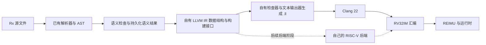
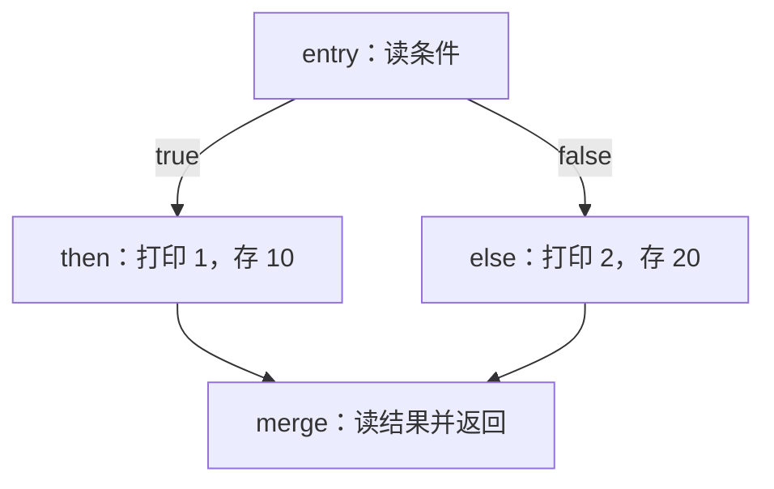

# Rx LLVM IR 实现计划（无 LLVM API，P2 完成基线）

本文以 [《Rx 编译器规范完整中文翻译》](../Rx编译器规范完整中文翻译.md) 为**唯一规范依据**。
语言行为、有效程序边界、目标平台和运行时接口均以该文件为准；
现有代码和测试只用于确定接入位置、检查实现，不能取代规范。

编写日期：2026-10-28；修订日期：2026-11-08。本文按 **P0–P2 已完成的基线**整理，
同时保留 P3–P11 的后续实现计划；“P2 完成”不表示整个语言的 IR lowering 已完成。
“建议”“本计划选择”表示工程方案；“规范要求”表示必须保留的行为。
P0–P2 中的设计说明作为已交付契约保留，实际接口与验收证据以各节状态及附录 E 为准；
伪代码和后续阶段的新类型、文件名仍是建议，不表示仓库里已经存在。
P0 及三个手写读例的历史核验结果见附录 D；不能用手写模块证明源码 lowering 已实现。
当前代码与无 LLVM API 路线的验证记录见附录 E；历史 API 核验不作为新路线的验收结果。

## 0. 怎样阅读和执行这份计划

### 0.1 先明确这一阶段要交付什么

整个 IR 部分最终的交付物是：自己的前端把有效 Rx 程序转换为合法的文本 LLVM IR，
再由 Clang 22 转成 RV32IM 汇编，在 REIMU 中得到正确行为。
当前 P2 基线交付的是其中的基础设施闭环：持久化语义结果 → 自有 IR → 自检 → `.ll`，
以及空源 main 和机器入口的端到端验证。完整语言覆盖与正式 IR 接线在 P3–P11 继续完成。



依据：[引言](../Rx编译器规范完整中文翻译.md#引言)、
[§16「LLVM IR 和代码生成」](../Rx编译器规范完整中文翻译.md#llvm-ir-和代码生成)。
完整课程编译器最终仍要有自己的后端；本阶段使用 Clang 验证前端。
运行时可以分配内存和实现 I/O，不能通过解释 Rx 或 IR 代替代码生成。

**本计划选择不调用 LLVM API 的路线。** 编译器使用 C++20 自行实现模块、类型、函数、
基本块、操作数和指令的数据结构，以及构建接口、结构检查器和 LLVM 文本输出器。
编译器及自有后端不包含 LLVM 头文件，不链接 LLVM 库，也不通过 C API、绑定或包装层间接调用 LLVM API。
后续自有后端直接读取同一份自有 IR 结构。
这是一项工程选择；§16 要求合法 LLVM IR 和自有后端，并不强制使用 LLVM 的内存对象。

`SemanticResult`、`Place`、`EmitResult`、`CoercionPlan` 和 `FunctionABI` 仍描述源语言事实、
存储位置、生成结果和调用约定；IRGen 自行决定求值顺序、copy/move、容器操作、克隆和相等。
自有 IR 表示本前端实际生成的 LLVM IR 子集，不另设一门需要再次 lowering 的中间语言，
也不预先实现完整 LLVM 指令集或复杂的通用继承树。文本拼写集中在输出器，AST lowering 不散落拼接字符串。

LLVM 22 **命令行工具仍用于编译器之外的验证**：测试 runner 对输出 `.ll` 调用
`llvm-as-22`、`opt-22 -passes=verify -disable-output` 和 Clang 22，再用 REIMU 检查行为。
rxcc 生成 `.ll` 本身不启动这些工具；构建 rxcc 不应要求 LLVM 开发包。
Clang 可编译 C 运行时和验证汇编，自有后端的最终实现责任保持不变。

### 0.2 为什么按这个顺序写

不要一开始就把所有 LLVM 指令和所有 AST 节点铺开。
先获得可以观察的输出，再围绕一个不断扩大的小程序增加能力：

| 阶段 | 当前要回答的问题 | 做完后新增的能力 |
| --- | --- | --- |
| P0 | 怎样知道一段 IR 真的执行正确？ | 手写最小 IR → Clang → REIMU → 输出 |
| P1 | 语义分析已经知道的事实保存在哪里？ | IR 可以读取类型、绑定、符号和常量 |
| P2 | 怎样自行表示、构建和输出合法 LLVM IR？ | 自有 IR 模型、构建/检查/打印、移除 LLVM 库依赖、`--stage ir -o` |
| P3 | 变量、函数参数和返回值怎样落到 IR？ | 局部变量、块、普通调用和 I/O |
| P4 | 同为 32 位整数，哪些操作仍然不同？ | 完整标量运算和 cast |
| P5 | 什么时候需要地址，什么时候读取值？ | 引用、临时值、强制转换和赋值 |
| P6 | 表达式中途跳走后，还能否继续生成代码？ | 分支、短路、循环和带值 break |
| P7 | 一个结构体或数组怎样作为独立的值流动？ | 布局、字段、索引、按值聚合参数/返回 |
| P8 | 点方法调用比普通调用多做了什么？ | 接收者调整、关联调用、数组 len |
| P9 | 拥有的堆存储和动态序列怎样工作？ | Box、Vec、增长、remove |
| P10 | 复制、克隆和相等为什么不能共用一种操作？ | 深克隆、结构化相等、递归辅助函数 |
| P11 | 怎样证明这些能力一起工作？ | 官方 IR 接线、完整回归和交付检查 |

**当前进度与执行边界。** 当前代码已按要求收束到 P2；P3 及后续实现与对应测试已移除，留待重写。

| 阶段 | 本文状态 | 完成边界或后续工作 |
| --- | --- | --- |
| P0 | 已完成 | 手写模块、RV32 目标、入口和 I/O 验证方式已核对，历史结果见附录 D |
| P1 | 已完成首批契约 | `SemanticResult` 拥有符号，保存稳定身份、表达式/字面量/常量/普通调用事实；使用位置调整已有独立预留表 |
| P2 | 已完成 | 自有模型、builder、检查器、输出器、模块所有权、双 main、CLI 和无 LLVM 库构建已接通，见 P2.4 |
| P3–P4 | 待重写 | 从局部 slot、值/位置区分、普通调用/返回开始，再实现标量运算与 cast；当前没有这些源码 lowering |
| P5–P10 | 待实现 | 引用/赋值、源码控制流、聚合、方法、容器和 trait lowering；分支模型与 CFG 检查也待对应阶段增加 |
| P11 | 待完成 | `config.mk` 的 IR/CODEGEN 仍为 Rust 参考路径，尚未完成自己的正式 IR 全量回归 |

下文 P0–P2 的“实现内容”用于说明已完成基线的职责和维护要求，不是要求重新迁移一遍。
下一步从 P3 开始重新实现，保留 P1 语义结果和 P2 基础设施作为起点；不得把 P11 的最终完成清单提前全勾选。

**编写顺序、编译器执行顺序、源程序求值顺序是三件不同的事。**
例如 sema 为确定赋值目标类型可以先检查左侧；生成的赋值代码仍必须先执行右侧。
所有后续步骤都围绕“动机 → 前置条件 → 实现内容 → 产出 → 验证”展开。
跨阶段的数据结构按实际需要增加字段，不要求在 P1 一次写完所有后续功能。
每个小节的“验证”须区分**本步验收**和**后续联合验收**；若测试依赖后续 lowering，
要标明依赖步骤，不能把它作为当前小节的完成门槛。

### 0.3 当前代码起点

以下是 2026-11-08 重构后对当前仓库接口的观察，不是规范条款；验证记录见附录 E：

| 现有位置 | 已有能力 | IR 接入时还需要什么 |
| --- | --- | --- |
| [main.cpp](../../rxcc/src/main.cpp) | IR stage、`-o`、自有检查/打印和标准 C++ 文件输出 | 随后续 lowering 扩展能力，保持失败时不截断旧输出 |
| [sema.hpp](../../rxcc/src/sema/sema.hpp)、[result.hpp](../../rxcc/src/sema/result.hpp) | `analyze(const Crate&)` 已交付拥有符号的 `SemanticResult` | 复用已有事实，按后续 lowering 需要补齐记录 |
| [body/context.hpp](../../rxcc/src/sema/body/context.hpp)、[result.hpp](../../rxcc/src/sema/result.hpp) | 已保存首批表达式事实、绑定与路径身份，临时作用域不再是 IR 的查询来源 | 后续补具体使用位置转换、投影和循环目标 |
| [body/calls/call.hpp](../../rxcc/src/sema/body/calls/call.hpp) | 调用签名、方法选择结果和接收者调整的数据结构 | 补充具体目标身份，将最终选择与调用 AST 关联 |
| [body/conversions.cpp](../../rxcc/src/sema/body/conversions.cpp) | 兼容性判定和 LUB | 记录具体转换路径及最终公共目标 |
| [ast.hpp](../../rxcc/src/ast/ast.hpp) | 完整语法结构 | `Expression::type`、`PathExpression::resolution` 当前是未回填的预留槽位 |
| [ast_builder.cpp](../../rxcc/src/ast_builder.cpp) | 已将末尾无分号表达式统一放入 `BlockExpression::tail` | 生成器直接使用 `tail`，不再从语句列表猜块尾 |
| [config.mk](../../config.mk) | semantic 已使用 rxcc | IR/CODEGEN 当前仍使用参考 rustc |
| [scripts/test.py](../../scripts/test.py) | IR → Clang → REIMU，逐字节比对输出 | 把 IR 命令切换到自己的前端，提供共享运行时 |
| [src/ir/](../../rxcc/src/ir/) | 自有 model/builder/check/printer；仅 void/i32、call/ret、空源函数和机器入口 | P3 起重新增加源值/存储/表达式与后续指令；不保留旧 P3/P4 代码 |
| [rxcc/CMakeLists.txt](../../rxcc/CMakeLists.txt) | 已移除 LLVM 开发包/库依赖，登记自有模型与迁移后的测试目标 | 增加后续阶段源码和测试；LLVM CLI 仅在 runner 中使用 |

本文不要求先重写 AST 或重做语义检查。首先保存现有检查过程已经得出的事实。
也不要让 IR 生成器再次按名称猜测类型、重新选择方法或重新推导整数。

### 0.4 先划清必须实现的范围

依据：[§1](../Rx编译器规范完整中文翻译.md#1-语言范围和测试保证)、
[§13](../Rx编译器规范完整中文翻译.md#13-引用和存储期限)、
[§14「堆清理」](../Rx编译器规范完整中文翻译.md#堆清理)。

| 必须保留 | baseline 可以省略 |
| --- | --- |
| 正确求值顺序、I/O、写引用和控制流 | 溢出检测、越界 panic、栈展开 |
| copy/move 的值语义，clone 的独立拥有存储 | move/借用数据流检查、运行时所有权标记 |
| 有效引用的目标与存储期限 | 生命周期语法的 IR 表示、生命周期检查 |
| 32 位整数、地址、usize/isize，正确外部 ABI | 一般泛型、trait object、函数值 |
| 有效控制流中的全部行为；生成前检查整个程序 | 为被排除执行规定行为或补运行时检查 |
| unit 作为函数/控制流结果 | 普通零大小绑定、参数、聚合/堆数据的完整实现 |
| Box/Vec 操作、深克隆、结构化相等 | 析构、逐对象 free、作用域退出清理 |

空 `Vec<T>`（T 非零大小）是有效数据，不能与被排除的零长度数组混为一谈。
被排除的是**源程序的无效执行**；实现引入的错误地址、提前结束或错误输出仍然是缺陷。

## P0：先建立可以观察结果的最小回路（已完成）

**状态。** 目标、入口、运行时和字节级验证方法已经建立；手写示例的实际记录见附录 D。
本节保留可复现的教学步骤，不把示例能力计为编译器的源码生成能力。

### P0.1 用手写 IR 确认目标、入口和 I/O

**动机。** 尚未开始遍历 AST 时，先确认“正确的输出长什么样、用什么命令运行”。
这样以后失败时可以区分前端生成问题与工具链、运行时问题。

**前置条件。** 只需要理解：LLVM 模块包含函数，函数中的 `call` 调用其他函数，
`ret` 结束当前函数。

**实现内容。**

1. 从仓库根目录打开 shell，按下方命令创建开发期临时目录，在其中准备 `smoke.ll`；
   这不是编译器输出实现。
2. 使用 Clang/LLVM 22，命令目标采用规范的 `riscv32-unknown-elf`，
   并固定 `-march=rv32im -mabi=ilp32`。
3. 先为源 `fn main() -> ()` 写一个内部 void 函数；
   再导出 C ABI 的 `i32 @main()`，调用它并返回 0。
4. 声明并调用 `println_i32(i32)`，与规范兼容的 C 运行时一起执行。

先在当前 shell 设置目录变量，后续命令继续在仓库根目录运行：

```sh
rx_ir_smoke_dir="$(mktemp -d)"
printf '%s\n' "$rx_ir_smoke_dir"
```

将下面完整模块保存为 `$rx_ir_smoke_dir/smoke.ll`，
把规范中的完整参考 C 运行时保存为 `$rx_ir_smoke_dir/runtime.c`。
这里的路径表示使用上面变量的实际值；两份文件都准备好后再执行验证命令。

最小完整模块示意：

```llvm
target datalayout = "e-m:e-p:32:32-i64:64-n32-S128"
target triple = "riscv32-unknown-unknown-elf"

declare void @println_i32(i32)

define internal void @__rx_fn_0() {
entry:
  call void @println_i32(i32 42)
  ret void
}

define i32 @main() {
entry:
  call void @__rx_fn_0()
  ret i32 0
}
```

上面的 layout/triple 来自当前本地 Clang 22 对规范目标的探测：

```sh
clang-22 --target=riscv32-unknown-elf -march=rv32im -mabi=ilp32 \
  -S -emit-llvm -x c /dev/null -o -
```

Clang 把目标拼写归一化为四段 triple；这是工具输出记录。
规范要求的是与 RV32IM/ILP32 一致的 32 位小端目标，并没有规定上面这个 layout 字符串必须逐字相同。
不要用宿主 x86_64 的 layout 或宿主 `sizeof(void*)`。

**产出。** 一份能经 LLVM 检查、打印 `42\n` 并正常返回 0 的手写模块。

**验证。**

```sh
llvm-as-22 "$rx_ir_smoke_dir/smoke.ll" -o "$rx_ir_smoke_dir/smoke.bc"
opt-22 -passes=verify -disable-output "$rx_ir_smoke_dir/smoke.ll"
clang-22 --target=riscv32-unknown-elf -march=rv32im -mabi=ilp32 \
  -O0 -S "$rx_ir_smoke_dir/smoke.ll" -o "$rx_ir_smoke_dir/smoke.s"
clang-22 --target=riscv32-unknown-elf -march=rv32im -mabi=ilp32 \
  -O2 -fno-builtin -S "$rx_ir_smoke_dir/runtime.c" -o "$rx_ir_smoke_dir/runtime.s"
xmake run -P vendor/REIMU reimu --memory=256M --stack=1M \
  -f "$rx_ir_smoke_dir/smoke.s,$rx_ir_smoke_dir/runtime.s" -o "$rx_ir_smoke_dir/smoke.out"
python3 -c 'import pathlib, sys; assert pathlib.Path(sys.argv[1]).read_bytes() == b"42\n"' \
  "$rx_ir_smoke_dir/smoke.out"
```

`runtime.c` 按 [§16「参考 C 运行时」](../Rx编译器规范完整中文翻译.md#参考-c-运行时)
提供 I/O 和后续需要的分配器；不定义机器 main。
保持输出中的换行为实际的 `0x0A` 字节。
参考 C 示例此前把格式串误写为 `"%d\\n"`，会输出反斜杠和字母 n；
本次已按规范 §15 的文字要求修正为 `printf("%d\n", value)`。
上面的字节断言没有输出且退出码为 0，才表示输出恰为数字 42 加一个换行；
不能只凭终端显示或 REIMU 的状态消息判断通过。
本仓库通过 xmake 启动 REIMU；可执行文件路径属于本地工具接入方式。
若需要移除 Clang 生成而 REIMU 不识别的调试指令，复用现有
[strip_asm_debug.py](../../scripts/strip_asm_debug.py) 的处理，不删改程序指令。

依据：[§15](../Rx编译器规范完整中文翻译.md#15-内置-io-和程序入口)、
[§16「目标和工具链」「符号、入口和运行时」](../Rx编译器规范完整中文翻译.md#16-后端)。

### P0.2 固定后续每一步的验证方式

**动机。** “Clang 接受”只能说明 IR 结构和部分类型关系合法，不能证明源行为正确。

**实现内容。** 后续每个小功能都使用同一组观察：

| 检查 | 能发现什么 |
| --- | --- |
| sema 全量检查后再生成 | 无效程序没有绕过名称/类型检查 |
| 自有结构检查器，再用外部 `llvm-as-22` / `opt-22` 验证 | 自有模型不变量、文本语法、指令类型、调用签名和 SSA 使用错误 |
| RV32IM 的 Clang `-O0` → REIMU | 普通执行、ABI、布局和副作用错误 |
| 对关键语义样例再用 `-O2` | 溢出标志、别名承诺等错误被优化放大 |
| 与期望 stdout 逐字节比较 | 数字、换行、顺序、多执行或少执行 |

每一步先验证自己新增的能力及受影响的旧能力。
未实现的有效功能在开发期可以明确报告“IR lowering 尚未支持”，并让测试失败；
不能把它改判为源语言非法，也不能静默输出空程序后声称通过。

## P1：让 IR 能读到语义分析已经得出的结论（首批契约已完成）

**状态。** P1.1 的结果所有权、P1.2 的首批查询以及 P1.3 的调整预留接口已实现。
实际入口为 `SemanticAnalyzer::analyze(const Crate&)`；`SemanticResult` 独立拥有符号，
驱动在临时分析器析构后将结果传给 `generate_ir`。不再实施 `run/take_result` 过渡方案。
`result.hpp` 已包含 `function_locals`、`let_bindings`、`expressions`、`paths`、
`integer_literals`、`ordinary_calls`、`constant_values` 等表。
`use_adjustments` 仅预留且当前不填写，不能据此声称具体 coercion 或 LUB 调整已完成。
以下保留契约与记录位置；字段/方法目标、具体转换和循环身份按 P5–P10 补齐，不是 P1 的遗留阻塞项。

**本阶段先交付到哪里。** 先支持后续 P2/P3 所需的查询：
源 main、普通函数和 I/O 的目标与签名、参数/let 的身份、整数/bool 的类型和值、
局部/常量路径的身份。全局符号的所有权也在这时明确。
结构体、容器等仍照常接受完整 sema 检查；它们专用的生成记录可以在对应阶段再增加。
P1 的完成不要求先做完引用转换、方法 lowering 或聚合布局。

### P1.1 先解决结果的所有权和生命周期

**动机。** 改造前全局符号归 `SemanticAnalyzer` 所有，`SemanticType` 中还保存结构体符号指针。
函数体检查结束后，局部作用域被清空。P1 已将需要跨阶段保留的事实移入结果，避免分析器析构后丢失信息或产生悬空指针。

**前置条件。** 已有 sema，不依赖任何 LLVM 指令实现。

**实现内容。**

1. 增加建议文件 `sema/result.hpp`，定义 `SemanticResult`。
2. 让结果拥有全局结构体、函数、常量符号及后续记录的局部绑定；
   分析器在构建结果时仍可持有对这些表的访问。
3. 分析完成后，把结果移交驱动；其生存期覆盖全部 IR 生成。
   AST 同样活到 IR 生成结束，节点地址才能用作查询键。
4. 建议最终接口形如 `SemanticResult analyze(const Crate&)`；
   保留现有 `run` 再增加 `take_result()` 也可以，迁移时一次统一调用者。
5. 有任何语义诊断时停止，不把含 `Error` 的不完整结果交给 IR。

可以先保留“分析器与 AST 一直活到生成结束”的过渡接口，
但最终必须明确谁拥有符号，不要复制一份仍指向已释放符号的结果。

**产出。** 驱动明确持有 `crate → SemanticResult → IR Module` 所需的对象。
`SemanticResult` 不包含 LLVM 值或类型，不包含 LLVM 头文件。
自有 IR 操作数、值/块身份等生成期映射只存在于 IRGen；模块的所有权在 P2 确定。
迁移时不把现有 LLVM 指针换入语义结果；`SemanticResult` 的接口保持与具体 IR 表示无关。

**验证。** 取出结构体字段类型、函数签名、常量结果，
在分析器已结束工作后仍能稳定读取；原 semantic 接受/拒绝行为保持一致。

### P1.2 给每个绑定和表达式留下可查询的事实

**动机。** IR 遇到两个都叫 `x` 的绑定时，必须知道读的是哪一个；
遇到 `1` 时，也必须知道它已经被定成哪种整数。

**实现内容。**

| 语义结果中的记录 | 为什么要存 | 后续使用 |
| --- | --- | --- |
| 每个参数、self、let 的 `LocalId` 和固定类型 | 遮蔽后仍区分不同存储 | P3 分配 slot |
| 路径 → LocalId / FunctionId / ConstantId；调用 → 用户函数或 builtin 目标 | 不在生成时重新名称查找，明确区分内置 I/O | P3 读取和调用 |
| 表达式 → 原始 `SemanticType`、place 信息、`diverges` | 区分值、地址、源级类型和检查时的发散结论 | P3–P10 |
| 字面量 → 已选类型和 32 位位模式 | 复用后缀/期望/default 的结论 | P4 常量输出 |
| 字段 → 所属 StructId、声明序号 | 表达式源码顺序与布局顺序不同 | P7 字段投影 |
| 常量项、数组长度、重复长度 → 求值结果 | 不再运行一遍常量求值 | P3/P7 |
| 函数列表及完整签名 | 先登记全部符号，再生成函数体 | P2/P3 前向调用 |

建议初版以 `const Node*` 为 AST 键，局部绑定使用独立编号。
同名字符串、源码 span、`SemanticType::toString()` 都不适合充当唯一身份。
当前 `SemanticType::toString()` 会显示结构体名，但字符串仍只是诊断文本；
类型身份必须由 `StructId`/符号身份判断，不能用打印结果作键。

记录绑定时保持原规则：**先检查并记录初始化器，再登记新绑定**。
例如 `let x = x + 1;` 的右侧指向旧 LocalId。

**记录接入位置。** 下表是职责索引：首批绑定、表达式、整数、常量和普通调用记录已接入；
标为 P5 及之后的记录仍按对应阶段增加，不能把整张表都视为已实现。

| 记录 | 产生结论并写入的位置 | 后续读取方 |
| --- | --- | --- |
| 全局 StructId / FunctionId / ConstantId、builtin 身份 | `declarations/collect.cpp` 登记符号时分配稳定身份；签名和常量定型后补齐内容 | P2 函数登记、P3 路径和调用 |
| 参数和 self 的 LocalId | `body/checker.cpp::enter_function`，与声明类型一起登记 | P3 参数 slot、P8 接收者 |
| let 的 LocalId、类型和绑定可变性 | `check_statement` 检查初始化器并完成类型核对后；随后才调用 `declare_local` | P3 let slot |
| 局部/常量路径解析到的身份 | `body/values.cpp::check_value_path`，在名字查找成功处记录 | P3 路径读取；不再查 Scope |
| 原始表达式事实 | `check_expression` 的统一返回处，以及直接调用的 `check_block` 返回处 | P3–P10 的值、place 和指令选择 |
| 整数文字的类型与位模式 | `check_integer_literal` 已选好类型后，结合 AST 的数值转成 32 位无符号位模式 | P4 常量输出；不重做类型推导 |
| 普通函数/I/O 的 CallTarget | `calls/call.cpp::check_ordinary_call` 选定符号与签名后，与调用节点关联 | P3 普通 call |
| 字段所属类型、声明序号和投影路径 | P7 扩展 `body/aggregate.cpp::check_field` 和结构体构造检查 | P7 字段地址与构造 |
| 方法/限定调用的目标和接收者调整 | P8 扩展 `calls/method.cpp` 及 `resolve_qualified_callee` 的解析结果 | P8 调用；P9/P10 builtin 操作 |
| 使用位置的 CoercionPlan | P5 扩展固定目标检查的调用处，P6/P7 在最终 LUB 确定后统一补齐各结果边 | 对应位置的转换发射 |
| LoopId 和跳转目标 | P6 扩展 `body/control_flow.cpp` 中的循环帧建立与跳转解析 | P6 CFG 生成 |

建议首批数据表形如下面的伪代码；它只表达关系，不是可以直接粘贴的 C++ 定义：

```text
SemanticResult
    owned_symbols                       // 按 P1.1 持有符号及其稳定身份
    locals[LocalId] = { type, is_mut }
    function_locals[FunctionId] = { self_id?, parameter_ids_in_order }
    let_bindings[LetStatement*] = LocalId
    expressions[Expression*] = { original_type, place, diverges }
    paths[PathExpression*] = Local(LocalId) | Constant(ConstantId) | Function(FunctionId)
    integer_literals[IntegerLiteral*] = { selected_type, bits_u32 }
    ordinary_calls[CallExpression*] = UserFunction(FunctionId) | BuiltinIO(kind)
```

`Parameter` 和 `SelfParameter` 当前不继承 `Node`，不要把它们强转成 `Node*` 作为键。
参数可用“FunctionId + 参数序号”映射，self 单独记录，let 使用声明节点地址。
局部作用域中的 `Binding` 需要增加 LocalId，或者改为引用结果表里的绑定记录；
即使 `lookup_local` 返回 Binding 副本，身份也随副本一起返回。
LocalId 可在整个结果内递增分配；若按函数重新编号，查询键就必须同时带 FunctionId。

`check_expression` 当前有很多直接 return。建议把原分派主体移到一个内部函数，
外层统一执行“调用内部检查 → 保存原始 ExpressionResult → 返回”；内部递归仍经过外层入口。
函数体和 if/loop 分支还可能直接调用 `check_block`，因此块结果也要在该函数返回处保存，
不能只给普通表达式加记录而漏掉块。相同块经两条入口保存时应保持同一事实。
不为保存记录再次检查同一个表达式，也不拿转换后的目标类型覆盖原始类型。

调用中的函数路径由调用解析器直接处理，结构体构造中的路径表示类型，
它们都不作为普通值表达式定型。生成器分别读取调用目标、结构体身份记录，
不要求这些特殊路径也具有可读取的源值。各表在成功生成某节点时应有必要的查询项；
缺项报告内部错误，不能默认为 i32、LocalId 0 或某个同名符号。

**产出。** IR 可以按节点查询事实，不需要读取即将消失的 `Scope`。

**验证。** 为遮蔽、参数被 let 遮蔽、同名结构体与函数、Self 和关联常量做结果查询。
断言查询到的身份正确，且原本合法的程序仍通过 sema。
首批可用 `fn main() { let x = 1; let x = 2; println_i32(x); }` 做查询验收：
两个 let 对应不同 LocalId，println 的实参指向第二个，调用目标为 builtin println_i32。
这时不要求已有可执行 IR；P2/P3 再消费同一份结果。

依据：[§6](../Rx编译器规范完整中文翻译.md#6-名称和作用域)、
[§10](../Rx编译器规范完整中文翻译.md#10-类型和推导)、
[§12](../Rx编译器规范完整中文翻译.md#12-常量上下文)。

### P1.3 给后续的“调整”预留明确的记录位置

**动机。** 一个表达式的自身类型，与它在某个位置被调整成的目标类型可能不同。
只保存一个“最终类型”会丢失应当执行的操作。

**实现内容。**

1. 将“表达式原始事实”与“使用位置的调整”分开保存。
   使用位置可以由“父节点 + 参数/字段/分支序号”描述。
2. 在 P5 增加具体的引用转换路径；在 P6 为最终 LUB 给每条结果边补全调整。
3. 普通函数/I/O 的调用目标在 P1/P3 就应可读取；
   在 P8 再扩展方法和限定调用，保存具体目标、`ResolvedMethod` 签名和 `ReceiverAdjustment`。
   当前 `ResolvedMethod` 只有签名与调整，没有用户 FunctionId 或 builtin 身份；
   必须在选中候选时补存具体目标，不能只把现有对象复制出来就视为完成。
4. 记录字段/索引自动解引用的路径、break/continue 的语义目标，
   可在实现相应节点时逐项加入。

例如 `if` 两支的原始类型分别是 `&mut i32` 和 `&i32`：
整个 if 的公共结果为 `&i32`，第一支需要调整，第一支自身的原始类型仍然是 `&mut i32`。
不要把两支直接改成同一个类型，然后让生成器猜发生过什么。

**产出。** 语义事实由 sema 决定，IR 按已选路径实现操作。
下面各阶段扩展这份结果，而不是建立第二套类型推导器。

**本小节交付边界。** P1 只建立“表达式原始事实”和“使用位置调整”分开存储的接口/数据表约定，
并验证两类记录不会互相覆盖；此时引用 coercion 和 LUB 结果边可以尚无记录。
具体 `CoercionPlan` 在 P5、最终 LUB 边在 P6/P7 随语义规则接入时写入并验收。
不以完整实现未来所有调整作为进入 P2 的前置条件。

## P2：生成结构合法的 LLVM 模块和最小程序（已完成）

**状态。** P2.1–P2.3 已由自有 C++20 实现交付，不调用 LLVM API。
实际实现和验收汇总见 P2.4；当前实现已缩减到 P2 最小子集，下面涉及后续类型/指令的关系仅作为扩展方向。

### P2.1 自行建立最小 IR 模型、构建接口和文本输出器

**动机。** 不调用 LLVM API 后，模块结构、类型、值身份、块状态和文本语法都需要自己维护。
先建立可供输出器与后端共同读取的结构，避免在遍历 AST 时到处拼接 LLVM 文本。

**前置条件。** P0 已有合法模块示例，P1 已有符号和类型查询。
当前 `rxcc/src/ir/` 已有最小自有模型与对应构建/检查/打印实现；本节保留其设计契约，
新增能力按后续阶段逐项扩展，不表示后续 lowering 已完成。

**先读懂 P0 模块中的记号。**

| 记号 | 含义 | 自有模型中的表示 |
| --- | --- | --- |
| `@main`、`@println_i32` | 模块级函数符号 | 模块持有的函数声明/定义及 `IRFunctionId` |
| `entry:` | 函数内基本块标签 | 函数持有的 `BasicBlock` 及 `BlockId` |
| `i32`、`i1`、`void` | 32 位整数、1 位计算值、无返回数据 | `IRType`；源类型与存储类型仍分别记录 |
| `i32 42` | 带类型的常量操作数 | 保存类型和位模式的 `Operand::Constant` |
| `call void @f()` | 调用无返回数据的函数 | `Call` 指令，只有副作用，没有结果 `ValueId` |
| `ret void`、`ret i32 0` | 结束当前函数 | `Return` 终结指令 |

后面会遇到 `%x.slot`、`%loaded` 这样的函数内名字。它们各自只定义一次，
属于 LLVM 的 SSA 值；SSA 即“静态单赋值”。名字保存的可以是整数，也可以是地址。
`%x.slot` 保存地址时，该地址本身不变，但地址里的内容可以用 store 多次改写。
因此“LLVM 名字只定义一次”不要求源变量也只能赋值一次。
函数内的参数、指令结果和基本块标签共用文本命名空间；这次必须由自己的输出器防止冲突。

**实现内容。**

1. **先确定最小数据模型。** 使用枚举、结构体和 `std::variant` 等 C++20 设施即可；
   只增加当前步骤需要的类型与指令，不建立完整 LLVM 类层次。建议关系如下，名称是伪代码：

```text
IRArtifact owns Module
Module = { target, types, functions }
Function = { id, name, linkage, signature, parameters, entry_allocas, blocks, is_declaration }
BasicBlock = { id, instructions, optional<Terminator> }
Instruction = { optional<ValueId> result, result_type, operation }
Terminator = Return | Branch | CondBranch | Unreachable
Operand = Constant(type, bits_or_null) | LocalValue(ValueId)
IRType = Void | Int(width) | Ptr | Array(count, element_type) | NamedStruct(type_id)
```

   P2 当前实际模型仅有 `void`、`i32`、函数声明/定义、`call` 和 `ret`。
   `i1/i8/ptr` 与 alloca/load/store 在 P3 增加，算术/比较/cast 在 P4 增加，
   分支与 CFG 在 P6 增加；数组、命名结构体与 GEP 在 P7 增加。
   每种 operation 有专用字段，例如 call 保存 `IRFunctionId` 和实参，load 保存显式存储类型，
   GEP 保存基址、显式源元素类型和带类型索引。不要把操作本体退化为一段待打印字符串。
   指令名、类型名、函数名与字段的语义必须对应合法 LLVM IR；本模型只是其受控子集。
   上述伪代码中的 `entry_allocas`、分支与复合类型均为后续扩展示意，当前模型未包含这些字段/变体。
   当前 `Type` 为枚举，命名类型的字段定义待 P7 加入模块类型表。

2. **明确身份与所有权。** `IRArtifact` 拥有模块；模块拥有类型表和函数，函数拥有参数与块，
   块拥有普通指令与至多一个终结指令。`IRFunctionId` 与 sema 的 `FunctionId` 用映射关联，
   不混用编号；`ValueId`/`BlockId` 在各自函数内解释，类型身份在模块内解释。
   分配身份后保持稳定，不把可能因容器扩容失效的元素指针/引用长期缓存。
   常量可直接作为操作数；只有参数和产生数据的指令才占用 `ValueId`。
   `SemanticResult` 和 AST 只在 lowering 时借用，完成的模块包含后端需要的显式类型、
   签名、目标和符号信息，不依赖临时检查器或 LLVM context。

3. **提供小而受约束的构建接口。** 自有 `IRBuilder` 维护“当前函数 + 可选当前块”，
   提供登记函数、创建块、添加普通指令和设置终结指令等操作。
   添加指令时分配唯一值身份，检查操作数类型；void call/store 等不产生伪结果。
   `set_terminator` 拒绝第二个终结指令并关闭当前插入位置；普通发射要求当前块存在且未终结。
   `NoContinuation` 仍由 IRGen 显式传播，不能仅靠 builder 的插入状态推断源表达式结果。
   当前 builder 只提供 call/ret 构建；入口 alloca 插入区到 P3 增加，分支接口到 P6 增加。
   `NoContinuation` 及源表达式生成接口也从 P3 开始引入，P2 不保留空壳实现。

4. **实现自己的结构检查器。** 最小版检查符号/身份唯一性、声明和定义签名一致、
   call 参数/返回类型、ret 与函数结果匹配、所有值引用属于当前函数、
   定义有入口块、每个定义中的块都恰有一个终结指令，以及普通指令不存在 void 数据结果。
   外部运行时声明可以没有函数体；内部源函数和需要的 helper 必须在最终输出前完成定义。
   当前检查器核对 call 结果在同块中定义先于使用，参数可供函数内各块使用；
   不支持跨块结果传递。存取类型/对齐检查到 P3 增加，跳转目标、前驱和支配关系到 P6 增加；初版不生成 phi。
   检查器明确返回成功/失败并报告诊断；不能用自检替代外部 LLVM 工具的合法性验证。

5. **集中实现 LLVM 文本输出。** 输出器只读取已检查的模块，不再次遍历 AST 或推导源类型。
   按稳定顺序打印 target、命名类型、函数声明/定义、块和指令。
   函数内部可用 `%arg_0`、`%v_0`、`bb_0` 等不同前缀；内部函数用 `__rx_fn_<id>`，
   类型用 `%__rx_struct_<id>`，helper 使用独立前缀。编号不依赖内存地址或哈希表遍历顺序。
   每个基本块显式打印标签；引用该块时使用 `label %bb_0`。
   统一处理类型、操作数、常量位模式、标点和换行；32 位常量的打印不执行宿主有符号溢出。
   内部符号采用上述受控名字，外部符号限于已知运行时接口，避免直接把任意源码名称写入文本。
   由标准 C++ 输出流写出文件并检查打开、写入、flush/close 错误。

6. **固定目标并迁移构建。** 模块记录 P0 已核对的 RV32 triple 和 data layout 字符串；
   目标规则由自有 target/layout 服务解释，不能从宿主指针大小或宿主结构体布局推导。
   当前已完成 `src/ir/`、驱动及测试的 API 替换，并从 CMake 移除 LLVM 包发现、版本检查、
   include、编译定义和链接库配置；保留 C++20、ANTLR 和 Threads，后续不得重新引入 LLVM 库依赖。
   不再使用 `llvm-config-22` 或 `LLVM_DIR`。CLI 验证工具的版本与可用性由测试 runner 检查，
   外部工具缺失只阻塞相应验证，不应阻塞 rxcc 本体配置、构建或输出 `.ll`。

**最小构建读例。** 以下是自有接口的伪代码，不是已有的 C++ API：

```text
artifact = IRArtifact(rv32_target)
module = artifact.module
builder = IRBuilder(module)
source = module.declare_function("__rx_fn_0", internal, void, [])
entry = module.declare_function("main", external, i32, [])
builder.begin_function(source)
builder.begin_block(source.new_block())
builder.set_terminator(Return())
builder.begin_function(entry)
builder.begin_block(entry.new_block())
builder.emit_call(source, [])       // void call 不分配结果值
builder.set_terminator(Return(Constant(i32, 0)))
check_module(module)                // 所有函数定义完整后检查
print_llvm(module, output_stream)   // 只负责序列化
```

应输出两个函数：内部源 main 以 `ret void` 结束；机器 main 调用它并 `ret i32 0`。
块名可以与 P0 不同，仍须是相同语义的合法 LLVM 22 文本。
初版不做常量折叠或运行优化 pipeline，保证模型与输出指令直接对应；
外部 Clang 的 `-O0/-O2` 只用于行为验证。

**产出。** 不依赖 LLVM 开发包的 IR 模型、构建接口、自有检查器和文本输出器，
以及由它们构建并打印的最小模块。后续自有后端能够直接读取该模型。

**本步验证。** 原 API smoke 测试已迁移为自有模型测试；用自有接口生成上述模块并经自己的检查器输出，
再由 runner 执行 `llvm-as-22`、`opt-22 -passes=verify -disable-output`，
最后以 RV32 Clang → REIMU 验证 stdout 为空且程序退出 0。
补充缺少/重复 terminator、错误 call/ret 类型、重复符号、无效值身份等失败用例，
检查失败时不交付输出模块；由外部 LLVM 验证文本命名和语法。
随后接入 P2.2/P2.3 的源码空 main。用不提供 LLVM 开发包的干净构建环境检查构建独立性，
并保住 parse/ast/semantic 原行为；P3 再用自己的前端验收源码 I/O。

### P2.2 将源 main 与机器 main 分开

**动机。** 源 main 返回 unit，还可以被源程序普通调用；
机器 main 必须符合 C ABI 并在初次调用完成后返回 i32 的 0。

**实现内容。**

1. 为全部源函数（包括 main 和方法）分配唯一内部名字，例如 `__rx_fn_<id>`。
   生成名字不直接由用户拼写组成，避免与入口、运行时和辅助函数碰撞。
2. 为源 main 生成 `void` 返回的内部函数。
3. 导出 `define i32 @main()` 包装器，调用源 main，随后 `ret i32 0`。
4. P3 接入源代码调用时，对 main 的调用按其 FunctionId 指向内部函数；P2 当前只生成包装器中的调用。
5. P0 手写模块的 I/O 保留规范 C ABI 符号；P3 再接源码 I/O，每个运行时定义只链接一次。

**产出。** 空的源 `fn main() {}` 可以正确结束；
后续“源 main 递归调用”不需要特殊终止指令。

**验证。** 当前用自己的前端验证空 `fn main() {}`；用 P0 手写模块验证机器入口和 I/O。
到 P6 有分支后再验证递归调用源 main：内层返回应恢复源调用者。

依据：[§15「程序入口」](../Rx编译器规范完整中文翻译.md#程序入口)、
[§16「符号、入口和运行时」](../Rx编译器规范完整中文翻译.md#符号入口和运行时)。

### P2.3 接入命令行和错误处理

**动机。** 从现在起，每一步都应能通过自己的可执行文件观察输出。

**实现内容。**

1. 保留现有 `--stage ir` 和 `-o <file.ll>`；本计划选择 IR stage 显式要求输出路径。
2. 复用现有词法、语法、AST 和完整 sema；全部成功后才开始 IR 生成。
3. 生成完整的自有 `Module`，全部 helper 完成并通过自有结构检查后，交给文本输出器。
   使用标准 C++ 文件流检查打开、写入、flush/close 错误；失败时报告诊断并非零退出。
   尽可能先在内存完成文本生成，再打开目标文件，避免语义/lowering/结构检查失败时截断输出。
   外部 LLVM 验证由测试 runner 在成功输出后执行，rxcc 不调用 LLVM API 或外部验证进程。
4. 沿用项目已有的用法/IO 错误退出类别；源程序错误仍按原约定拒绝。
   开发中的缺失 lowering 明确说明，不伪装成成功或源语言规定的类型错误。
5. 保留 parse、ast、semantic 的原行为，补充 usage 和 CMake 源文件列表。

**产出。**

```sh
./rxcc/build/rxcc --stage ir empty_main.rx -o empty_main.ll
```

`empty_main.rx` 的内容为 `fn main() {}`。`rxcc/examples/hello.rx` 包含局部变量、加法和 I/O，
分别依赖 P3/P4，不作为 P2 的输入。

**验证。** 用自己的前端生成空 main；另测缺失 `-o`、输出路径错误和语义失败。
单次源码 `println_i32(42)` 的端到端验证放在 P3.3；
`rxcc/examples/hello.rx` 的端到端验证放在 P4。
若存在 `--dump-tree` 等调试输出，它们不能进入 `-o` 指定的 LLVM 文件。
本阶段已迁移 `rxcc/tests/run_ir.py` runner，保留空 main 等现有用例，
后续步骤向同一 runner 增加测试；P11 再接入官方清单和大程序回归。

### P2.4 已交付实现与完成检查

以下清单只确认 P2 基础闭环，不替代 P11 的完整语言 IR 验收。

| 交付项 | 当前实际位置与接口 |
| --- | --- |
| 模块与所有权 | `ir/model.*` 的 `rx::ir::Module`；`IRArtifact` 以 `unique_ptr` 独立拥有模块，完成模块不借用 AST/sema |
| 稳定身份和构建 | `ir/builder.*` 的 `IRBuilder`；`IRFunctionId` 携带模块身份，`ValueId/BlockId` 携带函数归属，终结后关闭插入点 |
| 自有结构检查 | `ir/check.*` 检查模型正反例、签名/值归属、块终结与同块 call 结果定义先于使用；未保留 CFG/支配关系实现 |
| 文本序列化 | `ir/printer.*` 集中打印 LLVM 22 文本；`IRArtifact::verify_and_print` 先检查，非法模块不输出部分文本 |
| 目标规则 | `ir/model.hpp` 固定 `rv32_triple`、`rv32_data_layout`，当前不计算源存储布局，不使用宿主布局 |
| 源码入口 | `ir/generator.*` 的 `generate_ir` 读取 `SemanticResult`，生成内部源 main 与导出 `i32 @main()` 包装器 |
| 命令行和输出 | `main.cpp` 处理 `--stage ir ... -o ...`，先完整 sema、lowering、自检及内存序列化，再打开输出文件 |
| 构建和验证 | CMake 仅链接项目 IR/前端、ANTLR 和 Threads；CTest 与 `tests/run_ir.py` 从进程外调用 LLVM 22 工具验证 |

- [x] 编译器不包含 LLVM 头文件、不链接 LLVM 库，不经绑定或包装层调用 LLVM API。
- [x] rxcc 输出 `.ll` 不启动 `llvm-as`、`opt` 或 Clang；它们只属于外部测试验证链。
- [x] 空 `fn main() {}` 生成可验证模块，源 main 返回 void，机器 main 调用它后返回 i32 的 0。
- [x] 自有模型构建、结构检查、确定文本输出及独立模块生命周期具有测试。
- [x] 缺失 `-o`、无效输出路径、语义失败和不支持的 lowering 非零退出；生成前失败不截断旧输出。
- [x] 本次重新配置、构建成功，CTest 5/5 通过，包含 semantic invariant、模型、入口与 CLI 外部 LLVM 验证。

**验收限制。** 当前机器仍安装 LLVM 开发文件，未做“卸载开发包后的干净环境构建”实验；
无 LLVM 开发包依赖由源码、CMake 和已有链接检查支撑，不把未执行的环境实验写成通过。
本次验证命令及与既有历史记录的区别见附录 E。
引用、源码分支/循环、聚合及全部标准内置操作不在 P2 完成声明内；正式 `make test STAGE=ir`
仍走参考 Rust，不能用其成绩证明自己的 IR 已完整交付。

## P3：用局部存储打通变量、普通函数和返回值

### P3.1 先区分“一个值”和“存这个值的位置”

**动机。** LLVM 的临时值只能定义一次；源变量却能反复赋值。
先把变量放到存储中，可在不实现 SSA 构造算法的情况下保留源语义。

**实现内容。**

| 源类型 | 本计划选用的计算值 | 本计划选用的存储 |
| --- | --- | --- |
| 四种整数 | `i32`，语义类型仍区分四种 | 4 字节、对齐 4 |
| bool | `i1` | `i8`，0 或 1，对齐 1 |
| 引用（P5） | `ptr` | 4 字节、对齐 4 |
| unit 结果 | 一个“正常完成但无数据”的生成结果 | 不分配 slot |
| 发散路径 | 一个“没有后续执行路径”的生成结果 | 不制造占位值 |

定义建议接口：

```text
Place = { address: Operand(ptr), source_type: SemanticType,
          storage_type: IRTypeId, alignment: uint32 }
EmitResult = Value(value) | Unit | NoContinuation
PlaceResult = Location(place) | NoContinuation

emit_place(expr)       // 返回 PlaceResult；得到位置，不读取其中保存的源值
emit_value(expr)       // 按当前语境得到值；读取已有 place 时做 copy/move
load_value(place)      // bool: i8 -> i1；其他按类型读取
store_value(place, v)  // bool: i1 -> i8；其他按类型写入
```

这里的 `Value(value)` 是生成结果中的一种情况，保存自有 `Operand` 和对应源类型。
P7 增加的 `AggregateValue(private_storage)` 同样是源值的生成表示。
`SemanticResult` 不依赖上述 IR 字段，只有 IRGen 的 Place/EmitResult 使用它们。

存取函数通过自有构建接口添加带显式存储类型的 load/store 指令，
按 Place 中已保证的对齐填写属性；bool 分别发出 trunc / zext 跨越 i8/i1 边界。
LLVM 22 使用 opaque pointer：地址操作数的 IR 类型只能说明这是 ptr，
不能由此取出被引用的源类型或存储类型。load/GEP 所需类型来自 Place 或统一类型映射，
在自有指令中显式保存，再由输出器打印。

`NoContinuation` 描述当前生成路径已经结束，不能仅靠表达式的静态类型推断它。
例如一个调用即使实际永不返回，其静态结果仍是函数声明的返回类型。
后面 P6 用它处理嵌套的 return/break/continue。

**产出。** 变量的地址与从地址读出的值分开；所有 bool 存取走统一边界转换。
LLVM 22 文本指针使用 `ptr`；被引用类型仍保留在语义结果和 Place 中。

**本步验证。** 用自有构建接口构造小模块，经自有检查器和外部 LLVM 工具验证整数与 bool 的 load/store 边界，
以及 `Unit`/`NoContinuation` 不伪造数据值。

**P3.3 后联合验证。** 整数/bool 的 let、读取、布尔传参和返回不发生宽度混用；
unit 函数调用后可以继续执行；return 后没有伪造的零值继续参与计算。
这些端到端用例依赖 P3.2/P3.3，不是本小节的提前完成门槛。

### P3.2 给参数、let 和临时值分配固定 slot

**动机。** 地址必须稳定，遮蔽不能覆盖旧绑定，循环也不能每次迭代累积分配栈。

**实现内容。**

1. 每个 LocalId 对应独立 slot；参数进入函数时写入自己的本地 slot。
2. 固定大小的 `alloca` 统一插入函数入口，初始化 store 留在源程序实际执行位置。
   可以先收集 slot，也可以用单独的入口 alloca 插入区；不提前执行初始化器。
3. 按 AST 中的静态位置准备临时 slot，同一次调用中可供循环迭代复用。
4. 每次递归调用由自己的栈帧保存这些 slot。
5. 不对已存在的局部变量做“物化副本”来取得地址。
6. 初版把存储保留到函数返回，不提前插入会使有效引用失效的生命周期结束标记。

自有模型为函数入口保留固定 alloca 区，`create_entry_alloca` 分配稳定的结果身份，
把 alloca 记录放入该区，不改变主 builder 当前的源码执行位置。
输出器先打印入口 alloca 区，再打印入口普通指令；检查器和自有后端也按同一顺序读取它们。
初始化 store 保持在实际执行处；入口槽位的创建不能把初始化器副作用移到入口，
也不能因事后插入 alloca 而重新编号已有值身份。

**产出。** `LocalId → Place` 映射，固定的每次调用存储需求。

**验证。** 下面程序输出 `1\n2\n`；P5 加入引用后再检查旧绑定地址仍指向 1。

```rust
fn main() {
    let x = 1;
    println_i32(x);
    let x = 2;
    println_i32(x);
}
```

本步先以常量初始化核对两个 LocalId 和 slot。
P4 接通加法后再补 `let x = x + 1;`，验证初始化器仍读取旧绑定。

**读例一：同一个地址，两次不同的内容。** 下面的赋值部分是 P5 的预览；
P3 先实现初始化与读取，接通 P5 后再用自己的生成器验收完整程序。

```rust
fn main() {
    let mut x = 1;
    println_i32(x);
    x = 2;
    println_i32(x);
}
```

对应的完整教学模块可保存为 `locals.ll`：

```llvm
target datalayout = "e-m:e-p:32:32-i64:64-n32-S128"
target triple = "riscv32-unknown-unknown-elf"

declare void @println_i32(i32)

define internal void @__rx_fn_0() {
entry:
  ; alloca 产生 ptr：%x.slot 保存地址，不是源变量里的整数。
  %x.slot = alloca i32, align 4
  ; let 初始化：把 i32 常量 1 写进该地址。
  store i32 1, ptr %x.slot, align 4
  ; 值语境读取 x：在此时取得它的整数值，再传给 I/O。
  %before = load i32, ptr %x.slot, align 4
  call void @println_i32(i32 %before)
  ; x = 2：先得到 RHS 的常量值，再找到原来的 slot，改写内容。
  store i32 2, ptr %x.slot, align 4
  %after = load i32, ptr %x.slot, align 4
  call void @println_i32(i32 %after)
  ret void
}

define i32 @main() {
entry:
  call void @__rx_fn_0()
  ret i32 0
}
```

这里 `LocalId(x) → Place(%x.slot, i32, align 4)` 在生成函数期间保持不变。
`emit_place(x)` 返回这个位置；`emit_value(x)` 在需要读取的地方发出 load。
`%before`、`%after` 是两个不同的 SSA 值，各定义一次；修改 slot 不会追溯改变 `%before`。
`alloca i32` 中的 i32 是所分配内容的类型，指令结果则是 ptr；
`load i32` 的结果才是整数。`align 4` 表示该地址至少按 4 字节对齐。
这是本计划根据 i32 slot 的分配保证填写的属性，不能对任意地址照抄。

本例预期字节为 `b"1\n2\n"`，正常返回 0。
把它作为 P0 命令中的输入模块，仍链接同一份 runtime；
将文件名换成 `locals`，字节断言的期望值换成上述内容即可。
本节和后面两个读例都是手写教学模块，不表示 rxcc 已具备对应生成能力。

依据：[§6「作用域规则」](../Rx编译器规范完整中文翻译.md#作用域规则)、
[§13「存储和实现」](../Rx编译器规范完整中文翻译.md#存储和实现)。

### P3.3 普通调用、块和返回先走通

**动机。** 调用和 I/O 为后续算术、顺序、分支提供直接的观察手段。

**实现内容。**

1. 先为全部函数登记 IR 符号和签名，再生成函数体，支持前向调用和相互递归。
2. 本步参数/返回先支持整数、bool、unit 返回；P5 增加引用，P7 增加聚合。
3. 参数从左到右求值，每个完成后固定其值；若某个参数返回 `NoContinuation`，
   后续参数和最终 call 都不再生成到当前路径。
4. 函数体按顺序生成语句；表达式语句保留副作用并丢弃结果。
5. 使用已经归一化的 `BlockExpression::tail`：
   当前 `AstBuilder::build_block` 已把末尾无分号的块类表达式从语句列表移入 `tail`，
   `BodyChecker::check_block` 直接检查该字段。IR 先生成 statements，再在仍有后续路径时生成 tail；
   不重新识别尾表达式，也不另存一份可能失去同步的“有效尾节点”。
6. `return v` 求值并按声明结果类型返回；`return;` 发出 `ret void`。
   之后当前块被关闭，后继源节点仍已接受 sema 检查。
7. 函数正常完成时返回块尾值，正常 unit 完成时 `ret void`。
8. 常量路径直接读取 sema 的求值结果，不生成运行时依赖图或初始化函数。
9. 内部调用初版使用 LLVM 默认调用约定和一致的 lowered 参数类型。
   寄存器保存、前八参数以外的传递由验证用 Clang 处理；自有后端阶段再实现机器 ABI。

**产出。** 使用自己的 rxcc 生成下面程序的 IR，输出 `7\n`：

```rust
fn main() {
    let n = answer();
    println_i32(n);
}

fn answer() -> i32 {
    return 7;
}
```

**验证。** 前向调用、尾返回、提前返回、嵌套块、多个参数、
超过八个标量参数、调用后仍使用旧局部值。
递归的完整运行测试在 P6 有终止条件后补齐。

依据：[§7「函数」](../Rx编译器规范完整中文翻译.md#函数)、
[§11「调用表达式」「代码块表达式」「Return 表达式」](../Rx编译器规范完整中文翻译.md#11-表达式和求值)。

## P4：实现标量运算，先把 32 位语义做准确

### P4.1 从原始语义类型选择指令

**动机。** 四种整数都能表示为 LLVM i32，但除法、余数、右移和排序仍依赖源类型的符号性。
不能先丢掉类型区别，再从 IR 的 i32 猜回来。

**前置条件。** P3 的计算值、存取边界、从左到右的普通操作数求值。

**实现内容。**

| 源操作 | LLVM lowering | 额外约束 |
| --- | --- | --- |
| 整数 `+`、`-`、`*` | `add`、`sub`、`mul i32` | 按 32 位回绕 |
| 有符号 `/`、`%` | `sdiv`、`srem` | 向零截断，余数符号随被除数 |
| 无符号 `/`、`%` | `udiv`、`urem` | 按无符号位模式 |
| 整数/布尔 `&`、`\|`、`^` | `and`、`or`、`xor` | 两侧都执行；bool 用 i1 |
| 一元整数负号 | `sub i32 0, value` | 不附加不溢出承诺 |
| 整数 `!` | 与全 1 位模式 xor | 不使用布尔真值规则 |
| 布尔 `!` | `xor i1 value, true` | 逻辑取反 |
| 同类型标量 `==`、`!=` | `icmp eq/ne` | 源类型仍由 sema 判定一致 |
| 整数排序 | `icmp s*` 或 `icmp u*` | 根据源类型选择 |
| bool 排序 | 无符号 `icmp` | false < true；不能把 i1 的 true 当有符号 -1 |

普通二元操作先求值左操作数，再求值右操作数，最后执行运算。
本步先处理直接标量；共享引用变体在 P5 明确它们的读取时机。
短路 `&&`/`||` 到 P6 通过控制流实现。

**产出。** 一个只接收已准备好标量值的运算发射函数，
可由普通运算和后续复合赋值共用。

**验证。** 有符号负数除法/余数、u32 高位为 1 的比较、bool 排序、
非短路 bool 位运算，以及跨越 i32/u32 边界的加减乘。
用 `-O0`、`-O2` 验证相同结果。

依据：[§10「支持的类型」](../Rx编译器规范完整中文翻译.md#支持的类型)、
[§11「算术和位运算」「比较和逻辑」](../Rx编译器规范完整中文翻译.md#运算符表达式)。

### P4.2 单独实现移位和 cast

**动机。** 原样把源移位量传给 LLVM shift，无法满足“只保留低 5 位”的规则；
把整数 cast 当数值拓宽，也会引入本语言没有的行为。

**实现内容。**

1. 移位前发出 `count & 31`，包括普通移位和后续的 `<<=`/`>>=`。
2. 左移使用 `shl i32`；有符号右移用 `ashr`，无符号右移用 `lshr`。
   结果的源类型取左操作数，右侧可以是另一种整数。
3. 四种整数之间的 cast 保留 i32 位模式，通常不需要指令，
   但返回结果的源类型必须换为目标类型。
4. bool 到整数用 `zext i1 to i32`；false 为 0，true 为 1。
5. literal 使用 P1 保存的位模式；处理有符号最小值时不在宿主 C++ 中执行有符号溢出。
6. 本步不实现常量折叠器；自有构建接口原样记录已选定的运算。
   生成器直接落实回绕和移位掩码语义，不依赖后续优化补救错误 lowering。

**产出。** 移位、位模式转换和布尔转换的统一实现。

**验证。** 移位量 0、31、32、33、负数的低位情况、不同右侧整数类型、
`-1i32 as u32`、`2147483648u32 as i32`、true/false 到四种整数。
最终通过 `as i32` 交给 I/O，观察符号与位模式。

### P4.3 从第一版开始约束 LLVM 的语义承诺

**动机。** 合法的 LLVM 文本也可能因错误的附加承诺而在优化后改变结果。

**实现内容。**

- baseline 的回绕算术不发 `nsw`/`nuw`；没有证明时不发 `exact`。
- 不为了省指令删除移位量掩码。
- 不把除零或 MIN / -1、MIN % -1 的排除规则扩展成“所有整数运算都不会溢出”。
- 引用相关的别名属性留到确有证明时再考虑，P5 初版不自动附加 `noalias` 等承诺。
- 源程序中的普通名称/类型错误由 sema 完整处理，LLVM 的类型擦除不能代替检查。

自有算术指令初版不设置不溢出/精确性标志，输出器只打印普通 add/sub/mul 等指令。
将来如扩展这些属性，默认值仍应为空，并由引入它们的优化提供证明；
自有结构检查器与外部 LLVM verifier 都不能证明这些源语义承诺成立。

**产出。** `-O0` 与 `-O2` 可共同验证的标量 baseline。

**本阶段验收。** 整数、cast、shifts 和标量 I/O 的对应执行样例通过；
P3 的绑定、调用和返回继续正确。

## P5：明确地址、读取时机，再实现引用和赋值

### P5.1 引用指向原位置，值表达式需要时只物化一次

**动机。** `&x` 应指向 x 的 slot；
`&mut make()` 则需要为 make 的结果创造一个稳定位置。
如果每次“需要地址”都重新求值，就会重复副作用。

**前置条件。** P3 的 Place、固定 slot 与 Value/Unit/NoContinuation。

**实现内容。**

1. `&place`、`&mut place` 返回位置的地址，不先复制 place 的内容。
2. 对值借用、值基表达式的字段/索引、需借用的值接收者，
   使用 `materialize_once(value)` 将已求得的值写入固定临时 slot。
3. 每个显式 `*` 执行一次内置解引用：读出引用值后，把该地址视为目标 Place。
   P9 为 Box 补全同一投影机制；Vec 不可被 `*` 解引用。
4. 读取保存引用的局部变量，只加载指针值；读取其目标必须是另一项明确操作。
5. 对引用的引用，每层解引用分别读取该层保存的指针。
6. 生成器使用已通过检查的权限信息，不通过“复制到可写临时值”绕过不可变位置。

建议保留权限路径作为生成期不变量；其本身不需要运行时检查或额外字节。
不可变绑定保存 `&mut T` 时仍可通过它写 T；跨过共享引用的访问仍不可写。
两种行为不能仅由最外层变量是否 mut 决定。

**产出。** 引用参数、引用返回、显式借用/解引用以及标量临时借用。

**验证。**

```rust
fn main() {
    let x = 1;
    let old = &x;
    let x = 2;
    println_i32(*old);
    println_i32(x);
    let p = &mut 3;
    *p = 4;
    println_i32(*p);
}
```

输出 `1\n2\n4\n`。本程序的写入在 P5.3 接通。
P7 再补 `let r = &mut make_array()[0]`：调用一次，数组临时存储持续有效，
之后修改和读取元素得到预期值。

依据：[§11「Place 和值」「临时 place」](../Rx编译器规范完整中文翻译.md#place-和值)、
[§13](../Rx编译器规范完整中文翻译.md#13-引用和存储期限)。

### P5.2 把引用强制转换变成一条确定的路径

**动机。** `&Box<T> → &T` 可能真的需要读取 Box 指针；
`&mut T → &T` 则通常仍是同一个目标地址。
“两边都是 ptr”不足以证明应该直接透传。

**实现内容。**

1. 在 sema 中为通过的一对一转换记录 `CoercionPlan`。
   把现有兼容性判定与“生成调整路径”的规则集中复用，不保留两套可能分歧的算法。
2. 路径描述源引用、内置解引用步数/种类、到达的目标类型、最终共享/可变借用。
   不能仅记录目标类型，令 IR 无法知道需要几次 load。
3. 同类型普通值保持 copy/move；同类型 `&mut T` 在强制转换位置记录重借用语义。
4. `&mut T → &T`、同目标重借用通常透传指针；沿引用链继续解引用则加载相应指针。
   Box 的指针加载在 P9 补全后同样可用。
5. 强制转换结束时得到“到达位置的引用”，不加载/移动那个位置保存的 T。
6. 不引入拥有值的隐式借用、Vec 解引用、切片或容器元素整体转换。

**产出。** `emit_coercion(prepared_value, plan)`，
由 let、参数、返回、字段初始化和后续 LUB 的结果边共用。
计划只描述源语义调整，不携带 LLVM 指令对象。

**验证。** 普通引用参数、可变到共享、嵌套引用的合法解引用强制转换、
带标注 let 的可变重借用；P9 补 `&Box<T>` 和多层 Box 的执行验证。
生成时不重新推导整数，不改变内部引用可变性。

依据：[§10「强制转换类型」「可变引用重借用」](../Rx编译器规范完整中文翻译.md#强制转换类型)。

### P5.3 先求右侧，再求目标，最后写入

**动机。** 普通赋值和复合赋值的求值顺序与普通二元运算不同。
直接照抄 checker 先检查左边的递归顺序，会生成错误副作用顺序。

**实现内容。**

```text
普通赋值 lhs = rhs：
    right = emit_value(rhs)，实施已经选定的强制转换并固定结果
    若 right 没有后续路径：停止
    target = emit_place(lhs)，只计算一次目标位置
    若 target 的计算没有后续路径：停止
    store_value(target, right)
    返回 Unit

复合赋值 lhs op= rhs：
    prepared_right = 求值 rhs，保存标量值或共享引用值
    target = emit_place(lhs)，只计算一次目标位置
    old = load_value(target)
    right_scalar = 若右侧为共享引用，此时才读取其目标
    result = P4 的标量运算(old, right_scalar)
    store_value(target, result)
    返回 Unit
```

右侧是直接标量时，在求值 RHS 的时刻就固定其值；
右侧是共享引用时，先固定引用，读其目标的动作留到最终运算。
复合赋值不重新生成整个 lhs 表达式，也不提前读取旧值。
移位复合赋值复用 P4 的低 5 位掩码。
P7 将普通赋值的 store 扩展到完整聚合，P9 覆盖容器元数据。

**产出。** 一个统一、可检查的“准备 RHS → 目标地址 → 读取/写入”流程。

**验证。** 目标函数和 RHS 函数各打印一个编号，两种赋值都应先打印 RHS 编号。
让目标地址函数在返回地址前改变目标旧值，复合赋值应读取改变后的旧值。
共享引用 RHS 使用独立的、借用有效的数据，分别统计两个函数只执行一次。
RHS 提前 return 时，目标地址函数不能执行。

**规范与测试的区别。** 规范明确要求所有受支持复合赋值右侧优先；
该处还说明官方测试不检查两操作数的相对顺序。
因此本项目仍要写对应的顺序验证点，不能把测试未检查当作可以换序。

依据：[§11「借用、解引用和赋值」中的「求值顺序」](../Rx编译器规范完整中文翻译.md#借用解引用和赋值)。

### P5.4 共享引用参与标量运算时延后读取目标

**动机。** “求值引用”与“读取引用的目标”是两个动作。
规范要求先得到两侧操作数，再真正执行引用标量运算。

**实现内容。**

```text
PreparedScalarOperand =
    DirectScalar(value)
  | SharedReference(reference_value, scalar_type)

left = prepare_operand(lhs)
right = prepare_operand(rhs)
left_scalar = finish_operand(left)
right_scalar = finish_operand(right)
emit_scalar_operation(left_scalar, right_scalar)
```

其中直接标量在自己的求值时刻已读出；共享引用保留指针，到 finish 时才读目标。
一元运算在唯一操作数求值结束后执行同样的 finish。
算术/位运算只接受 sema 已批准的一层共享引用，不能套用任意自动解引用。

排序比较单独使用已记录的引用层级方案：得到左右引用值后，
按匹配的引用层级读取到最终标量，再按其类型比较。
外层 `&T < &mut T` 的运算符专用调整不能被推广到其他方向或内部层级。
相等所需的任意类型结构化读取在 P10 完成。

**产出。** 操作数准备与最终标量读取分离，普通运算和复合赋值共享最终运算函数。

**本阶段验收。** 引用、临时值、标量引用运算、赋值、重借用和原有标量调用正确；
合法引用不用运行时标记或引用计数。

## P6：用控制流表示选择、重复和提前离开

### P6.1 先建立基本块结束后的生成约定

**动机。** `return` 可以出现在运算、实参、分支、数组元素等表达式内部。
结束一个执行路径后继续往同一块追加指令，会生成非法 IR 或执行本应跳过的副作用。

**前置条件。** P3 的 NoContinuation 和自有 builder 插入点约定，P5 已能在任意子表达式结束时停止外层操作。

本步把 P2 的 terminator 表示、P3 的 `NoContinuation` 和 P3/P5 已有的提前返回传播
统一推广到所有控制流节点；不是首次引入基本块 terminator 或发散结果。

**实现内容。**

1. 每个被输出的基本块恰有一个 terminator，terminator 后不能追加指令。
2. `br`、`ret` 发出后关闭当前插入位置。
3. 每个表达式生成函数把“是否正常到达后续位置”显式返回给调用者。
4. sema 仍检查整个源程序；IR 可以跳过已无生成路径的后续节点。
   不在 IR 生成中重新做不可达代码的名称/类型判断。
5. 不为提前返回的分支造假值，不从没有写入的 merge slot 中 load。

生成器通过自有接口切换当前 `BlockId`，发出 terminator 后将当前块置空，表示路径关闭。
准备发射普通指令时，要求当前块存在且其 terminator 字段为空；检查器核对跳转目标、
前驱关系和 SSA 定义支配使用处。`NoContinuation` 由生成器向外传播。
插入点保护只用于临时生成工作；不能在 return/break 后误恢复原块并继续发射源副作用。

**产出。** 可用于所有控制流节点的块状态契约。

**验证。** `return` 之后的 println 不执行；某个实参提前返回时，
后面的实参和被调用函数都不执行；嵌套块提前离开时外层写入也不执行。

依据：[§10「Never 类型」「不可达代码」](../Rx编译器规范完整中文翻译.md#never-类型)。

### P6.2 先做 if，再用同样的结构做短路

**动机。** if 和短路都根据一个 bool 只执行某些代码；
先把“选择哪一条路径”做清楚，再处理值的汇合。

**实现内容。**

1. if 条件只求值一次，用 i1 条件分支到 then/else。
2. 只在正常完成的分支结尾跳到合流块；提前离开的分支没有这条边。
3. 对有值结果使用固定的 result slot：每条正常结果边先实施自己的转换，再写入。
   合流块只在确实存在正常前驱时读取它。
4. unit 结果不分配数据；两边都离开时返回 NoContinuation。
5. `else if` 按 AST 嵌套生成，后一个条件只在前面的条件为 false 时执行。
6. `a && b`：a 为 false 时直接给出 false，为 true 时才求 b。
   `a || b` 对称处理；可以复用“分支写结果 slot”的方式。
7. 不用会提前执行两个分支的方案实现有副作用的 if 或短路。
   baseline 无需 phi；后续优化可把合适的 slot 提升为 SSA。

**补齐 sema 的结果边。** 无固定目标时，先保留全部原始分支结果，再按规范求最终 LUB。
最终类型确定后，为每条分支记录到该目标的 CoercionPlan。
LUB 目标改变时，要更新此前结果边；不能只调整最后一个分支。
不重新检查原始表达式，也不把当前候选目标传成下一分支整数的期望类型。

**产出。** 标量和引用的分支结果、单侧提前返回、短路副作用。
P7 将 result slot 的写入扩展为聚合值复制/移动。

**验证。** 两支可打印不同标记，运行时只出现选中分支；
false &&、true || 跳过右侧；一支 return、另一支有值；
引用两支按最终 LUB 指向正确目标，并保持后续访问有效。

**读例二：分支各自写结果，到合流块再读取。**

```rust
fn choose(flag: bool) -> i32 {
    if flag {
        println_i32(1);
        10
    } else {
        println_i32(2);
        20
    }
}

fn main() {
    println_i32(choose(true));
    println_i32(choose(false));
}
```

先看 choose 的执行路线：



完整教学模块可保存为 `branch.ll`：

```llvm
target datalayout = "e-m:e-p:32:32-i64:64-n32-S128"
target triple = "riscv32-unknown-unknown-elf"

declare void @println_i32(i32)

define internal i32 @__rx_fn_0(i1 %flag) {
entry:
  %flag.slot = alloca i8, align 1
  %result.slot = alloca i32, align 4
  ; bool 参数的计算形式是 i1，本地存储形式是 i8。
  %flag.byte = zext i1 %flag to i8
  store i8 %flag.byte, ptr %flag.slot, align 1
  %condition.byte = load i8, ptr %flag.slot, align 1
  %condition = trunc i8 %condition.byte to i1
  ; br 是终结指令；本块到这里结束，只沿一条边继续。
  br i1 %condition, label %then, label %else

then:
  call void @println_i32(i32 1)
  store i32 10, ptr %result.slot, align 4
  br label %merge

else:
  call void @println_i32(i32 2)
  store i32 20, ptr %result.slot, align 4
  br label %merge

merge:
  ; 每条进入 merge 的边都已写入结果，才可以在这里 load。
  %result = load i32, ptr %result.slot, align 4
  ret i32 %result
}

define internal void @__rx_fn_1() {
entry:
  %first = call i32 @__rx_fn_0(i1 true)
  call void @println_i32(i32 %first)
  %second = call i32 @__rx_fn_0(i1 false)
  call void @println_i32(i32 %second)
  ret void
}

define i32 @main() {
entry:
  call void @__rx_fn_1()
  ret i32 0
}
```

result slot 是内存位置，分支通过 store 给它赋值；LLVM 不会自动把两支的整数合成一个值。
这份 baseline 用 slot 完成合流，所以暂时不需要 phi 指令。
若某一支改为提前 return，该支直接以 ret 结束，不再写 if 结果或跳到 merge；
若两支都提前离开，外层得到 NoContinuation，不建立需要读取结果的合流路径。

本例按 P0 的方式验证，预期字节为 `b"1\n10\n2\n20\n"`，正常返回 0。
输出中的 1/2 验证分支副作用，10/20 验证返回值；两者都需要正确。

依据：[§10「最小上界强制转换」](../Rx编译器规范完整中文翻译.md#最小上界强制转换)、
[§11「If 表达式」「比较和逻辑」](../Rx编译器规范完整中文翻译.md#if-表达式)。

### P6.3 再把“回边”和“退出边”加入循环

**动机。** while 与 loop 都会重复执行，但 continue 目标和结果值不同。
先把每种边的目的地写清楚，避免通过发散类型猜测跳转位置。

**实现内容。**

| 构造 | 正常流程 | continue 目标 | break 目标 |
| --- | --- | --- | --- |
| while | 条件块 → 体/退出；体尾回条件 | 条件块 | 退出块 |
| loop | 体块 → 体块 | 体入口 | 退出块，必要时携带结果 |

1. 在语义结果中记录每个 break/continue 对应的 LoopId；
   生成时维护 LoopId 到这些目标块和结果 slot 的映射。
2. loop 的带值 break 先求值操作数、应用最终结果转换、写 slot，再跳退出。
   若操作数已提前离开，就不再写 slot 或发出该 break 的跳转。
3. 裸 break 提供 unit；循环体的普通尾值不能当作 loop 的结果。
4. while 每次到条件块都重新求值条件，continue 也走条件块；
   while 正常退出的结果是 unit。
5. while 条件中的嵌套 loop 可有自己的跳转。
   对当前 while 或外层循环的非法条件内跳转已由 sema 的屏障规则拒绝。
6. 对 loop 的所有语义 break 收集最终类型和转换，包括不可达 break；
   生成的真实退出边则只来自实际生成的路径。
7. 若没有生成任何可继续的退出边，不生成未初始化的结果 load，
   返回 NoContinuation；不要仅因静态结果类型是 i32 就假定一定能退出。
8. 无 break 的 loop 是回边，不发出正常函数尾返回。

**产出。** 嵌套循环、带值 loop、while 条件嵌套循环、跨分支的 continue/break。

**验证。** while 多次求值条件、内层 break 不退出外层、
continue 跳过后续写入、不同分支带值 break、break 操作数 return、
静态存在但运行不到的 break。
无限循环样例主要检查 CFG/IR 结构，不把超时当作“运行成功”。

### P6.4 用一个小程序联合验收

```rust
fn sum_to(limit: i32) -> i32 {
    let mut i = 0;
    let mut sum = 0;
    while i < limit {
        i += 1;
        if i == 2 { continue; }
        sum += i;
    }
    loop {
        if sum > 0 { break sum; }
        return 0;
    }
}

fn main() {
    println_i32(sum_to(4));
}
```

应输出 `8\n`。再加入递归、有多个参数且调用后仍使用局部值的程序，
检查每次调用拥有独立状态。

**本阶段验收。** 已支持的所有标量/引用表达式可在有效控制流中任意组合；
没有 terminator 后指令、缺少终结指令的块、无真实前驱的伪结果读取。

## P7：把结构体和数组作为真正独立的值处理

### P7.1 先回答一个类型占多少存储

**动机。** 分配 slot、字段投影、数组步长、Box 分配和 Vec 增长都依赖同一份布局。
此时再引入布局服务，因为现在有了第一个需要计算多字段位置的功能。

**前置条件。** 规范类型已经归一化，语义分析已拒绝无限的按值布局环。

**实现内容。** 增加 `Layout { size, align, field_offsets }` 查询，按目标而非宿主计算：

| 类型 | 本计划选择的布局 |
| --- | --- |
| 四种整数、引用、Box 指针 | size 4、align 4 |
| bool | size 1、align 1 |
| `[T; N]` | align(T)，size(T) × N，元素步长为 size(T) |
| 结构体 | 声明顺序、逐字段对齐，最后补齐到最大字段对齐 |
| `Vec<T>` | `{ data: ptr, len: i32, cap: i32 }`，size 12、align 4 |
| unit | 无数据；用于正常结果时不分配 |

Box/Vec 的内部布局是本计划的选择；规范只要求固定大小的拥有者表示及正确行为。
此时先确定 Vec 头的固定大小，是为了让包含 Vec 的结构体也能完成布局；
其操作到 P9 再实现。引用、Box 和 Vec 的布局查询不递归展开其目标/元素，
从而允许 `struct Node { children: Vec<Node> }`。

例如 `struct Mixed { flag: bool, value: i32, tail: bool }`：
字段偏移为 0、4、8，size 为 12、align 为 4；数组中相邻 Mixed 的步长为 12。

LLVM 存储类型与该布局一致：bool 使用 i8，数组使用 `[N x StorageType(T)]`，
结构体使用按声明顺序的普通 LLVM struct，不人为 packed。
本路线自行实现固定 RV32 目标的布局算法，不调用 LLVM DataLayout API，
也不需要先实现任意目标的 data layout 字符串解析器：

1. 标量大小/对齐来自上表的固定目标规则；unit 的布局记录为 size 0、align 1。
2. `align_up(offset, align)` 把偏移向上取整到合法对齐边界；
   对每个结构体字段依次执行对齐、记录偏移、累加字段大小，最后补齐结构体尾部。
3. 数组使用已含尾填充的元素 size 作为 stride，检查 `size(T) × N` 的可表示范围。
4. 引用/Box 固定为一个 ptr，Vec 固定为 `{ptr, i32, i32}`；查询它们的大小不展开目标/元素。
   数组和按值字段才递归查询子布局，并用 Visiting/Complete 缓存防止实现错误导致无限递归。
5. 在自有类型表中先按 StructId 登记命名结构体身份，再补齐字段类型；
   输出器打印对应的命名类型定义，不依靠递归内联打印类型。只有完成定义的存储类型才能查询布局。
6. 大小/偏移计算使用足够宽的宿主无符号中间值，先检查加法、乘法、向上对齐是否溢出，
   再核对目标 32 位范围；不能让 C++ 运算先溢出，也不能使用宿主 `sizeof/alignof`。

固定 target 配置、存储类型映射和布局算法必须一起维护。
GEP 指令在自有模型中保存显式存储类型；若采用字节偏移，也必须读取同一布局查询结果。
自有后端使用模块内的存储类型和相同目标规则计算偏移，不在机器代码阶段另写一套布局约定。
通过独立 `.ll` 布局探针核对 LLVM 22 对相同类型的实际布局：例如用 GEP 计算字段偏移和数组步长，
运行后与自有布局查询结果比较。只通过 LLVM verifier 不能证明自算布局与 LLVM 的解释一致。

未被使用的空结构体等声明可以仍有类型记录；
普通可观察零大小数据不在必须支持的执行域内。

**产出。** 一个被 slot、字段、数组、容器和辅助函数共同使用的布局服务。
类型缓存按 StructId 和完整类型结构区分，不按打印名称合并。

**验证。** bool/i32 混排、尾填充、结构体数组、嵌套数组、引用字段、
包含 Vec 的递归结构体。用布局查询断言 size、align、field offset、array stride，
并检查输出的 LLVM storage type 与布局一致；字段/索引投影的 RV32 执行验证留到 P7.2。

依据：[§10「递归类型」](../Rx编译器规范完整中文翻译.md#递归类型)、
[§16「数据布局」「聚合类型参考布局」](../Rx编译器规范完整中文翻译.md#数据布局)。

### P7.2 构造与投影：按源码求值，按布局存放

**动机。** `S { second: f(), first: g() }` 的计算顺序取决于源码，
字段的内存位置却取决于声明。数组重复又只求值一次元素。

**实现内容。**

1. 先在统一生成结果中定义 `AggregateValue(private_storage)` 与 Place 的区别，
   并提供 `copy_or_move_value(destination, prepared_value)` 的基础接口。
   前者表示已经求得的独立聚合值，Place 表示原位置；该接口先覆盖完整值搬运，
   “读取 Copy 聚合时立即制作独立快照”的规则在 P7.3 完成。
2. 为结构体结果准备临时存储；按 AST 字段的源码顺序生成初始化器，
   每个结果经字段的转换方案后，写到其已解析声明序号对应的位置。
3. 数组列表按源码顺序逐元素求值、调整、写入。
   无固定元素目标时，使用 sema 已定好的最终 LUB 及每项转换。
4. `[element; N]` 先求值 element 一次，保存其结果，再初始化 N 个位置。
   N > 1 已由 sema 要求 Copy；这里执行普通复制，不调用 Clone。
   N = 1 可以移动非 Copy 元素。
5. 大的重复长度使用循环，避免把一个短源表达式无界展开为大量 IR。
6. 字段访问先生成基表达式，沿已确认的引用/Box 路径到达结构体，再投影；
   值基表达式先物化一次。Box 路径的执行随 P9 补齐。
7. 数组索引先求基表达式、再求 index，均一次；完成内置解引用后投影元素。
   index 的源类型必须沿用已定的 usize，IR 表示为 i32。
8. 字段/索引返回 Place；读取、写入或借用由外层需求决定。
9. 有效访问不需要边界 panic。baseline 可用普通 GEP；
   不附加未经证明的指针范围、对齐或别名承诺。

自有 GEP 指令初版不设置 inbounds 或其他范围/回绕标志，输出器打印普通 `getelementptr`；
字段索引为 `{i32 0, i32 declaration_index}`，索引含义见下方聚合读例。
输出器不能因某条指令用于字段投影而自动附加语义承诺。

**产出。** 聚合构造、字段/数组 Place、嵌套投影及其临时存储。
数组索引不插入 Vec 那样的容器借用，权限沿 sema 的路径保持。

**验证。** 用局部聚合验收逆声明顺序的字段初始化器、数组元素顺序、重复元素只求值一次，
以及嵌套字段/索引写入原对象。`make_array()[i]` 和 `&mut make_array()[0]` 依赖 P7.4
的聚合返回；这两项明确移至 P7.4 后联合验收，不要求 P7.2 提前支持跨函数聚合返回。

依据：[§11「数组和索引表达式」「结构体表达式」「字段访问表达式」](../Rx编译器规范完整中文翻译.md#数组和索引表达式)。

### P7.3 用“值快照”保持 copy/move 语义

**动机。** 用地址表示一个聚合值很方便，但那个地址可能仍指向原变量。
若直接把原地址作为按值参数传入，修改形参就会错误修改调用者。
若等所有参数求值后才复制，第一个参数也可能观察到过晚的状态。

**实现内容。**

1. 使用 P7.2 定义的 `AggregateValue(private_storage)` 和
   `copy_or_move_value(destination, prepared_value)` 接口。
2. 在值语境读取 Copy 聚合时，于该表达式求值时刻复制到独立结果存储。
   引用字段复制指针，不复制指向的对象。
3. 非 Copy 的 move 可以使用相同的物理浅复制/转移，
   因测试排除移动后使用，不需要清零源存储或添加移动标记。
   不把“无所有权检查”解释为可以为两个仍可观察的 Copy 值共用可变存储。
4. struct/array 普通赋值先固定完整 RHS 值，再计算 LHS 地址，最后覆盖完整值。
   覆盖含 Box/Vec 的旧值不需要析构或立即释放旧分配。
5. 传递给 if/loop 结果 slot、返回 slot、字段和数组元素时复用统一的
   `copy_or_move_value(destination, prepared_value)`。
6. 字节搬运不要求保留填充字节值。已知新旧区域不重叠时可 memcpy；
   存在重叠可能时用 memmove，或者先完整读取到独立临时值。
7. 深克隆另由 P10 实现；普通移动 Box/Vec 的拥有者不克隆其堆内容。

**产出。** 按值聚合的准备、复制/移动、整体赋值和结果汇合。
值快照的 slot 也按 P3 放在函数入口，不能在循环中动态积累。

**验证。** Copy 结构体/数组的副本可独立修改，引用字段仍指向同一目标，
整个数组赋值、结构体自赋值、多个实参间的副作用都得到正确结果。
测试程序遵守源级借用/移动保证，不以无效别名程序证明实现正确。

依据：[§8「Copy」](../Rx编译器规范完整中文翻译.md#copy)、
[§11「赋值目标」「调用表达式」](../Rx编译器规范完整中文翻译.md#赋值目标)。

### P7.4 扩展统一的函数 lowered 签名

**动机。** 聚合参数和返回值必须跨函数仍然按值，且不能返回指向被调用者栈帧的存储。

**实现内容。** 增加共享的 `FunctionABI` 描述，由声明、定义、调用和 return 同时读取。
本计划选择一种简单的内部约定：

| 源签名部分 | 内部 lowering |
| --- | --- |
| 标量/引用参数 | i32 / i1 / ptr |
| 结构体、数组、Vec 参数 | 指向已准备好的独立按值快照的 ptr |
| 标量/引用结果 | 直接返回对应 LLVM 值 |
| 聚合结果 | 调用者提供独立结果地址，作为额外首参数；IR 返回 void |
| unit 结果 | void，无结果地址 |

1. 每个聚合实参按从左到右求值顺序立即固定快照，再继续下一个实参。
2. 被调用者入口可再复制到自己的形参 slot，便于保持参数存储完全独立；
   初版允许这次额外复制，后续可在证明安全后省略。
3. 聚合返回写入调用者提供的结果 slot，不把被调用函数本地地址作为按值结果返回。
4. 返回“引用”时才直接返回所引用的地址；它与“聚合用隐藏地址返回”必须区分。
5. 初版可以不使用 LLVM `sret`/`byval` 等附加属性，
   只要求所有内部调用者与被调用者使用同一显式约定。
6. 方法的按值 self 也遵守此约定。外部 main、I/O、allocator 仍使用规范 C ABI。

这些 ptr 是内部传递机制，不改变源数组的按值性质，也不形成 C 风格数组退化。
将来的自有后端读取同一 lowered 签名即可。

**验证。** 被调用者修改 mut 数组/结构体参数不影响调用者；
返回嵌套聚合后调用者仍可使用；聚合在分支、loop break 和提前 return 中保持独立；
多个聚合实参、混合标量/聚合、递归聚合返回通过。
并在本步验证 P7.2 延后的 `make_array()[i]` 与 `&mut make_array()[0]`：
`make_array` 必须恰好调用一次，返回数组的存储在引用有效期间保持有效。

**读例三：按值传入结构体，用调用者的存储接收结构体结果。**

```rust
#[derive(Clone, Copy)]
struct Pair {
    left: i32,
    right: i32,
}

fn changed(mut value: Pair) -> Pair {
    value.left = 9;
    value
}

fn main() {
    let original = Pair { left: 1, right: 2 };
    let copied = changed(original);
    println_i32(original.left);
    println_i32(copied.left);
    println_i32(copied.right);
}
```

`Pair` 的两个字段都是 i32，偏移为 0、4，大小为 8、对齐为 4。
changed 的源签名是 `fn(Pair) -> Pair`；按本计划内部约定，
IR 签名为 `void(ptr result, ptr argument_snapshot)`。
两个 ptr 都只是传递机制：第一个由调用者分配结果存储，第二个指向已固定的实参快照。

完整教学模块可保存为 `aggregate.ll`：

```llvm
target datalayout = "e-m:e-p:32:32-i64:64-n32-S128"
target triple = "riscv32-unknown-unknown-elf"

%__rx_struct_0 = type { i32, i32 }

declare void @println_i32(i32)

define internal void @__rx_fn_0(ptr %result.out, ptr %argument.snapshot) {
entry:
  %value.slot = alloca %__rx_struct_0, align 4
  ; 把实参快照完整复制到自己的参数 slot。
  %incoming = load %__rx_struct_0, ptr %argument.snapshot, align 4
  store %__rx_struct_0 %incoming, ptr %value.slot, align 4
  ; 第一个索引 0 表示当前 Pair 对象，第二个 0 选择 left 字段。
  %value.left = getelementptr %__rx_struct_0, ptr %value.slot, i32 0, i32 0
  store i32 9, ptr %value.left, align 4
  ; 将完整返回值写进调用者提供的地址，然后正常返回。
  %returned = load %__rx_struct_0, ptr %value.slot, align 4
  store %__rx_struct_0 %returned, ptr %result.out, align 4
  ret void
}

define internal void @__rx_fn_1() {
entry:
  %original.slot = alloca %__rx_struct_0, align 4
  %argument.slot = alloca %__rx_struct_0, align 4
  %copied.slot = alloca %__rx_struct_0, align 4
  ; 按源码顺序初始化字段，按声明序号投影存储位置。
  %original.left = getelementptr %__rx_struct_0, ptr %original.slot, i32 0, i32 0
  store i32 1, ptr %original.left, align 4
  %original.right = getelementptr %__rx_struct_0, ptr %original.slot, i32 0, i32 1
  store i32 2, ptr %original.right, align 4
  ; 求值按值实参时立即固定快照，之后才可以求后续实参或调用。
  %argument.value = load %__rx_struct_0, ptr %original.slot, align 4
  store %__rx_struct_0 %argument.value, ptr %argument.slot, align 4
  call void @__rx_fn_0(ptr %copied.slot, ptr %argument.slot)
  ; callee 的本地 slot 已结束；这里读的是 caller 自己的存储。
  %original.number = load i32, ptr %original.left, align 4
  call void @println_i32(i32 %original.number)
  %copied.left = getelementptr %__rx_struct_0, ptr %copied.slot, i32 0, i32 0
  %copied.number = load i32, ptr %copied.left, align 4
  call void @println_i32(i32 %copied.number)
  %copied.right = getelementptr %__rx_struct_0, ptr %copied.slot, i32 0, i32 1
  %right.number = load i32, ptr %copied.right, align 4
  call void @println_i32(i32 %right.number)
  ret void
}

define i32 @main() {
entry:
  call void @__rx_fn_1()
  ret i32 0
}
```

GEP（getelementptr）只计算字段或元素地址，不读取内容，也不新建对象。
本例用 LLVM 的完整聚合 load/store 实现值搬运；生成器可把它封装进
`copy_or_move_value`，对其他类型按统一布局选择对应搬运方式。
`%argument.slot` 是实参快照，`%value.slot` 是被调用者参数，`%copied.slot` 是调用者结果，
三者与 `%original.slot` 都有独立存储。这里保留了 P7.4 允许的额外参数复制，便于理解。
结果可直接初始化新绑定 copied；不需要返回指向 `%value.slot` 的地址。
本例是 Copy 复制，未调用 Clone 辅助函数；深克隆仍由 P10 单独实现。

本例按 P0 的方式验证，预期字节为 `b"1\n9\n2\n"`，正常返回 0。
原对象保持 left=1，返回对象的 left=9，未修改的 right=2 也随完整返回值传回。

**本阶段验收。** 所有已支持类型的构造、赋值、调用和结果汇合遵循同一值语义。

依据：[§16「调用约定和值语义」](../Rx编译器规范完整中文翻译.md#调用约定和值语义)。

## P8：把方法降低成带明确接收者的普通调用

### P8.1 保存被选中的方法，不在生成时重新查找

**动机。** `x.clone()` 可能选中 inherent 方法，也可能选中内置/派生 Clone；
Box 的 clone 还可能在继续解引用前就被选中。
仅凭方法名和结果类型无法还原这项选择。

**前置条件。** P1 的使用位置记录、P5 的地址和转换、P7 的聚合调用。

**实现内容。**

1. 扩展现有方法解析结果：在候选命中处同时保存用户 FunctionId 或具体 builtin 种类、
   builtin 所属的具体类型、ReceiverAdjustment、参数/返回类型，再与调用节点关联。
   当前 `ResolvedMethod` 只有签名和调整；只保存它不能区分所有具体调用目标。
2. 复用 P1/P3 的普通调用目标记录，为限定调用补齐同样的具体身份；
   `resolve_qualified_callee` 当前只返回签名，需要在原解析位置保留目标。
   `Type::method(receiver, ...)` 使用普通参数及其强制转换。
3. 生成器不根据实参类型、期望结果或可变性再次筛选方法。
   规范中的“选中第一个候选后再检查”已由 sema 完成。
4. 内部生成 clone/eq 辅助函数时，通过已确定的类型能力选择实现，
   不借用源码点方法查找来递归调用字段的同名 inherent 方法。

**产出。** 所有调用由明确的 CallTarget 驱动，容器 builtin 可以等 P9/P10 填充 lowering。

**验证。** 同名 inherent clone 的真实参数和结果得到尊重；
不同名字空间、关联函数与方法、显式调用与点调用的目标一致。
将来 Box clone 不能误变成 pointee clone。

依据：[§11「调用表达式」「方法查找」](../Rx编译器规范完整中文翻译.md#方法查找)。

### P8.2 按所选路径求值接收者一次

**动机。** 需要 `&mut self` 时应得到接收者原存储的地址；
按值 self 则应该先取得自己的值。二者对同一个 AST 的处理不同。

**实现内容。**

1. 先求接收者并固定它的位置或值，再按 ReceiverAdjustment 解引用、自动借用。
2. 已有 place 保持原地址；值接收者需要借用时物化一次。
   需要借用时不先通过 emit_value 移走原对象；按接收者需求取得 Place 或物化结果。
3. 按值接收者在接收者求值时固定 copy/move 快照。
4. 然后按从左到右顺序求普通实参，最后发出调用。
5. 对借用接收者只准备引用，不在实参求值前提前执行方法体操作；
   P9 的 Vec 修改必须到实参完成后才读取/更新相应元数据。
6. 不实现运行时借用锁。有效的两阶段接收者借用由实际地址和正确操作时机保留。

**产出。** 用户方法的按值、共享、可变接收者，以及显式关联调用。
P9 补 Box 自动解引用后的同一调用路径。

**验证。** 可变方法修改原对象、共享方法只读取、按值方法使用独立参数；
临时结构体的方法只构造一次；函数接收者和实参的打印顺序正确。

### P8.3 固定数组 len 是常量结果，但仍要求值接收者

**动机。** 数组长度来自类型，接收者却可能包含调用副作用。
`make_array().len()` 不能直接替换为一个整数并删掉 make_array。

**实现内容。** 按已选 `&self` 调整处理接收者，
正常完成后返回已求值长度的 usize/i32 常量；
接收者提前离开时不产生长度结果。

**验证。** `make_array()` 在 `.len()` 前打印标记，调用输出长度且标记恰好出现一次。
再用带值分支提前 `return` 的数组接收者，确认该路径直接返回、不会产生 len 结果：

```rust
fn length(flag: bool) -> usize {
    (if flag { return 0; } else { make_array() }).len()
}
```

正常分支仍正确求值接收者并输出长度。本项只使用固定数组，不依赖 P9 的 Vec lowering。

**本阶段验收。** 用户方法、关联函数、关联常量、数组 len 与普通函数共享参数/返回约定。
容器方法和 builtin clone 的记录已经清楚，具体行为由后续阶段实现。

## P9：增加拥有的堆对象和 Vec 动态序列

### P9.1 先接分配器，再做只有一个对象的 Box

**动机。** 堆与栈的核心差别是存储可以跨函数返回。
先做 Box 的一个 T，再扩展为 Vec 的连续 T 序列，概念更少。

**前置条件。** P7 布局与值转移、P8 调用目标。

**实现内容。**

1. 生成器声明 `ptr @__rx_alloc(i32 size, i32 align)`，
   与规范的 `void* __rx_alloc(uint32_t, uint32_t)` C ABI 对接。
2. `Box::<T>::new(value)` 先按参数规则固定 value，
   请求 size(T)/align(T)，将值复制/移动到新分配，返回拥有者指针。
3. Box 的移动转移这个指针，不自动克隆 pointee。
4. `*box` 以拥有的目标地址形成 Place；
   完成 P5/P7/P8 中经过 Box 的强制转换、字段、索引和接收者解引用路径。
5. 读取 Copy pointee 可复制，拥有 Box 的非 Copy pointee 可移动；
   这些操作不需要销毁或释放旧分配。
6. 不增加 free、析构、退出清理或分配失败分支；
   有效请求满足规范的成功和非零大小保证。

**产出。** Box 构造、嵌套 Box、Box<数组/结构体>、Box<引用> 和通过 Box 的地址访问。

**验证。** Box 从函数返回后仍可用，写 pointee 更新正确目标；
内容中的可变引用与拥有者可变性按语义结果区分；
多层 `&Box<T>` 强制转换、自动字段/索引/方法只求基表达式一次。

依据：[§14「内置签名」「Box 的访问和移动」](../Rx编译器规范完整中文翻译.md#14-box-和-vec)、
[§16「堆分配接口」](../Rx编译器规范完整中文翻译.md#堆分配接口)。

### P9.2 Vec 先只有头、len 和索引

**动机。** 在写增长算法前，先固定“头存在哪里、元素存在哪里、哪些字节有效”。

**实现内容。**

1. 沿用 P7 的 `{ptr data, i32 len, i32 cap}`：
   头可以在局部/字段/数组/另一个 Vec 的元素中，元素缓冲区在堆上。
2. new 创建 `{null, 0, 0}`，不调用 `__rx_alloc(0, ...)`，
   不解引用空缓冲区。
3. len 读当前头的长度；is_empty 返回 len == 0。
4. 索引先准备基表达式的容器位置，再求 index，
   随后由该头读取数据指针并按 size(T) 投影元素。
   不能把容器位置与元素缓冲区地址混为一谈。
5. 保存已通过 sema 的 Vec 索引访问方式和权限路径，
   后续字段、Box、元素中的 `&mut` 不能绕过“该次 Vec 索引需要可变访问”的要求。
6. 索引不移动非 Copy 元素；要取出这种元素使用 remove。
   同一头的更新必须写回真实头，不能误更新其临时副本。

**产出。** Vec 的表示、只读查询和元素 Place。
索引的运行验收与 P9.3 的 push 一起完成，不能以空向量的结构检查代替它。

**验证。** 空 Vec 的 len/is_empty；
P9.3 后追加后再索引；嵌套头、字段中的 Vec、Vec<引用> 和 Vec<Vec<T>>。
数组、Box 与 Vec 中保存的 `&mut` 使用不同权限规则，继续保留 semantic 负例回归。

依据：[§14「Vec 操作」「索引和可变访问」](../Rx编译器规范完整中文翻译.md#vec-操作)。

### P9.3 push：先准备元素，再根据当前头决定是否增长

**动机。** 增长不是 clone：它只是把已有的拥有值移动到新存储。
若要求 T: Clone，就会错误拒绝有效的非 Clone 元素。

**实现内容。**

```text
接收者求值：固定 Vec 头的地址
普通参数求值：固定待追加元素的按值结果
进入 push：
    读取此刻的 data / len / cap
    若 len == cap：
        选择新的容量，计算容量 × size(T)
        分配新缓冲区
        搬运 len 个已初始化元素，保持顺序
        将真实头更新为新 data / cap
    将准备好的元素写入 data[len]
    最后把 len 更新为 len + 1
```

建议初始容量从 1 开始，后续倍增；容量和增长策略是不可观察的内部选择。
所有实际字节请求按 32 位 usize 正确计算；选择容量时避免无意义的倍增导致溢出，
必要时退回满足 required length 的可表示容量。
不读取、克隆或比较备用容量；旧缓冲区可以泄漏。

可以按具体 T 生成 typed helper，也可以在 IRGen 中内联；
编译器仍负责元素布局和元数据，不由运行时解释类型。

**产出。** 非 Copy、非 Clone 元素也可 push 的动态增长。

**验证。** 多次跨增长边界，元素顺序稳定；聚合和 Box/Vec 元素保留拥有关系；
`v.push(v.len())` 在 `v: Vec<usize>` 下有效：
先准备头地址、再得到 len 实参，最后进行 push，不能提前修改长度。
用引用有效的样例检查增长前后的元素值。

### P9.4 remove：先保存结果，再移动后缀

**动机。** remove 同时“产生一个被移出的值”和“把后面的值左移”；
如果先移动后缀，会把返回值覆盖。

**实现内容。**

1. 接收者及 index 按调用顺序准备；读取当前头。
2. 将位置 index 的值移动到独立结果存储。
3. 将后续 `len - index - 1` 个活动元素向左搬一位，
   重叠区域使用 memmove 或等价正确方向的搬运。
4. 更新 len 为 len - 1；原最后位置的旧字节不再是活动元素。
5. 返回保存的结果；不要求 T: Copy/Clone，不深克隆，不递归析构。
6. index < len 属于有效执行保证，不增加边界 panic。

**产出。** 有序删除和拥有值取出。

**验证。** 删除首、中、末元素；删空后再 push；
非 Clone 结构体、Box 和嵌套 Vec 的 remove 返回后可继续使用。
不能使用已被删除、移位或增长失效的旧元素引用作为有效测试。

**本阶段验收。** Box/Vec 可在任意已支持聚合、调用、分支和循环中组合；
typed helper 不调用通用解释器，空 Vec 不发生零字节分配，
增长/删除只处理活动元素。

依据：[§14「存储和引用」「堆清理」](../Rx编译器规范完整中文翻译.md#存储和引用)。

## P10：实现 Clone 与 PartialEq，再扩展到递归类型

P10.1/P10.2 的首轮实现和验收限定为非递归具体类型；P10.3 建立辅助函数登记/缓存后，
再把 Clone、PartialEq/Eq 扩展到递归与相互递归类型。
因此“任意受支持具体类型”指 P10.3 完成后的最终覆盖，不是 P10.1 的单步前置要求。

### P10.1 为每个具体类型生成独立的 Clone 操作

**动机。** 普通复制/移动保留拥有者指针，而克隆拥有容器必须获得独立堆内容。
共享引用则刚好相反：克隆引用本身，目标继续共享。

**前置条件。** P7 的布局与值传递，P9 的分配和动态序列。

**实现内容。** 建议统一辅助函数接口：
`void clone_T(ptr destination, ptr source)`，随后按 T 的计算值形式取出结果。

| T | Clone lowering |
| --- | --- |
| 整数、bool | 复制值 |
| `&U` | 复制引用地址；不克隆 U |
| `&mut U` | 没有 Clone；sema 已阻止该操作 |
| 数组 | 按顺序克隆每个元素 |
| 有效派生结构体 | 按字段递归克隆 |
| `Box<U>` | 分配新的 U 存储，递归克隆 U |
| `Vec<U>` | 创建等长的新活动序列，逐元素克隆；不克隆备用容量 |

空 Vec 的 clone 不需要零大小分配，但元素的 Clone 能力仍由 sema 要求。
显式 `Type::clone` 与点调用按各自已选目标进入此实现；
选中用户 inherent clone 时调用用户函数，不按方法拼写强行进入 builtin。

**产出。** 对本步已覆盖的非递归具体类型执行显式克隆；不生成 Copy 的运行时方法。
递归/相互递归具体类型由 P10.3 扩展，不作为本步验收范围。

**验证。** 克隆拥有 Box/Vec 的聚合，修改克隆内容不影响原拥有数据；
克隆共享引用字段后，两者仍观察同一个引用目标；
克隆嵌套容器、数组、空 Vec；inherent clone 使用其真实签名。
另外验证 `r: &NonClone` 的 `r.clone()`：查找可选择共享引用自身的 Clone，
返回引用，而不是要求 NonClone 也实现 Clone；最终仍以 sema 已选目标为准。
这些首轮样例不含递归类型；递归 helper 的生成和递归值测试放在 P10.3。

依据：[§8「Clone」](../Rx编译器规范完整中文翻译.md#clone)、
[§14「克隆和相等」](../Rx编译器规范完整中文翻译.md#克隆和相等)。

### P10.2 相等借用操作数，按内容比较

**动机。** 比较不应消耗 Box/Vec，指针地址不能代表内容，
结构体的填充字节也不属于相等语义。

**实现内容。** 建议统一辅助函数接口：
`i1 eq_T(ptr left, ptr right)`。

1. 按普通左右顺序准备两个操作数的借用。
   已有 place 保留原位置；值表达式只物化一次并保留到比较完成。
2. 两侧准备完成后才执行比较；不把非 Copy 操作数移走或深克隆。
3. 标量按值比较；引用逐层比较目标，不能比较指针地址来代替目标。
4. 数组逐元素、结构体逐字段比较，忽略填充。
5. Box 比较其内容；Vec 先比 len，再比较活动元素，忽略 data 地址和 cap。
6. `!=` 对一次相等结果取反，不重复求值两个操作数。
7. 无需为 Eq 增加新操作；它是 sema 已验证的能力。
8. 不使用整对象 memcmp，也不以“两个指针不同”直接判 false。
   同地址捷径也不能擅自代替可能递归的语义比较。

辅助函数内部可以逐项失败即返回，不影响两个源操作数都已按规定求值。
T 的完整身份来自 sema，不能因两边都 lowered 为 ptr 就允许跨类型相等。

**产出。** 非递归同源类型上、保留拥有值的结构化相等/不等；递归类型扩展在 P10.3。

**验证。** 对非递归具体类型，不同分配地址但相同内容的 Box/Vec 相等；
Vec 容量不同但活动序列相同仍相等；
两个不同引用地址指向相同值时相等；
比较后双方继续使用；混有 bool 填充的结构体不依赖填充字节。
不在本步生成递归 helper；对应递归类型覆盖由 P10.3 完成。

依据：[§8「PartialEq」「Eq」](../Rx编译器规范完整中文翻译.md#partialeq)、
[§14「克隆和相等」](../Rx编译器规范完整中文翻译.md#克隆和相等)。

### P10.3 先登记递归辅助函数，再生成函数体

**动机。** `Node { children: Vec<Node> }` 的布局有限，
但“生成 Node clone → 生成 Vec<Node> clone → 生成 Node clone”会令编译器无限递归。

**实现内容。**

1. 缓存键为“操作种类 + 完整具体 TypeKey”。
   StructId 区分名义类型，容器/数组/引用保存完整子类型和数组长度；
   不因生命周期或打印名称产生多余或错误的实例。
2. 请求辅助函数时先分配函数身份、登记签名并标记 Generating，
   缓存其自有 `IRFunctionId`，随后再生成函数体。
3. 再次遇到 Generating 项时引用已存在的函数，不继续展开。
4. 生成完成后标记 Complete；最终模块中每个需要的辅助函数都必须有完整定义。
5. 递归结构体类型复用 P7 的自有命名类型身份缓存，
   先登记 `IRTypeId` 再补字段定义；不在 C++ 中无限递归创建或打印类型。
6. 不为所有可能容器组合预先生成代码，只为程序确实需要的具体类型生成辅助函数。

生成辅助函数体时，建议使用该函数专用的 builder；若复用主 builder，必须保存并恢复插入点，
还要保存当前源函数、局部绑定和循环上下文，不能只恢复自有 builder 的插入点。
最终模块验证在所有 helper 完成后执行，不能让 Generating 状态残留到输出阶段。

**产出。** 递归和相互递归类型的有限 IR 生成；
实际执行通过普通运行时递归遍历有限的值。

**验证。** 派生 Clone/PartialEq/Eq 的 Vec 子节点树、
互相引用的类型定义、深层嵌套容器；
检查 helper 数量稳定、没有重复定义、没有未完成的声明被当作实现。
声明本身布局有限但无法构造终止值的类型，不应令编译器死循环。

**本阶段验收。** Copy、move、Clone、PartialEq 和 Eq 各自承担正确职责，
递归辅助函数生成终止，克隆与相等可通过完整程序观察。

## P11：接入正式测试并完成联合验收

### P11.1 让测试入口真正使用自己的 IR

**动机。** 当前测试配置的 IR 使用 rustc；只运行 make 的绿色结果不能证明新生成器正确。
运行时也要明确由哪条构建路径提供，避免缺失或重复定义。

**前置条件。** P0–P10 的能力已逐步通过独立验证，运行时 C 文件已准备好。

**实现内容。**

1. 建议新增 `rxcc/runtime/runtime.c`，提供规范的三个 I/O 函数和 `__rx_alloc`；
   它只包装 C/REIMU libc，不包含源 main，也不解释源程序或 IR。
2. BUILD 继续构建 rxcc，并用 Clang 22 为同一 RV32IM/ILP32 目标编译这份运行时，
   把汇编写入测试约定的 `{runtime}`。
3. 将 IR 命令切换为：

```make
IR = ./rxcc/build/rxcc --stage ir {source} -o {output}
```

4. CODEGEN/optimization 尚依赖参考 rustc 时，保留其需要的 reference crate 构建。
   检查新共享运行时与参考路径的实际符号，只链接每个运行时定义一次；
   不能为了切换 IR 就删除参考路径仍需的构建步骤。
5. 核对现有 runner 的 Clang 参数：目前使用
   `--target=riscv32-unknown-none-elf -march=rv32im -mabi=ilp32`。
   本计划的独立验证命令使用规范的 `riscv32-unknown-elf`；
   接线时明确核对两种拼写的 RV32 数据布局和 ABI，不能悄悄回退到宿主目标。
6. RUN 继续使用两份文本汇编、256 MiB 内存、1 MiB 栈，
   保存纯程序输出用于逐字节比较。
7. 运行时生成的调试元数据若影响 REIMU，同样采用已有的汇编兼容处理；
   不依赖某个不可达的非法汇编指令被运行时跳过。

**产出。** `make test STAGE=ir` 的每个 .ll 都来自 rxcc，
Clang 只负责本阶段验证用的机器代码生成。

**验证。** 保存日志和一个实际生成的模块，检查没有调用 rustc 生成该 .ll，
没有从参考产物拷贝结果；独立使用规范目标命令也能编译和运行该模块。

### P11.2 将语言覆盖与测试目录对应起来

**动机。** 应按语义验证能力，而不是只观察总通过数。
同一问题需要小样例定位，也需要大程序检查组合。

**实现内容。**

- 开发期继续扩展现有 `rxcc/tests/ir/` 和 `run_ir.py`：
  小程序按 P0–P10 组织，记录源文件、输入、精确输出、预期生成成功与否。
  新路线所需的正反例按阶段补充，已有 API 用例迁移后继续保留相应语义覆盖。
- runner 固定放在 `rxcc/tests/run_ir.py`，从 P2.3 的最小空 main 骨架逐阶段扩展；
  本步骤再加入官方清单和 optimization 大程序覆盖。新增或迁移的测试和 runner 必须提交到版本控制，
  并接入 CI；`.gitignore` 对 `rxcc/tests/*` 的通配规则必须为 `ir/` 和 `run_ir.py` 留出例外。
- 开发 runner 执行 rxcc（自有结构检查与文本输出）→ 外部 LLVM 验证 → RV32 Clang → REIMU；
  异常退出、超时、缺失输出文件、汇编失败、输出不同都失败。
  CI 必须安装或提供固定版本的 `llvm-as-22`/`opt-22`；
  不能假定只安装 `clang-22` 就已经提供 verifier，也不再安装 LLVM 开发包作为 rxcc 的构建前提。
   原 API 测试已在 P2 基线迁移为自有模型的构建/检查/打印测试；此处继续扩展已有测试文件和 runner，
   不丢失原有命令行、入口、存储和标量语义覆盖，不再安排一次重复迁移。
- 对阶段尚不支持的能力明确列 pending；阶段验收只报告实际覆盖内容。
  最终验收不允许靠 pending 或过滤隐藏缺失能力。
- 源错误用例检查 IR 入口同样经过 sema，不能生成一个看似成功的可运行模块。
- 为关键语义补小样例：复合赋值 RHS 优先、引用操作数的准备与读取、
  接收者/参数一次求值、按值聚合实参快照、递归 helper 生成。

当前扫描到的官方语料规模是工程记录，会随测试仓库变化：

| 来源 | 当前规模 | 在本计划中的用途 |
| --- | --- | --- |
| semantic | 236 个源程序 | 改造结果保存时保住接受/拒绝行为 |
| codegen | 60 个源程序、115 组 I/O | runner 自动生成对应 IR 测试项 |
| optimization | 13 个源程序、39 组 I/O | 额外作为大程序 IR 正确性/资源回归 |

**特别注意：现有 runner 不为 optimization 项自动生成 IR 项。**
`make test STAGE=ir` 只覆盖从 codegen 清单扩展出的 IR 检查。
要让后面 13 个源程序也验证自己的 IR，应由开发 runner 读取其原始清单，
覆盖编译阶段为自己的 IR → Clang，复用原 I/O。
不修改官方 manifest，也不把仍走参考 CODEGEN 的
`make test STAGE=optimization` 作为自己的 IR 通过证据。

**产出。** 小样例、官方 IR 样例、大程序三层覆盖；
测试数量和实际命令可以对照。

### P11.3 检查 IR 本身及资源行为

**动机。** 大程序会暴露小样例看不出的栈累积、布局展开、符号重复和调用状态错误。

**实现内容。**

| 不变量 | 检查重点 |
| --- | --- |
| 结果完整 | 所有已生成节点有必要的语义事实，Error 不进入生成器 |
| LLVM 合法 | 指令操作数类型正确；定义可用于使用处；块终结正确 |
| 身份与所有权 | 模块/函数/块拥有关系明确；值、块和类型身份稳定，不跨函数/模块错用 |
| 无 LLVM API 依赖 | 编译器和自有后端无 LLVM 头文件、库、绑定或间接 API 调用；外部工具仅用于验证 |
| 文本输出 | 类型/符号/标签/操作数一致，打印不依赖内存地址；相同输入产生稳定文本 |
| 路径正确 | 提前离开后不继续副作用；合流只读取已定义结果 |
| 存储稳定 | 固定 slot 在入口；循环迭代不累积动态 alloca；递归有独立帧 |
| 聚合独立 | Copy 副本和按值参数/返回没有意外共用可写值存储 |
| 布局统一 | bool、数组步长、字段偏移、堆大小都来自同一套规则 |
| 堆使用正确 | Vec 只访问活动元素；空 Vec 不解引用 null；不要求释放 |
| 生成终止 | 类型/辅助函数有缓存；递归类型不会编译期无限展开 |
| 符号一致 | 源 main 调用内部符号；机器 main 返回 0；运行时定义一次 |
| 目标正确 | 32 位地址和 usize/isize，小端，RV32IM/ILP32 |
| 优化后等价 | 回绕、移位、别名相关关键样例在 -O0/-O2 结果一致 |

使用大栈帧、多活动局部值、多参数、深递归调用、循环状态合流、
拥有树、排序、最短路径和栈机器等现有大程序作组合回归。
这些目录是验证素材；规范中的资源和语义要求仍是判断依据。

IR 必须保留完整 32 位常量和正确的地址计算。
超出 12 位的立即数/偏移、远距离跳转、机器栈布局与寄存器分配，
由验证用 Clang 处理；转入自有后端时必须继续实现，不能在 IR 阶段截断信息来规避。

### P11.4 本阶段完成定义

只有下面各项都满足，才把 IR 阶段标为完成：

- [ ] `rxcc --stage ir input.rx -o output.ll` 走自己的前端生成模块。
- [ ] 生成前完成整个程序的语义检查，原 semantic 回归保持正确。
- [ ] 文本 LLVM IR 被 LLVM/Clang 22 接受，目标与 RV32IM/ILP32 一致。
- [ ] 编译器与自有后端不调用 LLVM API，CMake 不依赖 LLVM 开发包；全部 helper 完成后通过自有结构检查，再由自有输出器生成 `.ll`。
- [ ] runner 使用 LLVM 22 命令行工具验证 `.ll`，生成 IR 本身不启动外部 LLVM 工具。
- [ ] `SemanticResult` 不依赖具体 IR 对象；IRGen 保留源类型和生成状态，自有后端可读取 artifact 中的自有 module。
- [ ] 自算目标布局与输出的 LLVM 存储类型一致，字段偏移、尾填充和数组步长已通过 RV32 布局探针核对。
- [ ] 当前全部官方 IR 项的所有 I/O 输出正确，无失败、异常、超时或遗留 pending。
- [ ] optimization 语料也经自己的 IR 路径验证，而不是借用参考 codegen 的结果。
- [ ] 关键求值顺序和存储语义的小样例具有明确预期，并已通过。
- [ ] 源 main 普通/递归调用、机器入口正常返回 0、运行时符号和外部 ABI 正确。
- [ ] Box/Vec、聚合值语义、克隆、相等和递归类型全部完成联合验证。
- [ ] 在规范的内存/栈参数下执行；循环没有动态栈累积。
- [ ] 有一份真实验证记录，写明构建、编译器命令、测试集合和结果。

最终可使用的已有入口：

```sh
cmake -S rxcc -B rxcc/build
cmake --build rxcc/build -j2
python3 tests/custom/run_semantic.py
python3 rxcc/tests/run_phases.py
python3 rxcc/tests/run_ir.py
make test STAGE=ir
```

`rxcc/tests/run_ir.py` 的现有参数在迁移时保持兼容；额外大程序覆盖的参数和完整调用方式届时明确。
这些命令是未来执行计划；本文本身不宣称新的 IR 生成器或这些验收结果已存在。

## 附录 A：现有文件与后续职责划分

**为什么把文件表放在这里。** 先理解“要保存什么、要生成什么”，再决定它们放在哪里；
文件划分为逻辑服务，不是实现顺序。P2 基线按实际位置列出；后续建议位置不要求立即建文件。
不要为了凑表一次创建全部空文件，也不要为匹配旧计划而拆分现有实现。

| 建议位置 | 主要职责 | 首次需要 |
| --- | --- | --- |
| `sema/result.hpp` | 符号所有权、LocalId、表达式/使用位置事实 | P1 |
| 现有 `sema/body/*` | 检查时记录结果、最终 LUB、调用/投影选择 | P1，随后逐项扩展 |
| `ir/model.hpp / model.cpp` | 自有模块、函数、块、操作数、指令、终结指令与类型表 | P2，按后续阶段增加子集 |
| `ir/artifact.hpp / artifact.cpp` | 自有模块所有权；供输出和后续自有后端访问 | P2 |
| `ir/builder.hpp / builder.cpp` | 身份分配、当前块状态、带类型的指令构建 | P2 |
| `ir/check.hpp / check.cpp` | 自有结构检查，随指令集增加类型/CFG/SSA 检查 | P2，P3/P6 扩展 |
| `ir/printer.hpp / printer.cpp` | 自行序列化类型、符号、块、指令为 LLVM 22 文本 | P2 |
| 现有 `ir/artifact.*`、`src/main.cpp` | 已组织自检、内存序列化及标准 C++ 文件流错误处理；不另建 output 文件 | P2 已完成 |
| 现有 `ir/model.*` | 已固定 RV32 triple/data layout 与标量对齐规则；不另建 target 文件 | P2 已完成，P7 扩展布局服务 |
| `ir/value.hpp / value.cpp` | Place、EmitResult、源类型与自有 IR 操作数/存储的生成期关联 | 已有 P3 基础，P7 扩展聚合结果 |
| `ir/storage.hpp / storage.cpp` | LocalId/静态临时位置到 slot 的映射、入口 alloca 区 | P3 |
| `ir/generator.hpp / generator.cpp` | crate/函数入口、绑定到存储、统一生成结果 | P2/P3 |
| `ir/operators.cpp` | 标量运算、操作数准备、cast；赋值按 P5 增加 | P4/P5，待重写 |
| `ir/references.cpp` | place、物化、借用、解引用和强制转换 | P5 |
| `ir/control_flow.cpp` | 分支、短路、循环、跳转、结果边 | P6 |
| `ir/layout.hpp / layout.cpp` | 源类型到存储类型、目标大小、对齐、偏移 | P7 |
| `ir/aggregates.cpp` | 结构体/数组、投影、copy/move 值快照 | P7 |
| 现有 `ir/generator.cpp`；后续可拆 `ir/calls.cpp` | 当前普通签名和调用已接通；聚合 lowered 签名与接收者调整在后续扩展 | P3 基础已实现，P7/P8 扩展 |
| `ir/containers.cpp` | Box/Vec 的具体类型操作 | P9 |
| `ir/traits.cpp` | Clone/PartialEq 具体类型辅助函数及递归缓存 | P10 |
| `runtime/runtime.c` | 规范 I/O 和无类型分配 | P0 临时验证；P9/P11 正式接入 |
| `tests/ir/`、`tests/run_ir.py` | 小样例与官方 I/O 的自己的 IR 路径 | P2.3 建立骨架，各阶段逐步增加 |
| 现有 `CMakeLists.txt` | 已移除 LLVM 开发包/库依赖，登记自有 IR 源码和迁移后的测试目标 | P2 已完成，后续按需扩展 |

上表路径均以 `rxcc/` 为根，`sema/`、`ir/` 位于其 `src/` 下。
代码尚小时可以合并相邻职责，出现独立规则后再拆分。

依赖方向保持：

```text
AST + SemanticResult ──→ 自己的 IRGen ──→ IRArtifact(自有 Module)
                                             │
                                             ├──→ 自有检查器 → 文本输出器 → .ll
                                             │                             │
                                             │                       外部 LLVM 22 工具验证
                                             └──→ 后续自有后端 → RV32IM 汇编
```

sema 不引用 IR 对象；IRGen 把源语言语义完整落实到自有 module 的显式类型、指令和符号。
后续自有后端遍历 `Module → Function → BasicBlock → Instruction`，
实现指令选择、寄存器分配、栈帧、调用约定和汇编输出，不依赖 AST 或临时 BodyChecker。
终结指令字段和入口 alloca 区也是后端必须读取的模块结构，不能只遍历普通指令列表。
后端不使用 LLVM 解析/遍历 API，不必先把 `.ll` 重新解析为 LLVM 对象；
独立读取任意外部 `.ll` 不属于当前计划，若以后需要，应另行规划自有子集解析器。
对 opaque pointer 的 load/GEP，后端读取自有指令携带的显式类型，不能从 ptr 猜被指向类型。
模块只需使用本前端约定生成的 LLVM IR 子集；遇到未支持指令应明确报错。
若以后添加自有模块优化，必须同步扩展自有模型、构建接口、检查器、输出器和后端的指令支持。
外部 opt/Clang 优化后的模块不自动作为自有后端输入。
Clang 的代码生成继续用于验证，不承担最终提交的自有后端职责。

## 附录 B：规范要求到步骤的覆盖索引

本表是从唯一规范文件提取的实现覆盖索引，不增加新的语言规则。
规范引用均指同一份文件的相应章节及文中命名的小节。

| 编号 | 需要保留的行为 | 规范位置 | 实现/验证步骤 |
| --- | --- | --- | --- |
| IR01 | 合法 LLVM 22 文本，自己的前端和后续自有后端职责明确 | 引言、§16 LLVM IR | P0、P2、P11 |
| IR02 | RV32IM、ILP32、小端、32 位地址与整数 | §10 类型、§16 目标/布局 | P0、P3、P7 |
| IR03 | 源 main 是 unit 普通函数，机器 main 返回 0 | §15 入口、§16 符号/入口 | P2、P6、P11 |
| IR04 | 三个 I/O 的签名、十进制和精确换行 | §15 I/O、§16 C ABI | P0、P3、P11 |
| IR05 | 前向调用、关联项、Self、局部遮蔽 | §6、§7、§12 | P1、P3、P8 |
| IR06 | 类型推导结论复用，四种整数源类型不同 | §10 推导/类型身份 | P1、P4 |
| IR07 | 常量项和数组长度只用已验证的常量求值结果 | §12 | P1、P3、P7 |
| IR08 | 加减乘/取负回绕，无错误不溢出标志 | §11 算术和位运算 | P4 |
| IR09 | 有/无符号除法余数、算术/逻辑右移 | §11 算术和位运算 | P4 |
| IR10 | 移位量低 5 位，cast 保留位模式 | §10 cast、§11 运算/cast | P4、P5 |
| IR11 | 普通操作数、参数、数组元素从左到右 | §11 求值顺序 | P3–P8 |
| IR12 | 结构体字段按源码求值，按声明布局 | §11 结构体表达式、§16 布局 | P7 |
| IR13 | 普通与复合赋值 RHS 优先，各部分一次求值 | §11 赋值求值顺序 | P5 |
| IR14 | 引用标量操作先求引用值，运算时读目标 | §11 算术和赋值顺序 | P5 |
| IR15 | 只在需要时物化值，旧 place 不变副本，临时存储足够长 | §11 临时 place、§13 | P3、P5、P7 |
| IR16 | 引用转换/重借用按所选内置路径，Vec 不解引用 | §10 强制转换、§14 | P5、P9 |
| IR17 | LUB 先独立定型，最终调整所有结果边 | §10 LUB | P1、P6、P7 |
| IR18 | if/短路只执行所选路径，unit 与发散不同 | §10 never、§11 控制流 | P3、P6 |
| IR19 | return/break/continue 跳到正确目标，while continue 重测条件 | §11 循环/return | P6 |
| IR20 | 不可达代码仍检查，生成时不执行被跳过副作用 | §1、§10 不可达代码 | P1、P6、P11 |
| IR21 | 固定 slot、遮蔽不结束旧存储、递归独立帧 | §13 存储和实现 | P3、P11 |
| IR22 | 数组重复一次求值；N>1 要 Copy；len 仍求接收者 | §11 数组和数组方法 | P7、P8 |
| IR23 | 字段/索引自动解引用、基表达式一次求值 | §11 索引/字段 | P5、P7、P9 |
| IR24 | 聚合整体赋值和按值参数/返回，数组不退化 | §8 Copy、§11、§16 调用 | P7 |
| IR25 | 方法使用已选目标及调整；限定调用不自动借用 | §11 调用/方法查找 | P8 |
| IR26 | Box 拥有存储，构造/移动/访问保持正确引用关系 | §14 Box | P9 |
| IR27 | Vec 连续活动序列、增长、两阶段接收者借用 | §14 Vec/存储和引用 | P8、P9 |
| IR28 | Vec 索引的可变访问限制贯穿后续路径 | §14 索引和可变访问 | P1、P9 |
| IR29 | remove 保序且不要求 Copy/Clone | §14 Vec 操作 | P9 |
| IR30 | 深克隆拥有内容，共享引用只复制地址 | §8 Clone、§14 克隆 | P10 |
| IR31 | 相等借用操作数，按字段/目标/活动元素比较 | §8 PartialEq、§14 相等 | P10 |
| IR32 | 有限递归布局与递归 trait/helper 的编译期终止 | §8 能力、§10 递归类型 | P7、P10 |
| IR33 | 分配接口、对齐、重叠搬运、运行时不解释程序 | §16 分配/职责划分 | P7、P9、P11 |
| IR34 | 可省略堆清理，但不改变 move/clone/引用语义 | §14 堆清理 | P7、P9、P10 |
| IR35 | use/生命周期不进入 IR；普通语义检查仍在 | §1、§4 丢弃语法、§13 | P1、P2、P11 |
| IR36 | 不依赖 ZST、越界、所有权违规等被排除行为 | §1、§11、§13、§14 | 全阶段的验证样例 |
| IR37 | 256 MiB/1 MiB、完整输出、汇编可被 REIMU 接受 | §16 资源/执行 | P0、P11 |

## 附录 C：每完成一个步骤时留下什么记录

建议在对应步骤末尾追加简短记录，内容使用下面的格式：

```text
步骤：P5.3
实现：实际文件和入口；本次增加了什么行为
语义接口：增加/修改的记录，以及谁读取它
最小验证：源程序、输入、预期输出与实际结果
回归：实际执行的测试集合与通过/失败数量
遗留：明确的未支持能力；它由哪个后续步骤补齐
```

记录以实际发生的验证为准。测试代码尚未覆盖的规范行为，
仍在本计划的覆盖表里保持待完成，不能因总分已绿而删去。

## 附录 D：本次文档示例的实际核验记录

核验日期：2026-10-30。输入为本文四个完整的手写 LLVM 模块，
运行时直接提取自已修正换行格式串的规范 C 示例，全部构建产物放在临时目录。

| 模块 | 对应位置 | 实际 stdout 字节（与期望完全一致） |
| --- | --- | --- |
| `smoke.ll` | P0.1 最小入口与 I/O | `b"42\n"` |
| `locals.ll` | P3.2 读例一：变量存取 | `b"1\n2\n"` |
| `branch.ll` | P6.2 读例二：分支与结果合流 | `b"1\n10\n2\n20\n"` |
| `aggregate.ll` | P7.4 读例三：按值参数与聚合返回 | `b"1\n9\n2\n"` |

四个模块均通过 `llvm-as-22` 和 `opt-22 -passes=verify -disable-output`。
Clang 22 使用 `--target=riscv32-unknown-elf -march=rv32im -mabi=ilp32`，
分别以 `-O0`、`-O2` 编译每个模块；生成的汇编也通过 Clang 集成汇编器检查。
运行时以相同目标和 `-O2 -fno-builtin` 编译。
REIMU 以 `--memory=256M --stack=1M` 执行，8 次模块/优化级别组合全部退出 0，
并按上表逐字节比较输出。

三个读例的完整 Rx 源码均通过当前 `rxcc --stage semantic`。
P0 的三个 shell 代码块均通过 `bash -n`；目标探测和完整验证命令块也已实际执行成功。
这些结果只验证教学示例和命令，反映 2026-10-30 的历史状态。
截至本次整理，P1 首批接口和 P2 生成基础设施已实现，当前状态见 P2.4 与附录 E；
三个手写读例不能证明对应的完整源码 lowering 已实现，官方 IR 回归仍待 P11 接通。

## 附录 E：P2 完成基线的代码整理与验证

整理日期：2026-11-08。按“P2 后重新实现”的要求，当前代码只保留 P0–P2 基础闭环。
P1 的语义结果及完整语义检查保持原样；P3/P4 lowering 及提前实现的分支/CFG 基础设施已移除。
这次调整取代此前“保留已有后续能力”的状态说明，P3–P11 正文仍作为后续计划保留。

| 范围 | 当前状态 |
| --- | --- |
| `rxcc/src/ir/model.* / builder.* / check.* / printer.*` | 仅 void/i32、函数/基本块/值身份、call/ret、基础签名与同块定义检查、确定文本输出 |
| `rxcc/src/ir/artifact.*` | 独立拥有模块，自检成功后输出；不依赖 LLVM API 或 AST/sema 生存期 |
| `rxcc/src/ir/generator.*` | 所有源函数先核对 P2 边界，再生成空的无参 unit 普通函数及机器入口；后续能力明确诊断为尚未支持 |
| 已移除的 P3/P4 文件 | `ir/value.*`、`ir/storage.*`、`ir/scalar.*` 及 `tests/ir/scalar_test.cpp`；不留空壳或禁用实现 |
| `rxcc/tests/ir/` | `model_test.cpp` 取代旧 `api_smoke.cpp`，保留模型正反例；入口测试仅覆盖 P2 与后续功能的明确拒绝 |
| CMake 与 runner | 移除 scalar 测试目标和参数，runner 仅验证 P2；正式 `config.mk` IR/CODEGEN 仍为参考 Rust 路径 |

当前模型可手工构造带 i32 参数/返回的 call/ret，用来验证 P2 的底层签名与身份关系，
不代表源码参数、普通调用或返回表达式已经实现。
此前迁移期间的“24 模块、48 次执行、6/6 CTest”属于清理前范围，不再作为当前代码的覆盖声明。

本次实际执行结果：

| 命令/检查 | 本次结果 |
| --- | --- |
| `cmake -S rxcc -B rxcc/build`、`cmake --build rxcc/build -j2` | 配置、构建成功 |
| `ctest --test-dir rxcc/build --output-on-failure` | 5/5 通过，包含本地 `semantic_invariants`、模型正反例、空函数入口与 P2 CLI 验证 |
| `make test STAGE=semantic BUILD=` | 使用本次构建的 rxcc，245/245 通过；跳过重复构建 |
| `python3 rxcc/tests/run_ir.py --reimu` | 6 个模块通过 `llvm-as-22`/`opt-22`，12 次 RV32 `-O0/-O2` 汇编检查与执行均通过，stdout 为空且退出码为 0 |

未远程运行 CI，也未卸载本机 LLVM 开发包。正式 IR/CODEGEN 仍走参考 Rust，未用其成绩代替本次验收。
清理前已备份相关源码、测试、CMake 与计划文档；备份位于工作区之外。
P1 核心契约测试 `rxcc/tests/semantic_invariants.cpp` 已解除忽略，并作为 `BUILD_TESTING`
开启时的必选测试注册；不再因文件缺失而静默跳过。该测试与源码一起纳入版本管理，
覆盖结果所有权、移动后查询、绑定遮蔽、表达式与常量事实以及调整记录分离。

本文所在 `documents/` 仍被 `.gitignore` 忽略；按本次提交全部相关改动的要求，仅显式纳入本计划，
不改变其他本地文档、环境配置或构建产物的忽略规则。
